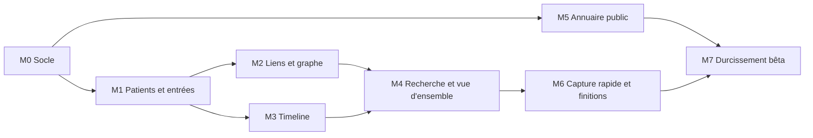

# Document C – Plan d'implémentation · PsyMate, plateforme de suivi clinique

Oct 24, 2026 · @Hayes · Version 1.2 · Complément des documents A (architecture) et B (UX) · révisé le 25 octobre 2026 : C6 (identité étendue, vue d'ensemble, admin), C7 (réserve pour le compagnon patient) · révisé le 27 octobre 2026 : versions épinglées (Spring Boot 4.1, Spring Modulith 2, Angular 22) ; l'ordonnancement détaillé du backend est dans `D-orchestration-backend.md`

Mis à jour le 29 octobre 2026 : renommages et décisions de docs/G-decisions.md (PsyMate, com.psymate, psymate-api / psymate-web ; tâche M1-14b ajoutée ; M6-05 étendue ; vocabulaire de l'annuaire fermé). Quand ce document et G se contredisent, G l'emporte.

## Décisions d'outillage (fixées le 24 octobre 2026, versions révisées le 27 octobre 2026)

Ce plan suppose les choix ci-dessous ; ils ne sont pas rediscutés dans les sections suivantes.

| Sujet | Décision | Conséquence pour le plan |
| --- | --- | --- |
| Dépôts | Deux dépôts GitHub privés sur le compte `mrscams` : `psymate-api` (Spring Boot) et `psymate-web` (Angular) ; pas de licence open source (G Q2) | Une fonctionnalité bout en bout = deux tâches, reliées par le contrat d'API |
| Build backend | **Maven** avec wrapper (`./mvnw`), Java 21 (Temurin), **Spring Boot 4.1** (ligne 4.x : Spring Framework 7, Jakarta EE 11, Jackson 3, JSpecify), **Spring Modulith 2.1.2** (ligne 2.1 = celle alignée sur Boot 4.1 ; importée par le BOM `spring-modulith-bom`) ; package racine `com.psymate` (G Q1) | Trois commandes à connaître : `./mvnw verify`, `./mvnw spring-boot:run`, `./mvnw test -Dtest=…` ; utiliser les noms de starters et de slices de test de la ligne 4 (plusieurs ont été renommés lors de la modularisation de Boot 4 : vérifier dans la documentation 4.1, jamais de mémoire) |
| Build frontend | Node 22, pnpm, Angular CLI (**Angular 22**, Material 22 en M3) | `pnpm install`, `pnpm start`, `pnpm test`, `pnpm e2e` ; zoneless et Signal Forms sont stables en 22 et sont la base des formulaires (éditeur d'entrée, barre de commande) |
| Versions | Épinglées le 27 octobre 2026 à la version **stable** de chaque ligne : Spring Boot 4.1.x, Spring Modulith 2.1.2, Angular 22.x. Spring Boot 3.5 est hors support OSS depuis le 30 juin 2026 ; Angular 20 sort du support fin novembre 2026 ; Angular passe à une majeure par an (v23 en juin 2027, support deux ans) : aucune montée majeure forcée pendant M0–M7 | On ne démarre jamais un dépôt sur une ligne hors support ; une montée de version mineure est une tâche dédiée (branche, PR, CI verte), jamais glissée dans une tâche fonctionnelle ; springdoc-openapi et openapi-generator sont pris dans leurs versions compatibles Boot 4 / Jackson 3 et figés dans `pom.xml` / `package.json` |
| Contrat d'API | OpenAPI généré par springdoc dans `psymate-api`, commité dans `contract/openapi.yaml`, versionné par tag ; `psymate-web` le récupère à un tag et régénère son client | Toute tâche qui change l'API commence par le contrat ; le YAML est l'unique « message » entre les deux dépôts |
| Base de données | PostgreSQL 16 via Docker Compose (image `pgvector/pgvector:pg16`), base `psymate`, utilisateur `psymate`, rôle applicatif `psymate_app` (G Q9), aucune base externe avant la bêta | Docker Desktop obligatoire ; Testcontainers pour les tests d'intégration |
| Services locaux | Postgres, Mailpit (e-mails, expéditeur `test@gmail.com` en local, G Q4), script de seed | `make up`, `make down`, `make seed` |
| Agents | Claude Code (terminal ou IDE) dans chaque dépôt, avec `CLAUDE.md`, `.claude/settings.json`, hooks ; sous-agents par défaut, worktrees pour deux jalons en parallèle, équipes pour un jalon transversal | Un agent = un module Spring ou une fonctionnalité Angular ; jamais deux agents sur les mêmes fichiers |
| CI | GitHub Actions sur chaque PR : build, tests, `ApplicationModules.verify()`, ArchUnit, lint, test de contraste des tokens | Une PR rouge ne se fusionne pas, quel que soit l'auteur |
| Hors périmètre | Hébergement, chiffrement, RGPD, sauvegardes : étude séparée après le backend V1 (G Q16 ; voir « Plus tard » du document A). Agenda Google (fiches 15, 15b) : hors V1 (G Q25) | Le jalon M7 prévoit la place de ces sujets sans les traiter |

## C1. Jalons

Huit jalons de la repo vide à la bêta de 50 praticiens ; chacun se termine par une démonstration que tu peux faire à un praticien pilote. Efforts en jours pour un développeur seul assisté d'agents, hors étude hébergement.



M2 et M3 ne dépendent que de M1 et peuvent avancer en parallèle (deux worktrees) ; M5 ne dépend que de M0 et peut être confié à une équipe d'agents pendant que tu travailles M1-M4.

| Jalon | Objectif | Démontrable à la fin | Effort |
| --- | --- | --- | --- |
| **M0 Socle** | Deux dépôts, Maven et pnpm, Docker Compose, CI verte, Modulith avec modules vides, Flyway V1, identité (inscription, connexion, tenant), i18n FR/EN, contrat OpenAPI généré et consommé, `CLAUDE.md` et hooks | Un praticien s'inscrit, se connecte, voit une page vide en français ou en anglais ; `./mvnw verify` et `pnpm test` passent en CI | 4 j |
| **M1 Patients et entrées** | Profil patient, séance d'accueil automatique, six types d'entrées avec tables de détail, versions et règle de grâce, vocabulaire d'émotions (globales + custom), tags, éditeur d'entrée (panneau), liste des patients | Créer un patient, démarrer une séance, saisir une note, un événement, une situation, un ressenti, un médicament ; corriger une entrée et voir l'historique | 8 j |
| **M2 Liens et graphe** | Table `link`, types de liens, validation par types d'entrées, éditeur de lien, requête de voisinage, vue graphe Cytoscape avec niveau de détail | Lier un ressenti à un événement et à une situation, voir le graphe centré sur la situation, retirer un lien | 6 j |
| **M3 Timeline** | Endpoint fenêtré avec curseur, composant timeline (zoom, plages, situations en cours, modes chronologique et par séance), filtres, vue décennie agrégée | Parcourir 10 ans d'historique fictif sans ralentissement, filtrer par émotion, basculer par séance | 6 j |
| **M4 Recherche et vue d'ensemble** | Full-text + trigrammes, facettes, surlignage ; outbox et événements de domaine ; projection `patient_overview` et ses blocs ; courbe d'intensité | Ouvrir un patient en moins de 200 ms, chercher « licencimen » et trouver « licenciement », voir la tendance et les situations actives | 6 j |
| **M5 Annuaire public** | Profession, `practitioner_profile`, écran « Mon profil public », pages publiques (annuaire, fiche, contact), anti-spam, Mailpit | Un visiteur sans compte trouve une psychologue à Paris, ouvre sa fiche et lui envoie un message | 5 j |
| **M6 Capture rapide et finitions** | Barre de commande (grammaire, aperçu, rail « lié à »), raccourcis clavier globaux, états vides / chargement / erreur de tous les écrans, mode sombre, export PDF (Could) | Saisir un ressenti lié en moins de 12 secondes au clavier ; chaque écran a ses trois états | 5 j |
| **M7 Durcissement bêta** | Seed de 100 patients × 2 000 entrées et tests de charge, limitation de débit, journaux d'audit applicatifs, onboarding (patient démo), page d'aide, tests e2e complets, accessibilité axe-core, hooks de préparation V2 vérifiés (outbox, pgvector, chunks) | Déploiement progressif 5 → 20 → 50 praticiens, inscription ouverte (G Q21), hébergement traité dans l'étude séparée | 5 j |
| **M11 Agenda (API)** (ajouté le 15 novembre 2026, G Q50–Q59, section C11) | Module `agenda` : table `appointment` (V12), rendez-vous (créer depuis un créneau, lire, déplacer, annuler, confirmer), séries hebdomadaires (1, 2 ou 4 semaines, 26 occurrences au plus), fenêtre `GET /api/agenda` et `freebusy`, rendez-vous d'un patient avec défauts de durée et de modalité, préférences `agenda.*`, événements sans abonné, seed, contrat `0.12.x` ; **sans** synchronisation Google ni écran web | Par l'API : créer une série de quatre rendez-vous pour un patient, lire la semaine (`GET /api/agenda`), déplacer une occurrence et voir le conflit signalé sans blocage, annuler la série ; `make seed` remplit huit semaines d'agenda ; `./mvnw verify` vert | 6 j |
| **M13 Profil 360 (API)** (ajouté le 18 novembre 2026, G Q62–Q70, section C12) | Dans le module `patients` (aucun nouveau module) : table `patient_profile_item` (V14), quatre rubriques (`history`, `family`, `health`, `values_goals`), période en libellé libre et année de tri pour `history`, modification sur place sans historique, archivage logique, lecture de tout le profil sans pagination (500 informations actives au plus), seed, contrat `0.14.0` ; séance intouchée, **sans** écran web | Par l'API : ajouter à un patient une information dans chacune des quatre rubriques, lire le profil (`GET /api/patients/{id}/profile-items`) avec le fil d'histoire trié par année, corriger une information, la retirer de la vue ; `make seed SIZE=demo` donne à Camille R. un profil complet ; `./mvnw verify` vert | 1,5 j |
| **M14 Prise de rendez-vous en ligne (API)** (ajouté le 22 novembre 2026, G Q71–Q82, section C13) | Dans le module `agenda` (aucun nouveau module, aucun compte patient, G Q71) : un visiteur sans compte demande un créneau sur la page publique d'un praticien, vérifie son e-mail, et le praticien confirme (mode `manual`, défaut) ou l'acceptation est automatique (`auto`) ; préférences `booking.*` dans `identity`, `PublishedProfileFacade` dans `directory.api`, table `booking_request` et colonnes `guest_email`, `origin` d'`appointment` (V15), créneaux offerts, lien de gestion, e-mails de suivi, expiration des demandes, purges par paliers, seed, contrat `0.15.0` ; **sans** écran web | Par l'API, après `make db-reset` et `make seed SIZE=small` : `GET /api/public/booking/practitioners/<slug du praticien de démonstration>` répond 200 et `…/slots` renvoie des créneaux ; `GET /api/agenda/requests` de ce praticien renvoie les deux demandes du seed ; une demande envoyée par `POST …/requests` produit un e-mail de vérification dans Mailpit, et le lien suivi crée une demande que le praticien confirme ; `./mvnw verify` vert | 7 j |
| **M16 Version arabe (API)** (ajouté le 23 novembre 2026, G Q96–Q102, section C15) | L'arabe devient la troisième langue servie par l'API (aucun nouveau module) : langue de la requête résolue en un seul endroit de `shared`, préférence `locale` = `ar`, libellés arabes des catalogues (`label_ar`, `inverse_label_ar`, V16), `messages_ar.properties` complet, e-mails arabes de droite à gauche, chiffres latins et calendrier grégorien ; résumé « En bref », exports et recherche restent en français (second temps, M8) ; seed, contrat `0.16.0` ; **sans** écran web ; rien ne change pour `fr` et `en` | Par l'API, après `make db-reset` et `make seed SIZE=small` : le praticien de démonstration en arabe reçoit ses catalogues en arabe ; une erreur de validation demandée avec `Accept-Language: ar` revient en arabe ; un e-mail arabe s'affiche de droite à gauche dans Mailpit ; les réponses `fr` et `en` sont identiques avant et après ; `./mvnw verify` vert | 4 j |

**Total indicatif : 45 jours**, soit environ trois mois à mi-temps ou deux mois à plein temps avec des agents. Les jalons M2/M3 et M5 en parallèle peuvent ramener le calendrier à sept semaines pleines. **M11 Agenda (API)**, ajouté le 15 novembre 2026 après M10, s'y ajoute pour 6 jours ; l'écran web de l'agenda et la synchronisation Google (M12) sont des jalons séparés, non chiffrés ici. **M13 Profil 360 (API)**, ajouté le 18 novembre 2026, s'y ajoute pour 1,5 jour ; l'onglet web « Profil 360 » est un jalon séparé, non chiffré ici. **M14 Prise de rendez-vous en ligne (API)**, ajouté le 22 novembre 2026, s'y ajoute pour 7 jours ; les écrans web (M14-09 à M14-15) sont planifiés dans `psymate-web/docs/K-plan-prise-de-rendez-vous.md`, non chiffrés ici. **M16 Version arabe (API)**, ajouté le 23 novembre 2026, s'y ajoute pour 4 jours (estimation de M16-01, le plan M ne chiffre pas en jours) ; la partie web (M16-07 à M16-29) est planifiée dans `psymate-web/docs/M-plan-version-arabe.md`, non chiffrée ici.

## C2. Tâches prêtes pour un agent

Chaque tâche tient dans une session d'agent (une à trois heures), touche un seul module ou une seule fonctionnalité, et se termine par des tests verts. Les colonnes « Dépôt » et « Module » disent à quel agent la confier ; deux tâches du même module ne tournent jamais en parallèle. Le texte « Lire » renvoie aux sections des documents A et B à fournir dans le prompt. L'ordre de lancement, les vagues et les couloirs parallèles côté backend sont détaillés dans `D-orchestration-backend.md`.

### M0 Socle

| ID | Titre | Dépôt / module | Lire | Quoi construire | Critères d'acceptation | Tests | Dépend de |
| --- | --- | --- | --- | --- | --- | --- | --- |
| M0-01 | Initialiser `psymate-api` | api / racine | C3, G Q1, Q9 | Projet **Spring Boot 4.1** Maven (`com.psymate:psymate-api`), Java 21, wrapper, **Spring Modulith 2.1.2** (BOM), Flyway, springdoc (version compatible Boot 4 / Jackson 3), Testcontainers, Spotless ; `Makefile` ; `docker-compose.yml` (pgvector/pg16 avec base `psymate`, utilisateur `psymate`, rôle `psymate_app` créé par l'init du conteneur ; Mailpit) ; CI GitHub Actions. Starters et slices de test aux noms de la ligne 4 (vérifiés dans la doc, pas de mémoire) | `./mvnw verify` vert en local et en CI ; `make up` démarre Postgres et Mailpit ; `GET /actuator/health` répond `UP` ; `pom.xml` n'a aucune dépendance de la ligne Boot 3 / Jackson 2 | Test de contexte Spring ; test Testcontainers minimal | — |
| M0-02 | Modules Modulith vides et règles de dépendance | api / tous | A3, A5, A11 | Neuf packages (`identity`, `patients`, `vocabulary`, `clinical`, `linking`, `search`, `overview`, `events`, `directory`) avec `package-info.java` et dépendances autorisées ; package `shared` ; packages **vides et réservés** `ai` et `companion` avec leur `package-info.java` (A11 : `companion` ne peut dépendre que de `patients`, `clinical`, `events`) ; test `ApplicationModules.verify()` ; règles ArchUnit (pas d'accès aux repositories d'un autre module) | Une dépendance interdite ajoutée volontairement fait échouer le build ; `companion` et `ai` existent sans aucune classe | `ModularityTests` | M0-01 |
| M0-03 | Migrations de base | api / tous | A4 dictionnaire, A11 schéma réservé, E | `V1__init.sql` : extensions (`pg_trgm`, `unaccent`, `vector`), `tenant`, `practitioner` (avec `profession`), `patient`, `entry_type`, `emotion`, `link_type`, tables vides V2 (`entry_embedding`, `entry_chunk`, `ai_feedback`, `outbox_event`), tables vides réservées au compagnon (`patient_device`, `patient_submission`, A11) ; `REVOKE UPDATE, DELETE` sur les tables append-only pour le rôle `psymate_app` (G Q9) | Flyway applique V1 sur un Postgres vierge ; toutes les tables du dictionnaire existent avec leurs index ; `patient_device` et `patient_submission` existent et sont vides | Test Flyway sur Testcontainers | M0-01 |
| M0-04 | Identité : inscription, connexion, tenant | api / identity | A2 UC-01, A4.7, ADR-09 | Spring Security session + cookie (12 h, 30 jours avec « rester connecté », G Q6), `POST /api/auth/signup`, `/login`, `/logout`, création du `tenant`, choix de la profession, hachage Argon2, `CurrentPractitioner` ; réinitialisation de mot de passe par e-mail (Mailpit) | Inscription puis connexion renvoient un cookie ; accès sans session → 401 ; e-mail de réinitialisation visible dans Mailpit | Intégration Testcontainers + Mailpit | M0-02, M0-03 |
| M0-05 | Contrat OpenAPI et publication | api / racine | C3 | springdoc génère `contract/openapi.yaml` au build (`./mvnw verify` échoue si le fichier commité diffère) ; script de tag | Le YAML est à jour dans la PR ; un tag `contract-v0.1.0` existe | Test de cohérence du contrat | M0-04 |
| M0-06 | Initialiser `psymate-web` | web / racine | B7, étude couleurs | **Angular 22** standalone, zoneless, pnpm, Angular Material 22 (M3) avec le thème Nordique (tokens de l'étude couleurs), `@angular/localize` FR/EN (français d'abord, G Q23), ESLint + règle `no-hardcoded-color`, Prettier, Vitest, Playwright, CI | `pnpm test`, `pnpm lint`, `pnpm build` verts ; bascule FR/EN ; test de contraste des tokens vert | Test unitaire d'un composant ; test de contraste | — |
| M0-07 | Client généré et écrans d'identité | web / auth | B3 flux 1 | Script `pnpm contract:pull` (tag) + openapi-generator ; écrans inscription, connexion, mot de passe oublié ; garde de route ; intercepteur 401 | Parcours complet contre l'API locale ; e2e « inscription → liste vide » | e2e Playwright | M0-05, M0-06 |
| M0-08 | `CLAUDE.md`, `.claude/settings.json`, hooks, agents | api et web | C4 | Fichiers décrits en C4 dans les deux dépôts ; hook post-édition (format) ; hook fin de tâche (tests) ; agents `reviewer`, `backend-module-dev`, `frontend-feature-dev` | Une session d'agent de test lit le fichier, lance `make test` sans demander de permission et refuse une dépendance interdite | Revue manuelle | M0-02, M0-06 |

### M1 Patients et entrées

| ID | Titre | Dépôt / module | Lire | Quoi construire | Critères d'acceptation | Tests | Dépend de |
| --- | --- | --- | --- | --- | --- | --- | --- |
| M1-01 | Patients : CRUD, propriété, archivage | api / patients | A2 UC-02, ADR-09 | Entité, `PatientFacade`, `PatientOwnershipGuard`, endpoints `/api/patients`, archivage = `DELETE` → `archived_at`, `PatientCreated` ; tags, versions et drapeaux de patient (G Q7) | Un praticien ne lit jamais le patient d'un autre (403) ; archiver masque sans supprimer | Intégration : propriété, archivage | M0-04 |
| M1-02 | Vocabulaires : émotions globales et custom, types, tags | api / vocabulary | A4.5, A4.6, G Q8, Q11 | Seed des 29 émotions (famille, libellés FR/EN, valence/arousal nuls ; `shame` en famille `disgust`), `link_type`, `entry_type` ; CRUD tags par praticien (normalisation, fusion) ; création d'émotion custom (famille obligatoire, unicité par praticien) ; fusion d'émotions custom en V1 | `GET /api/vocabulary/emotions` renvoie globales + custom du praticien ; un tag égal à une émotion est refusé | Intégration vocabulaire ; unité normalisation | M0-03 |
| M1-03 | Entrées : modèle hybride, versions, séance obligatoire | api / clinical | A4.1, A4.2, A4.8, A11 règles, UC-03, UC-05 | `entry`, `entry_version`, tables de détail (feeling, medication, session), `TimeSpan` et précisions, `session_id` obligatoire sauf pour une séance, séance d'accueil créée avec le patient, correction → version, règle de grâce (`versioning.grace-period`), `EntryCreated` / `EntryCorrected` / `EntryArchived` ; colonnes réservées `author_type` (défaut `practitioner`, jamais modifiée) et `submission_id` (toujours `NULL`) avec la contrainte `ck_entry_session_required` (A11), portées par l'entité mais **sans aucune logique** | Les six types se créent et se corrigent ; une entrée sans séance est refusée ; une correction après 1 h 15 (75 min, G Q31) crée une version, avant non ; valence/arousal copiés si présents ; toute entrée créée porte `author_type = 'practitioner'` et `submission_id IS NULL` | Intégration par type ; test de la règle de grâce ; test des six précisions temporelles ; test des valeurs par défaut des colonnes réservées | M1-01, M1-02 |
| M1-04 | Séances : démarrer, clôturer, compléter | api / clinical | UC-04, F11 | Séance = entrée `session` ; « séance courante » (ouverte, sinon dernière) ; clôture avec durée (défaut : préférence `sessions.defaultDurationMin`, 60) et compte rendu ; ajout d'entrées à une séance passée | Une entrée saisie pendant une séance ouverte reçoit son `session_id` sans le préciser ; une séance clôturée accepte des ajouts | Intégration | M1-03 |
| M1-05 | Endpoints entrées et contrat | api / clinical | A5 exemples JSON, A11 | `POST /api/patients/{id}/entries`, `GET/PATCH /api/entries/{id}`, `GET /api/entries/{id}/versions`, validation Jakarta par type, erreurs 422 structurées ; `authorType` présent en lecture dans tout DTO d'entrée (détail, timeline, recherche, graphe), **absent des requêtes de création et de modification** ; contrat regénéré et tagué | Payload de l'exemple A5 accepté ; erreurs lisibles champ par champ ; `authorType: "practitioner"` dans chaque réponse ; un `authorType` envoyé en création est ignoré ou refusé (`422`) | Intégration ; test du contrat | M1-03, M1-04 |
| M1-06 | Liste des patients | web / patients | B4 écran 1, B3 flux 2 | Écran 1 complet (filtre, tri, archivés, raccourcis `N` `/`), panneau « Nouveau patient », états vide/chargement/erreur, patient démo | e2e : créer un patient, le retrouver, l'archiver | Unité + e2e | M0-07, M1-01 |
| M1-07 | Page patient et en-tête permanent | web / patient-shell | B2 | Route `/patients/:id`, en-tête (nom, âge, flags, séance courante, Démarrer/Clôturer), onglets `1` `2` `3`, mémorisation de l'état des onglets, SignalStore patient | Changer d'onglet et revenir conserve l'état | Unité | M1-06 |
| M1-08 | Éditeur d'entrée (panneau) | web / entries | B4 écran 5, B5 | Panneau six types, champs minimaux par type, sélecteur de précision, séance présélectionnée, curseur d'intensité, « Plus » replié, brouillon `Ctrl+S`, historique des versions, création d'émotion custom en ligne | e2e : saisir un ressenti 8/10 en moins de 20 s au clavier ; corriger et voir « 2 versions » | Unité + e2e | M1-05, M1-07 |
| M1-09 | Paramètres : tags et émotions custom, langue | web / settings | UC-11 | Écran paramètres : gestion des tags (renommer, fusionner), émotions custom, langue | Fusionner deux tags réétiquette les entrées | e2e | M1-02, M1-07 |

### M2 Liens et graphe

| ID | Titre | Dépôt / module | Lire | Quoi construire | Critères d'acceptation | Tests | Dépend de |
| --- | --- | --- | --- | --- | --- | --- | --- |
| M2-01 | Liens : table, règles, cycle de vie | api / linking | A4.3, A7 états | `link` complet (provenance, statut, confiance, preuves), validation `allowed_source_types` / `allowed_target_types`, même patient obligatoire, index unique partiel, `superseded` au changement de type et à l'archivage d'une entrée, `LinkAccepted` / `LinkRejected` | Lien invalide → 422 ; doublon actif impossible ; modifier le type crée un nouveau lien et marque l'ancien | Intégration ; unité des règles | M1-05 |
| M2-02 | Création d'entrée avec liens en une transaction | api / clinical + linking | A7 séquence 2 | `links[]` dans `POST /entries` ; tout ou rien | Un lien invalide annule l'entrée | Intégration transactionnelle | M2-01 |
| M2-03 | Requête de voisinage et niveau de détail | api / linking | A4.4, A6 graphe | CTE récursive profondeur ≤ 3, `GET /api/patients/{id}/graph`, limite 150 nœuds, regroupement en super-nœuds, endpoint `expand` | Patient seed de 2 000 entrées / 1 500 liens : réponse < 300 ms à profondeur 2 | Intégration + test de performance sur seed | M2-01 |
| M2-04 | Éditeur de lien | web / links | B4 écran 6, B3 flux 4 | Panneau : recherche de cible, types autorisés seulement, phrase lisible, inversion, justification ; touche `L` | e2e : lier deux entrées depuis une entrée ouverte | Unité + e2e | M2-01, M1-08 |
| M2-05 | Rail « Lié à… » dans l'éditeur d'entrée | web / entries | B5 | Cinq entrées récentes/actives, type proposé selon les types, `Tab` + `Espace` | e2e : ressenti lié à un événement en une saisie | e2e | M2-02, M2-04 |
| M2-06 | Vue graphe | web / graph | B4 écran 4 | Cytoscape + `cose-bilkent`, formes et couleurs par type (tokens), styles de trait par type de lien, racine et profondeur, filtres, panneau de détail, glisser pour lier, double-clic recentrer, super-nœuds | Graphe de 150 nœuds fluide ; glisser-déposer crée un lien | Unité + e2e | M2-03, M2-04 |

### M3 Timeline

| ID | Titre | Dépôt / module | Lire | Quoi construire | Critères d'acceptation | Tests | Dépend de |
| --- | --- | --- | --- | --- | --- | --- | --- |
| M3-01 | Endpoint timeline fenêtré | api / clinical | A6 timeline | `GET /timeline` avec fenêtre, curseur keyset, filtres, situations en cours chevauchantes, facettes ; `GET /timeline/summary?granularity=month` | 200 éléments < 150 ms ; résumé décennie < 100 ms sur le seed | Intégration + performance | M1-05 |
| M3-02 | Composant timeline | web / timeline | B4 écran 3 | Axe vertical, cartes par type (tokens), bandes de situations, zoom (`Ctrl+molette`, `+` `-`), virtual scroll CDK, trois fenêtres en mémoire, zone « avant le suivi », pastille « dit en séance du… » | Défilement fluide sur 5 000 entrées ; zoom sans requête tant que la fenêtre couvre | Unité + e2e | M3-01, M1-07 |
| M3-03 | Filtres et mode par séance | web / timeline | B4 écran 3, F11 | Chips de filtres, « Brouillons seulement », bascule `M` chronologique / par séance, séances dépliables | e2e : filtrer anxiété, basculer par séance, déplier la dernière | e2e | M3-02 |
| M3-04 | Vue décennie agrégée | web / timeline | A6 | Au zoom maximal, agrégats mensuels (comptes par type, intensité moyenne) | Bascule automatique au-delà d'une plage de 3 ans | Unité | M3-01, M3-02 |

### M4 Recherche et vue d'ensemble

| ID | Titre | Dépôt / module | Lire | Quoi construire | Critères d'acceptation | Tests | Dépend de |
| --- | --- | --- | --- | --- | --- | --- | --- |
| M4-01 | Outbox et événements de domaine | api / events | A4.9, A7 | Spring Modulith event publication registry, table `outbox_event`, republication, abonnés idempotents | Un événement non traité survit à un redémarrage et est rejoué | Intégration | M1-03 |
| M4-02 | Index de recherche et requêtes | api / search | A6 recherche | Trigger `search_vector` pondéré (`french` + `unaccent`), index GIN et trigrammes, `GET /search` avec classement, boost récence, repli trigrammes, facettes, extraits surlignés | « licencimen » trouve « licenciement » ; 5 000 entrées < 300 ms | Intégration + performance | M4-01 |
| M4-03 | Projection vue d'ensemble | api / overview | A6 vue d'ensemble, exemple de calcul | `patient_overview` JSONB, `OverviewListener` sur `EntryCreated` / `EntryCorrected` / `LinkAccepted` / `PatientUpdated`, blocs (faits clés, situations actives, tendance 90 j, émotions dominantes), `source_rev` et recalcul à la volée | Ouverture < 200 ms ; projection jamais obsolète (test de course) | Intégration ; idempotence du listener | M4-01, M2-01 |
| M4-04 | Écran recherche | web / search | B4 écran 7, B3 flux 5 | `/` dans l'en-tête, résultats avec facettes et surlignage ambre, section approchés, panneau, « Voir dans la timeline », `Échap` restaure | e2e : recherche avec faute, facette, ouverture | Unité + e2e | M4-02, M3-02 |
| M4-05 | Écran vue d'ensemble | web / overview | B4 écran 2, B3 flux 6 | Six blocs, courbe ECharts (intensité, marqueurs séances et médicaments), navigation vers graphe et timeline, états par bloc | e2e : ouvrir un patient, cliquer une situation → graphe centré | Unité + e2e | M4-03, M2-06, M3-02 |

### M5 Annuaire public

| ID | Titre | Dépôt / module | Lire | Quoi construire | Critères d'acceptation | Tests | Dépend de |
| --- | --- | --- | --- | --- | --- | --- | --- |
| M5-01 | Profil public : modèle et édition | api / directory | A4.10, UC-13, G Q15 | `practitioner_profile`, table `directory_vocabulary` (liste fermée de spécialités et publics, seed initial), `GET /api/vocabulary/directory`, `GET/PUT /api/me/profile` (spécialités et publics validés contre la liste, pas de saisie libre), photo (stockage local en dev, redimensionnée, métadonnées retirées), publish/unpublish avec règles (nom + un contact), `ProfilePublished` / `ProfileUnpublished` | Publication refusée sans contact ; spécialité hors liste → 422 ; retrait immédiat | Intégration | M0-04 |
| M5-02 | Annuaire public : recherche et fiche | api / directory | UC-14, UC-15 | `/api/public/directory` (filtres, facettes, tri distance via `geo`, pagination), `/api/public/directory/{slug}` (contact filtré), exclusion de l'authentification, limitation de débit (Bucket4j, G Q24) | Sans session : 200 ; les champs non affichés par le praticien n'apparaissent pas | Intégration ; test « jamais de données patient dans ce module » (ArchUnit) | M5-01 |
| M5-03 | Formulaire de contact | api / directory | F26 | `POST …/contact` avec jeton anti-spam (honeypot + délai minimal), e-mail relayé via Mailpit, pas de persistance en dossier | Message reçu dans Mailpit ; spam évident refusé silencieusement | Intégration | M5-02 |
| M5-04 | Écran « Mon profil public » | web / profile | B4 écran 10, B3 flux 8 | Formulaire, interrupteurs « afficher » par contact, prévisualisation, publication avec champs manquants | e2e : publier, voir la fiche, retirer | Unité + e2e | M5-01, M1-09 |
| M5-05 | Pages publiques | web / public | B4 écrans 8-9, B3 flux 7, étude couleurs § application | Routes publiques sans garde, annuaire (recherche, filtres, tri, liste/carte), fiche, formulaire ; pré-rendu des pages publiques (SSR ou prerender) pour F27 ; pas de pied de page « numéros d'urgence » (G Q20) | e2e sans connexion : trouver, ouvrir, contacter ; Lighthouse accessibilité ≥ 90 | Unité + e2e | M5-02, M5-03 |

### M6 Capture rapide et finitions

| ID | Titre | Dépôt / module | Lire | Quoi construire | Critères d'acceptation | Tests | Dépend de |
| --- | --- | --- | --- | --- | --- | --- | --- |
| M6-01 | Grammaire de la barre de commande | web / capture | B5 | Parseur pur (TypeScript, sans DOM) : préfixes `/evt` `/sit` `/med` `/note`, détection d'émotion par préfixe (globales + custom), intensité, dates relatives et précision, `> cible` | Jeu de 40 phrases de test couvrant chaque règle | Unité (table de cas) | M1-02 |
| M6-02 | Barre de commande et aperçu | web / capture | B5, B4 écran 5 | Champ dans l'en-tête, aperçu interprété, rail « lié à », `Entrée` / `Ctrl+Entrée` / `Ctrl+S`, création d'émotion custom proposée | e2e : ressenti lié en moins de 12 s mesuré | e2e chronométré | M6-01, M2-05 |
| M6-03 | Raccourcis globaux et états des écrans | web / shell | B2, B4 | `N` `/` `L` `1` `2` `3` `Échap`, états vide/chargement/erreur manquants, messages i18n | Chaque écran a ses trois états en revue visuelle | e2e de chaque état | M4-05 |
| M6-04 | Mode sombre et contraste doux | web / theme | Étude couleurs § 6 | `data-theme` dark et soft, préférence système, réglage par praticien | Tous les écrans lisibles en sombre ; test de contraste vert sur les deux thèmes | Test de contraste étendu | M0-06 |
| M6-05 | Export PDF du dossier et export du compte refusé | api / clinical | F14, G Q18, E7 O12, design 27 | Export Markdown/PDF d'un patient (thème clair), entrées privées exclues ; export asynchrone de tous les patients d'un compte refusé ou suspendu : table `export_job` (migration `V11__export_job.sql`), zip chiffré, lien valable 7 jours, purge des exports expirés | PDF ouvrable, ordre chronologique ; un compte suspendu lance et télécharge son export, lien `410` après 7 jours | Intégration | M3-01 |

### M7 Durcissement bêta

| ID | Titre | Dépôt / module | Lire | Quoi construire | Critères d'acceptation | Tests | Dépend de |
| --- | --- | --- | --- | --- | --- | --- | --- |
| M7-01 | Seed réaliste et tests de charge | api / racine | C3 seed, G Q22 | Générateur : 100 patients, 2 000 entrées chacun sur 10 ans, 1 500 liens, émotions distribuées ; patient DEMO (18 mois, 20 séances, relu ensuite) ; scénarios de charge (timeline, recherche, overview, graphe) | Toutes les cibles de latence de A6 tenues sur ce seed | Tests de performance en CI nocturne | M4-05, M2-06 |
| M7-02 | Limitation de débit, journaux, erreurs | api / shared | A9 R7, G Q24, Q29 | Rate limiting par session et par IP (public) avec Bucket4j, valeurs existantes conservées ; journal d'audit applicatif (qui a lu/modifié quel patient) dans `security_event` ; pages d'erreur et codes cohérents | Un scan de l'annuaire est ralenti ; chaque accès à un patient est journalisé | Intégration | M5-02 |
| M7-03 | Onboarding et patient démo | web / onboarding | B3 flux 1 | État vide, patient DEMO supprimable, page d'aide des raccourcis, premier message sur les suggestions (préparé pour V2) | Un nouveau praticien saisit sa première entrée en moins de 3 minutes (test utilisateur) | e2e | M6-02 |
| M7-04 | Accessibilité et e2e complets | web / racine | B7 accessibilité | axe-core sur les 13 écrans, navigation clavier complète, liste équivalente du graphe, zoom 200 % | Zéro violation axe « serious » ; parcours clavier e2e | e2e | M6-03 |
| M7-05 | Vérification des hooks V2 et des réserves | api / events | A4.9, A8, A11 | Test que chaque événement attendu est bien dans l'outbox, que `entry_embedding` / `entry_chunk` / `ai_feedback` existent et sont vides, que `visibility=private` est exclu des exports ; test des réserves du compagnon (A11, R13) : `patient_device` et `patient_submission` existent et sont vides, toute ligne de `entry` a `author_type = 'practitioner'` et `submission_id IS NULL`, la contrainte `ck_entry_session_required` existe, `authorType` est présent dans les schémas de réponse du contrat OpenAPI, les packages `ai` et `companion` sont vides | Rapport de conformité V2 vert, section « réserves compagnon » incluse | Intégration | M4-01 |
| M7-06 | Place pour l'étude hébergement | — | A « Plus tard », G Q16, Q17, Q19 | Liste des décisions attendues (chiffrement, sauvegardes, hébergeur santé, RGPD, mineurs, fournisseur SMTP, stockage des justificatifs et exports en bêta) et des points d'entrée dans le code (configuration externalisée, secrets, journaux) ; aucune implémentation | Document de passation prêt pour l'étude séparée | — | M7-02 |

**Traçabilité** : UC-01 → M0-04/07 ; UC-02 → M1-01/06 ; UC-03 → M1-03/05/08 ; UC-04 → M1-04 ; UC-05 → M1-03/08 ; UC-06 → M2-01/04/05 ; UC-07 → M3-\* ; UC-08 → M2-03/06 ; UC-09 → M4-03/05 ; UC-10 → M4-02/04 ; UC-11 → M1-02/09 ; UC-12 → M1-08 ; UC-13 → M5-01/04 ; UC-14 → M5-02/05 ; UC-15 → M5-02/03/05 ; UC-V2-\* → hooks M4-01, M7-05 (conception seulement).

## C3. Dépôts et projet

Deux dépôts, un contrat entre les deux, et une seule commande pour chaque action courante : c'est ce qui permet à un agent de travailler sans deviner.

### `psymate-api` (Spring Boot, Maven)

```
psymate-api/
  pom.xml                      Spring Boot 4.1, Java 21, Spring Modulith 2.1.2 (BOM), Flyway, springdoc (ligne Boot 4), MapStruct, Testcontainers, Spotless
  mvnw, mvnw.cmd, .mvn/        wrapper : jamais de Maven installé à la main
  Makefile                     up, down, seed, test, run, contract, admin
  docker-compose.yml           postgres (pgvector/pgvector:pg16, base psymate, rôle psymate_app), mailpit
  contract/openapi.yaml        contrat généré et commité ; tagué contract-vX.Y.Z
  CLAUDE.md                    règles pour les agents (C4)
  .claude/settings.json        permissions, hooks, env
  .claude/agents/              backend-module-dev.md, reviewer.md
  src/main/java/com/psymate/
    App.java
    shared/                    TenantId, PatientId, erreurs, i18n des messages
    identity/  patients/  vocabulary/  clinical/  linking/
    search/    overview/  events/      directory/
    ai/        companion/     réservés : package-info.java seulement, aucune classe
      package-info.java api/ controller/ dto/ service/ repository/ model/ config/   (par rôle, G Q33 ; appliqué module par module, C8)
  src/main/resources/
    application.yml            profils local, test ; app.name=PsyMate ; versioning.grace-period=75m (G Q31)
    db/migration/              V1__init.sql, V2__…  (une migration = un sujet, jamais modifiée après fusion)
    messages_fr.properties, messages_en.properties
  src/test/java/com/psymate/
    ModularityTests.java       ApplicationModules.verify()
    ArchitectureTests.java     ArchUnit : repositories inaccessibles hors module, directory sans accès patient, gardes JPA, dossiers par rôle (C8)
    <module>/…IT.java          Testcontainers
  tools/seed/                  générateur de données de démonstration
  .github/workflows/ci.yml     verify + contract check
```

### `psymate-web` (Angular)

```
psymate-web/
  package.json                 Angular 22, Material 22, @ngrx/signals, cytoscape, echarts, openapi-generator, vitest, playwright
  Makefile ou scripts pnpm     start, test, e2e, lint, contract:pull, build
  CLAUDE.md, .claude/          idem backend
  openapi/openapi.yaml         copie du contrat au tag épinglé (fichier CONTRACT_TAG)
  src/app/
    core/                      auth, intercepteurs, gardes, i18n, thème (tokens Nordique), raccourcis globaux
    api/                       client généré (ne jamais éditer)
    shared/ui/                 chips de type, pastille d'émotion, curseur d'intensité, panneau latéral
    features/
      auth/  patients/  patient-shell/  entries/  links/  timeline/  graph/
      search/  overview/  capture/  settings/  profile/  public/
    theme/tokens.css           variables de l'étude couleurs ; test de contraste
  src/locale/                  messages.fr.xlf, messages.en.xlf
  e2e/                         Playwright : un dossier par flux de B3
  .github/workflows/ci.yml     lint + test + build + e2e (API lancée en service Docker)
```

### Conventions

| Sujet | Règle |
| --- | --- |
| Nommage backend | Packages en minuscules par module ; classes `EntryService`, `EntryRepository`, `EntryController`, DTO `EntryDto` / `CreateEntryRequest` ; événements au passé `EntryCreated` |
| Nommage frontend | Dossiers par fonctionnalité ; composants `entry-editor.component.ts` ; stores `patient.store.ts` ; un composant standalone par fichier |
| API | REST, JSON camelCase, erreurs RFC 9457 (`application/problem+json`) avec `errors[]` par champ ; pagination par curseur ; dates ISO 8601 UTC |
| Contrat | springdoc génère `contract/openapi.yaml` ; la CI échoue si le fichier commité diffère ; chaque changement d'API = bump de version + tag `contract-vX.Y.Z` ; le frontend épingle le tag dans `CONTRACT_TAG` et régénère avec `pnpm contract:pull` |
| Migrations | Flyway, SQL pur, une migration par sujet, immuable après fusion ; un nouveau type d'entrée = une migration + une ligne dans `entry_type` |
| Tests backend | Unitaires (domaine, règles), intégration Testcontainers par module (`*IT.java`), `ModularityTests`, `ArchitectureTests`, performance sur seed (nocturne) |
| Tests frontend | Vitest pour composants et parseur de la barre de commande ; Playwright pour chaque flux de B3 et chaque état d'écran ; axe-core dans les e2e |
| Qualité | Spotless (Java), Prettier + ESLint (`no-hardcoded-color`), couverture ≥ 70 % sur `domain` et `application` |
| Branches | `main` protégée ; une branche par tâche `M2-04-link-editor` ; PR avec le template (tâche, critères cochés, tests) ; squash merge |
| Versions des bibliothèques | Figées dans `pom.xml` / `package.json` (aucune plage ouverte) ; une montée de version = une PR dédiée avec le changelog lu et la CI verte ; jamais dans une PR fonctionnelle |
| i18n | Français d'abord (G Q23) : `messages_fr` et `messages.fr.xlf` complets à chaque tâche ; les fichiers EN peuvent suivre, jamais bloquants |

### Environnement local

```
docker compose up -d          # postgres:5432 (psymate/psymate), mailpit:8025
./mvnw spring-boot:run        # http://localhost:8080, Swagger sur /swagger-ui
make seed                     # 100 patients fictifs (profil local uniquement)
make admin EMAIL=hushan@gmail.com   # premier administrateur (M7-08), mot de passe affiché une fois
pnpm start                    # http://localhost:4200, proxy vers 8080
```

Variables : `SPRING_PROFILES_ACTIVE=local`, `DB_URL`, `MAIL_HOST=localhost`, `MAIL_PORT=1025`, `ADMIN_EMAIL`. Aucune base externe ; aucun secret réel en local.

### Données de démonstration

Le générateur (`tools/seed`) produit des patients cohérents et non identifiables : prénoms et initiales fictifs, 10 ans d'historique, séances toutes les une à trois semaines, situations qui s'ouvrent et se ferment, ressentis dont l'intensité suit les situations actives (pour que la vue d'ensemble et le graphe montrent des motifs), médicaments avec changements de posologie, 10 % de dates imprécises, 5 % d'entrées privées, liens manuels plausibles. Trois tailles : `small` (5 patients, dev quotidien), `medium` (100 patients, tests de performance), `demo` (1 patient DEMO très lisible pour l'onboarding, généré par M7-01 puis relu : G Q22). Les tests de performance de M7-01 tournent sur `medium`.

## C4. Travailler avec les agents

Le principe : l'agent ne doit jamais deviner. Tout ce qu'il doit savoir est dans le `CLAUDE.md` du dépôt, dans le prompt de la tâche, ou dans les documents A et B qu'on lui indique.

### Ce que contient `CLAUDE.md` (backend ; le frontend suit le même plan)

La version qui fait foi est le fichier `CLAUDE.md` du dépôt : il a évolué depuis (G Q31 à Q38). Extrait de la version d'origine, gardé pour l'historique :

```markdown
# psymate-api

## Ce que c'est
API de PsyMate, suivi clinique pour psychologues, psychiatres et coachs. Monolithe modulaire Spring Boot 4.1 (Spring Framework 7, Jackson 3) / Spring Modulith 2.1.2 / Java 21 / PostgreSQL 16. Package racine : com.psymate.
Documents de référence : docs/A-architecture.md, docs/B-ux.md, docs/C-plan.md, docs/D-orchestration-backend.md, docs/E-modele-donnees.md, docs/G-decisions.md (copies exportées).

## Commandes (utilise uniquement celles-ci)
- make up / make down : Postgres + Mailpit
- ./mvnw verify : build + tests + vérification des modules (doit être vert avant toute PR)
- ./mvnw test -Dtest=NomDuTest : un test
- ./mvnw spring-boot:run : API sur :8080
- make seed : données fictives
- make contract : regénère contract/openapi.yaml

## Architecture (règles non négociables)
- Un module Spring Modulith par contexte : identity, patients, vocabulary, clinical, linking, search, overview, events, directory.
- Un module ne lit jamais les tables ni les classes internes d'un autre ; il passe par la façade du package `api` ou par un événement.
- Dépendances autorisées : voir package-info.java de chaque module (ApplicationModules.verify() les vérifie).
- directory ne dépend que d'identity et ne touche jamais aux données patient.
- Toute entrée appartient à une séance ; toute correction crée une version (sauf règle de grâce) ; rien n'est supprimé physiquement.
- Les liens sont des lignes de `link` avec provenance et statut ; jamais de clé étrangère "lien" dans `entry`.
- Une migration Flyway fusionnée ne se modifie jamais : on en ajoute une.
- L'IA V2 n'existe pas en V1 : ne pas écrire de code IA, mais ne pas casser les hooks (outbox, tables vides).
- Le compagnon patient n'existe pas en V1 (docs/A-architecture.md A11) : `entry.author_type` vaut toujours 'practitioner', `entry.submission_id` toujours NULL, `patient_device` et `patient_submission` restent vides, le package `companion` reste vide. Ne jamais les supprimer, ne jamais les remplir, ne jamais exposer `authorType` en écriture.

## Versions
Spring Boot 4.1.x, Spring Modulith 2.1.2, Java 21 : ne jamais rétrograder, ne jamais ajouter une dépendance de la ligne Boot 3 / Jackson 2 (`com.fasterxml.jackson.*` est Jackson 2 ; Jackson 3 vit sous `tools.jackson.*`). Les noms de starters sont ceux de la ligne 4 : vérifie dans la documentation, pas de mémoire.

## Conventions
REST JSON camelCase, erreurs RFC 9457, pagination par curseur, dates UTC ISO 8601, MapStruct pour les DTO, Jakarta Validation.
Tests : unitaires pour le domaine, *IT.java Testcontainers pour chaque endpoint, jamais de mock de la base.

## Ne fais jamais
- Ajouter une dépendance Maven sans le dire dans la PR.
- Désactiver un test, baisser la couverture ou supprimer une règle ArchUnit.
- Écrire un secret, une URL de prod, ou appeler un service externe.
- Modifier le contrat OpenAPI sans bump de version.

## Fin de tâche
./mvnw verify vert, contrat à jour, PR avec le template rempli (tâche C2, critères cochés, tests ajoutés).
```

### `.claude/settings.json` (extrait)

```json
{
  "permissions": {
    "allow": ["Bash(./mvnw *)", "Bash(make *)", "Bash(docker compose *)", "Bash(git diff *)", "Bash(git log *)", "Bash(gh pr *)"],
    "deny": ["Bash(rm -rf *)", "Bash(git push --force *)", "Read(.env*)"]
  },
  "hooks": {
    "PostToolUse": [{ "matcher": "Edit|Write", "hooks": [{ "type": "command", "command": "./mvnw spotless:apply -q" }] }],
    "Stop": [{ "hooks": [{ "type": "command", "command": "./mvnw verify -q || echo 'Tests rouges : corrige avant de terminer' >&2; exit 2" }] }]
  }
}
```

Le hook `Stop` renvoie le code 2 quand les tests échouent : l'agent reçoit le message et continue au lieu de s'arrêter sur du rouge. Adapter le même schéma au frontend (`pnpm lint`, `pnpm test`).

### Agents réutilisables (`.claude/agents/`)

| Fichier | Rôle | Outils | Quand |
| --- | --- | --- | --- |
| `backend-module-dev.md` | Implémente une tâche dans un seul module ; lit A et la tâche ; termine par `./mvnw verify` | Lecture, écriture, Bash autorisé | Toute tâche `api / <module>` |
| `frontend-feature-dev.md` | Implémente un écran ou un composant ; lit B et l'étude couleurs ; termine par `pnpm test` et un e2e | idem | Toute tâche `web / <feature>` |
| `reviewer.md` | Relit un diff : frontières de modules, tests présents, critères d'acceptation, couleurs en dur, secrets ; ne modifie rien | Lecture seule, Bash `git diff` | Avant chaque fusion |
| `seed-perf.md` | Génère ou étend le seed et lance les scénarios de performance | Bash | M7 et à chaque régression de latence |

### Écrire un bon prompt de tâche

Structure : contexte (documents et sections), objectif, périmètre (fichiers et module autorisés), critères d'acceptation copiés de C2, tests attendus, interdits, livrable. Exemple pour **M2-04 Éditeur de lien** :

```text
Tâche M2-04 — Éditeur de lien (dépôt psymate-web, feature links).

Contexte : lis docs/B-ux.md section B4 « Écran 6 : éditeur de lien » et B3 « Flux 4 », et docs/A-architecture.md A4.3 (types de liens, types autorisés par couple source/cible). Le client API généré expose POST /api/entries/{id}/links et GET /api/vocabulary/link-types (avec allowedSourceTypes / allowedTargetTypes).

Objectif : un panneau latéral LinkEditorComponent ouvert depuis une entrée (touche L ou bouton « Lier ») qui crée un lien typé vers une autre entrée du même patient.

Périmètre : src/app/features/links/** uniquement, plus l'enregistrement du raccourci L dans core/shortcuts. Ne touche pas à entries/, graph/, ni au client api/.

Critères d'acceptation (C2 M2-04) :
- recherche de cible parmi les entrées du patient (texte, type, période), entrées déjà liées grisées ;
- seuls les types de liens autorisés pour le couple (type source, type cible) sont affichés ;
- la phrase « <source> <type> <cible> » se met à jour en direct ; le bouton ⇄ inverse source et cible ;
- justification optionnelle ; Entrée crée le lien ; lien existant → message « Ce lien existe déjà · Modifier le type ? » ;
- couleurs via les tokens (aucune valeur hexadécimale) ; états vide, chargement, erreur.

Tests : unitaires Vitest (filtrage des types autorisés, inversion), e2e Playwright « lier deux entrées depuis une entrée ouverte » dans e2e/flux-4-lier.

Interdits : nouvelle dépendance npm, modification du client généré, couleur en dur.

Livrable : branche M2-04-link-editor, pnpm lint/test/e2e verts, PR avec le template rempli.
```

### Boucle de revue

1. L'agent ouvre la PR ; la CI tourne (build, tests, modules, lint, contraste).
2. Lance l'agent `reviewer` sur le diff : il vérifie les frontières, les critères de C2 un par un, l'absence de couleurs en dur et de secrets, la présence des tests, et liste ce qui manque.
3. Lis toi-même trois choses : la migration (si présente), le contrat OpenAPI (diff du YAML), et le test e2e (il raconte ce que fait la fonctionnalité).
4. Essaie la fonctionnalité en local avec le seed `small`.
5. Fusionne en squash ; supprime la branche.

Ne fusionne jamais sur la seule base de « les tests passent » : un agent peut écrire des tests qui valident son propre bug. Le test e2e lu par toi est le vrai garde-fou.

### Un agent, des worktrees ou une équipe ?

| Situation | Mode | Exemple |
| --- | --- | --- |
| Une tâche de C2 | Une session Claude Code, qui peut lancer des sous-agents pour explorer, vérifier, relire | M1-03 |
| Deux tâches indépendantes de modules différents | Deux sessions dans deux worktrees (`claude --worktree`), une branche chacune | M2-03 (linking) et M3-01 (clinical, timeline) |
| Un jalon transversal backend + frontend + tests | Équipe d'agents (expérimental, `CLAUDE_CODE_EXPERIMENTAL_AGENT_TEAMS=1`) : un lead, un équipier `backend-module-dev`, un `frontend-feature-dev`, un `reviewer` ; liste de tâches partagée ; le lead synthétise | M5 Annuaire public |
| Diagnostic d'un bug de performance | Équipe de 3 équipiers avec hypothèses concurrentes | Timeline lente sur le seed `medium` |

Règles pour qu'ils ne se gênent pas : un agent = un module ou une feature, jamais deux agents sur les mêmes fichiers ; backend et frontend communiquent uniquement par le contrat OpenAPI (le backend tague, le frontend tire) ; 3 à 5 équipiers maximum ; chaque équipier reçoit un prompt complet (il ne voit pas l'historique du lead) ; les permissions sont pré-approuvées dans `settings.json` pour éviter les interruptions ; surveille et recadre, ne laisse pas une équipe tourner une heure sans regarder.

### Pièges fréquents et parades

| Piège | Symptôme | Parade |
| --- | --- | --- |
| L'agent « corrige » en traversant une frontière | Import d'un repository d'un autre module | `ModularityTests` + ArchUnit en CI ; règle explicite dans `CLAUDE.md` |
| Oubli de la table de détail d'un type | Ressenti sans `entry_feeling` | Test « chaque type a sa table et son validateur » (M1-03) |
| Migration modifiée après fusion | Flyway checksum mismatch | Règle `CLAUDE.md` ; la CI rejoue les migrations depuis V1 |
| Tests qui valident le bug | Vert, mais la fonctionnalité est fausse | Lecture humaine de l'e2e ; `reviewer` compare aux critères de C2 |
| Couleur ou texte en dur | Hex dans un composant, chaîne non traduite | ESLint `no-hardcoded-color`, extraction i18n en CI |
| Contrat désynchronisé | Le frontend appelle un champ qui n'existe plus | CI échoue si le YAML diffère ; `CONTRACT_TAG` épinglé |
| Agent qui s'arrête sur du rouge | « Les tests échouent, je m'arrête ici » | Hook `Stop` avec code 2 |
| Prompt trop court | L'agent invente le périmètre | Toujours le gabarit ci-dessus avec les sections de A/B à lire |
| Deux agents, mêmes fichiers | Conflits de fusion, écrasements | Découpage par module ; worktrees ; équipes avec fichiers distincts |
| Dépendance ajoutée en douce | Nouvelle entrée dans `pom.xml` ou `package.json` | Interdit dans `CLAUDE.md` ; le `reviewer` liste les diffs de dépendances |
| Réserve « nettoyée » par un agent | Colonne `author_type` ou table `patient_submission` supprimée comme « inutilisée », `authorType` retiré d'un DTO | Règle `CLAUDE.md` ; test M7-05 « réserves compagnon » ; le `reviewer` signale tout diff sur ces objets |
| Code de la ligne Boot 3 écrit de mémoire | Starter `spring-boot-starter-web` introuvable, import `com.fasterxml.jackson` à côté de `tools.jackson`, annotation de test périmée | Section « Versions » du `CLAUDE.md` ; l'agent lit la doc 4.1 ; le `reviewer` cherche `com.fasterxml.jackson` et les starters renommés dans le diff |
| Ancien nom ou ancien package | `clinic-api`, `fr.app`, `clinic_app` dans un diff | G Q1, Q2, Q9 : `psymate-api`, `com.psymate`, `psymate_app` ; le `reviewer` les cherche |

## C5. Définition de « fini »

### Une tâche est finie quand

- Chaque critère d'acceptation de C2 est démontré par un test automatisé ou, à défaut, par une vérification manuelle décrite dans la PR.
- `./mvnw verify` ou `pnpm lint && pnpm test && pnpm e2e` sont verts en CI.
- Le contrat OpenAPI est à jour et tagué si l'API a changé ; le frontend concerné est régénéré.
- Aucune frontière de module n'est franchie ; aucune couleur, chaîne ou secret en dur.
- La PR suit le template, le `reviewer` n'a plus de remarque bloquante, et tu as lu la migration, le diff du contrat et le test e2e.
- Le `CLAUDE.md` est mis à jour si la tâche a introduit une convention nouvelle.

### Un jalon est fini quand

- Toutes ses tâches sont fusionnées sur `main`.
- La démonstration prévue en C1 fonctionne de bout en bout sur le seed `small`, en français (et en anglais si les traductions sont à jour, G Q23), au clavier.
- Les cibles de performance concernées (A6) sont mesurées sur le seed `medium` et tenues.
- Les états vide, chargement et erreur des écrans du jalon existent.
- Un praticien pilote a vu la démonstration et ses remarques sont transformées en tâches ou explicitement écartées (à partir du moment où l'application est utilisable, G Q10).

### La bêta est prête quand

- M0 à M7 sont finis ; les 15 cas d'usage V1 (UC-01 à UC-15) passent en e2e.
- Les hooks V2 sont vérifiés (M7-05) : outbox alimentée, tables `entry_embedding`, `entry_chunk`, `ai_feedback` présentes et vides, `visibility=private` exclu des exports ; les réserves du compagnon (A11) sont en place et vides.
- Le vocabulaire d'émotions et les types de liens sont livrés avec les valeurs par défaut de E5 (G Q10, Q11, Q12) ; leur validation clinique se fait avec les premiers praticiens inscrits, les couleurs de familles aussi (étude couleurs).
- axe-core ne remonte aucune violation sérieuse sur les 13 écrans ; zoom 200 % et navigation clavier complets.
- Le document de passation pour l'étude hébergement (M7-06) est écrit : chiffrement, sauvegardes, hébergeur santé, RGPD, journaux d'audit réglementaires.
- L'onboarding permet à un nouveau praticien de saisir sa première entrée en moins de trois minutes sans aide.
- Le déploiement progressif 5 → 20 → 50 est planifié avec un canal de retour pour les praticiens et un tableau des incidents ; l'inscription est ouverte (G Q21), les premiers praticiens sont invités de manière informelle.

### Ce que ce plan ne couvre pas

Hébergement, chiffrement, conformité, sauvegardes et exploitation : étude séparée, dont M7-06 prépare l'entrée. L'IA (V2) : conçue dans A8 et B6, aucune tâche ici ; la première tâche V2 sera « lire les événements de l'outbox et proposer un lien par règle temporelle », possible sans migration grâce aux hooks de V1. Le compagnon patient : réservé dans A11 et B9, aucune tâche ici (voir C7). L'agenda Google (fiches 15, 15b) : hors V1 (G Q25), aucune tâche, aucun module. Les signalements de l'annuaire (fiche 23) : V1.1 (G Q26).

## C6. Tâches ajoutées le 25 octobre 2026 — préférences, vérification des praticiens, administration

Ces tâches découlent des ajouts A10 (document A) et B8 (document B) et des fiches `docs/design/07, 10, 11, 12, 13, 14, 20`. Elles s'insèrent dans les jalons existants sans en créer de nouveau ; l'estimation totale est d'environ **7 jours** (4 backend, 3 frontend), dont 2 parallélisables avec M5 par une équipe d'agents. Le jalon M7 gagne une condition de sortie : **aucun praticien de la bêta n'est publié dans l'annuaire sans dossier approuvé**.

### Dans M0 / M1 — identité étendue

| ID | Titre | Dépôt / module | Lire | Quoi construire | Critères d'acceptation | Tests | Dépend de |
| --- | --- | --- | --- | --- | --- | --- | --- |
| M1-10 | Inscription enrichie et confirmation d'e-mail | api / identity | A10.2, design 12, G Q21 | `POST /api/auth/register` (profession, n° pro, téléphone, adresse, `remote_only`, consentements), ouvert à tous sans code d'invitation, lien de confirmation 24 h, `verification_status` initial, anti-énumération (`201` identique), mot de passe ≥ 12 + liste compromise, valeurs par défaut des préférences selon la profession | Critères de `12-inscription.md` ; `./mvnw verify` vert ; contrat regénéré | Intégration (Testcontainers + Mailpit) | M0-04 |
| M1-11 | Connexion durcie, verrouillage, 2FA TOTP | api / identity | A10.4, design 11 | `202 otpRequired` puis `200` ; 5 échecs → `423` + `Retry-After` ; `security_event` ; `/api/me/2fa/*` avec codes de secours ; message unique en cas d'échec ; réponses `403 email_unconfirmed` / `403 suspended` | Critères de `11-connexion.md` ; test de timing (± 50 ms) | Intégration | M1-10 |
| M1-12 | Préférences par compte | api / identity | A10.2, ADR-11, design 14 | Colonne `preferences` JSONB, `GET/PATCH /api/me/preferences` (merge RFC 7396, clés inconnues ignorées), défauts par profession (`sessions.defaultDurationMin` = 60, `locale` = fr), événement `PreferencesChanged` | `PATCH` partiel conserve les autres clés ; clé inconnue → `200` ; test de défauts `coach` | Unité + intégration | M1-10 |
| M1-13 | Dossier professionnel (API) | api / identity.verification | A10.2, A10.3, design 13, G Q14 | Tables `verification_document`, `verification_decision`, `document_access_log` ; upload multipart (antivirus, signature de fichier, 10 Mo, EXIF), stockage chiffré hors base, URL signées 5 min ; `GET/POST/DELETE /api/me/verification/*` ; règle de complétude : diplôme et pièce d'identité obligatoires pour toutes les professions, ADELI/RPPS recommandé ; `submit` → `under_review` + e-mail admins ; tâche de purge à 90 jours | Critères de `13-dossier-professionnel.md` ; un praticien ne lit jamais le document d'un autre | Intégration + test de purge planifiée | M1-10 |
| M1-14 | Administration : validation (API) | api / identity.admin | A10.1, A10.4, ADR-12, design 20 | Rôle `admin` (2FA obligatoire), `/api/admin/verifications/*`, décision append-only avec message obligatoire si complément/refus, effets (`approved` → badge et annuaire ; `rejected` → suspension + révocation des sessions), SLA `overdue`, rappel quotidien ; règle ArchUnit « `identity.admin` ne dépend d'aucun module clinique » | Critères de `20-admin-validation-praticiens.md` ; la règle ArchUnit échoue si on ajoute une dépendance vers `patients` | Intégration + `ModularityTests` | M1-13 |
| M1-14b | Administration : comptes, suspension, journal, recours, vocabulaire de l'annuaire (API) | api / identity.admin (+ façade `directory.api`) | G Q15, Q27, Q28, Q29 ; design 21, 22, 27 ; E4 V10 | Migration `V10__admin_journal.sql` (vue `admin_journal_v` sur `security_event` + `verification_decision`) ; `GET /api/admin/practitioners`, `POST …/{id}/suspend`, `…/reactivate` (motif obligatoire, sessions révoquées, `PractitionerSuspended`) ; `GET /api/admin/journal` paginé, lecture seule ; recours : `POST /api/me/appeal` (compte refusé ou suspendu, un seul ouvert), `GET /api/admin/appeals`, `POST …/{id}/decision` ; `GET/POST/PATCH /api/admin/vocabulary/directory` (liste fermée des spécialités et publics, désactivation plutôt que suppression) | Critères de `21-admin-praticiens.md`, `22-admin-journal.md`, `27-compte-suspendu.md` (recours) ; un `UPDATE` sur `security_event` échoue avec le rôle `psymate_app` ; désactiver une spécialité utilisée par un profil publié → `409` ; aucun champ patient dans les réponses | Intégration + `ArchitectureTests` | M1-14, M5-01 |
| M1-15 | Écrans connexion, inscription, dossier professionnel | web / auth, account-verification | design 11, 12, 13 | Layout public, formulaires avec validation inline et autocomplétion navigateur, bloc OTP conditionnel, jauge de force, dépôt de fichiers avec glisser-déposer, progression, bandeau d'état global tant que non approuvé | Critères des trois fiches ; axe-core 0 violation ; parcours clavier e2e | Unité + e2e | M1-10, M1-13, contrat |
| M1-16 | Préférences et bascules synchronisées | web / account-preferences, shared | design 14, design 02 | `PreferencesStore` unique (chargé au login, optimiste, cache `localStorage`), page Préférences, bascule « Vue : Simple · Complète » et sélecteur de fenêtre branchés sur les mêmes clés, thème appliqué immédiatement, langue | Changer ici puis ouvrir un patient → vue appliquée ; reconnexion autre navigateur → conservé | Unité + e2e | M1-12, M4-05 |

### Dans M4 — vue d'ensemble à deux niveaux et recherche

| ID | Titre | Dépôt / module | Lire | Quoi construire | Critères d'acceptation | Tests | Dépend de |
| --- | --- | --- | --- | --- | --- | --- | --- |
| M4-06 | Résumé rédigé par règles et payload enrichi | api / overview | design 02 « Résumé assemblé par règles » | `NarrativeComposer` (fragments structurés FR, EN si possible), `feelings` en points réels, `sinceLastSession`, `recentSessions` avec compte rendu complet pour la dernière | Seed Marie D. → phrase « monte » ; seed plat → « reste stable » ; événement non commenté → phrase dédiée | Unité (table de cas) + intégration | M4-03 |
| M4-07 | Vue simple « Récit » et bascule | web / patient-overview | design 02, 02b | Composants de la vue simple, graphe à points réels (une série par émotion, repère médicament, ticks séances), bascule et sélecteur reliés aux préférences | Critères de `02-vue-ensemble-patient.md` ; snapshot vide | Unité + e2e | M4-06, M1-16 |
| M4-08 | Écran Recherche dans le dossier | web / patient-search | design 07 | Page `/patients/:id/search`, puces par type avec compteurs, période, séance, archivées, résultats surlignés, aperçu, navigation clavier, syntaxe `tag:` `émotion:` `avant:` | Critères de `07-recherche-dossier.md` | Unité + e2e | M4-02, M4-04 |

### Dans M5 — profil public révisé

| ID | Titre | Dépôt / module | Lire | Quoi construire | Critères d'acceptation | Tests | Dépend de |
| --- | --- | --- | --- | --- | --- | --- | --- |
| M5-04 (révisé) | Écran « Mon profil public » avec aperçu | web / account-profile | design 10 | Enregistrement automatique (800 ms), interrupteurs par contact, interrupteur « Publié » avec liste de contrôle et refus `409` détaillé, **aperçu visiteur** en direct, photo recadrée, puces spécialités/publics choisies dans la liste fermée (G Q15) | Critères de `10-mon-profil-public.md` ; publication refusée si `verification_status ≠ approved` | Unité + e2e | M5-01, M1-13 |
| M5-06 | Publication conditionnée à la vérification | api / directory | A10.1 | `ProfileFacade.publish` vérifie `verification_status = approved` via `PractitionerFacade` ; abonnement à `PractitionerRejected` et `PractitionerSuspended` pour dépublier ; badge « vérifié » dans la fiche publique | Profil non approuvé → `409 {missing:["verification"]}` ; refus ou suspension → fiche `404` en moins d'une minute | Intégration | M5-01, M1-14 |

### Dans M7 — administration et durcissement

| ID | Titre | Dépôt / module | Lire | Quoi construire | Critères d'acceptation | Tests | Dépend de |
| --- | --- | --- | --- | --- | --- | --- | --- |
| M7-07 | Écrans d'administration | web / admin | design 20, 21, 22 | Module lazy `/admin/**` avec garde de rôle, barre sombre, file de validation, dossier, visionneuse (URL signée), checklist, décision, pages Praticiens (suspension / réactivation) et Journal, recours, vocabulaire de l'annuaire | Critères de `20-admin-validation-praticiens.md`, `21`, `22` ; un praticien qui tape `/admin` est redirigé | Unité + e2e | M1-14, M1-14b |
| M7-08 | Compte admin de bootstrap et procédure | api / identity | A10, G Q5 | Commande `make admin EMAIL=…` (défaut `ADMIN_EMAIL`, exemple `hushan@gmail.com`) qui crée le premier administrateur (mot de passe à usage unique affiché une fois dans le terminal, 2FA forcée au premier login) ; procédure dans `docs/ops/admin.md` | Un admin existe en local après `make admin` ; sans 2FA, l'accès `/api/admin/**` est refusé | Intégration | M1-14 |

**Traçabilité ajoutée** : UC-16 → M1-13/15 ; UC-17 → M1-14, M1-14b, M7-07/08 ; UC-18 → M1-12/16 ; UC-19 → M1-11/15 ; F28–F33 → M1-10…M1-16, M5-06, M7-07.

### Agents et parallélisme

- `backend-module-dev` prend M1-10 → M1-14 dans l'ordre (même module `identity`, jamais en parallèle) ; `D-orchestration-backend.md` décrit comment découper `identity` en sous-packages pour paralléliser M1-11, M1-12 et M1-13 après M1-10. M1-14b suit M1-14 (et M7-08, même couloir) dès que M5-01 est fusionnée.
- `frontend-feature-dev` peut traiter M1-15 et M1-16 dans deux worktrees dès que le contrat `contract-v0.2.0` (identité étendue) est tagué.
- M7-07 (admin front) et M5-04 révisé (profil) sont indépendants et confiables à une équipe pendant M4.
- Le prompt type de `docs/design/README.md` s'applique tel quel ; ajouter pour les tâches admin la contrainte : « n'importe aucun service ni composant des features patient ; la règle ArchUnit et le garde de rôle sont testés ».

## C7. Réserve pour le compagnon patient (25 octobre 2026) — aucune tâche, aucun jalon

Le compagnon patient (application mobile du patient, envoi d'un lot d'entrées avant la séance) est une idée **remise après M4** et documentée uniquement par ses points d'ancrage : document A, section A11 (schéma, règles, module réservé, ADR-13, R13) et document B, section B9 (ce que les écrans V1 laissent possible). **Aucune tâche n'est créée ici.** Les seules obligations de la V1 sont déjà portées par des tâches existantes, modifiées le 25 octobre :

| Tâche | Ce qu'elle doit poser pour le compagnon |
| --- | --- |
| M0-02 | Package `companion` vide avec son `package-info.java` et ses dépendances autorisées (`patients`, `clinical`, `events`) |
| M0-03 | Tables vides `patient_device` et `patient_submission` dans `V1__init.sql` |
| M1-03 | Colonnes `entry.author_type` (défaut `practitioner`) et `entry.submission_id` (`NULL`), contrainte `ck_entry_session_required`, index partiel `ix_entry_submission` ; aucune logique |
| M1-05 | `authorType` en lecture dans tous les DTO d'entrée, jamais en écriture |
| M7-05 | Test que tout cela existe, reste vide et n'a pas été « nettoyé » |

Quand l'idée sera reprise : rédiger le document d'étude du compagnon (comparaison React Native / Capacitor + Angular, appairage par code, stockage local chiffré et bouton « Envoyer », rattachement du lot à la séance ouverte, rappels, exercices en rappels purs, numéros d'urgence, impacts HDS et dispositif médical), puis seulement créer un jalon « Compagnon » avec ses tâches. Rien de cela n'est à faire maintenant. (L'agenda n'est plus hors V1 depuis le 15 novembre 2026 : son API est le jalon **M11**, module `agenda`, G Q50–Q59, section C11 ; seule la synchronisation Google reste hors V1, jalon M12. L'identifiant M8 désigne la migration JPA, C8.)

## C8. Migration JPA et restructuration de l'architecture (ajouté le 2 novembre 2026)

Deux séries de tâches backend absentes des sections précédentes. **M8** (migration JPA, G Q32) est terminée ; ses lignes sont reportées pour la traçabilité. L'identifiant M8 ne désigne plus l'agenda (dont l'API est le jalon M11, C11, depuis le 15 novembre 2026). **M9** applique la revue d'architecture du 1er novembre 2026 (`docs/etudes/revue-architecture-2026-11-01.md`) et les décisions G Q33 à Q38 ; ses étapes A-01 à A-20 deviennent M9-01 à M9-20, dans le même ordre.

### M8 Migration JPA (G Q32) — terminée

| ID | Titre | Dépôt / module | Lire | Quoi construire | Critères d'acceptation | Tests | Dépend de |
| --- | --- | --- | --- | --- | --- | --- | --- |
| M8-01 | Fondation JPA | api / racine | G Q32, `docs/etudes/etude-jpa.md` | Starter Spring Data JPA (Hibernate 7.4.13), `open-in-view=false`, `ddl-auto=none` (`validate` en test), nommage snake_case, UTC, règles ArchUnit (pas d'association inter-modules, pas d'entité dans le web ni l'API, `@Immutable` sur l'append-only, `@DynamicUpdate` sur `entry_version`) | Fait, PR #40 | `JpaFoundationIT`, fixtures ArchUnit | M7 |
| M8-02 | patients en JPA | api / patients | G Q32, `docs/etudes/jpa-conversion-checklist.md` | Entités `Patient`, `PatientVersion` (`@Immutable`), `PatientFlag`, `PatientTag` ; lectures `f_unaccent` natives | Fait, PR #41 | `PatientPersistenceIT` | M8-01 |
| M8-03 | vocabulary en JPA | api / vocabulary | idem | Entités du vocabulaire ; fusions de tags natives | Fait, PR #45 | `VocabularyPersistenceIT` | M8-01 |
| M8-04 | directory en JPA | api / directory | idem | Profil, vocabulaire de l'annuaire, demandes de contact ; recherche publique native | Fait, PR #43 | `DirectoryPersistenceIT` | M8-01 |
| M8-05 | identity en JPA | api / identity | idem | 9 entités dans `identity.persistence` ; natif conservé pour `spring_session`, `auth_token`, keyset admin, vue `admin_journal_v` | Fait, PR #46 | `IdentityPersistenceIT`, `AdminPersistenceIT` | M8-01 |
| M8-06 | clinical.export en JPA | api / clinical.export | idem | Entité `ExportJob` et son repository ; lecture des entrées et verrou praticien restés en SQL (`JdbcClient`, aligné par M9-12) | Fait, PR #47 | `ExportPersistenceIT` | M8-01 |

### M9 Restructuration de l'architecture (G Q33 à Q38)

**Règles communes à toutes les tâches M9.**
- Une tâche = une PR = un module (ou seulement `docs`, `src/test` et `tools`). `./mvnw verify` vert.
- Un déplacement de classe ne change pas le contrat : `ContractIT` reste vert **sans** `make contract`. Si un renommage change un schéma OpenAPI, la tâche s'arrête et le signale.
- Pendant la restructuration d'un module (M9-07 à M9-18), aucune tâche fonctionnelle ne touche ce module (G Q36). Deux modules différents peuvent avancer en parallèle (couloirs de D5).
- Les tests suivent leurs classes dans la même PR. Chaque module restructuré entre dans la règle ArchUnit de dossiers par rôle (`ROLE_FOLDER_MODULES`, posée par M9-02) : la liste ne fait que grandir.
- « Lire » renvoie à la revue (`docs/etudes/revue-architecture-2026-11-01.md`) : §4.1 pour la convention, §4.2 et §4.3 pour l'ancien et le nouvel emplacement de chaque classe du module, §5 pour le détail de l'étape.

| ID | Titre | Dépôt / module | Lire | Quoi construire | Critères d'acceptation | Tests | Dépend de |
| --- | --- | --- | --- | --- | --- | --- | --- |
| M9-01 | Remettre les documents d'aplomb | api / docs | revue ARCH-12, ARCH-13, §5 A-01 ; G Q33–Q38 | G (Q33 à Q38, Q25, G5), CLAUDE.md, A3, A4.8, A5, C3, C8, E (fichier de schéma, suppressions autorisées), F, manuel, agent `backend-module-dev` | Plus aucun document ne contredit G Q31 à Q38 ; C8 liste M8 et M9 | Aucun (documentation) ; `./mvnw verify` vert | — |
| M9-02 | Gardes indépendantes de la structure | api / `src/test`, `tools` | revue ARCH-04, ARCH-08, ARCH-15, ARCH-17, §5 A-02 ; G Q32–Q38 | Règle « pas d'entité exposée » sur les annotations (`@RestController`, `@RestControllerAdvice`) ; garde de technologie par module (G Q32, Q38 ; exception temporaire clinical.export jusqu'à M9-12) ; « autorisé ⊆ utilisé » ; `bootstrap` ne dépend pas d'`auth` ; `shared` sans module ni SQL (exception `shared.audit` jusqu'à M9-05) ; test d'appartenance des tables (écriture : propriétaire seul, exception vocabulary jusqu'à M9-03 ; lecture : search et overview, G Q34 ; aucun `DELETE` sur une table clinique, G Q37) ; règle de dossiers par rôle avec `ROLE_FOLDER_MODULES` vide ; garde DTO (aucune classe `*Dtos` ni record public imbriqué dans `dto/`, G Q35) ; test `Documenter` qui génère le tableau des modules dans `docs/generated/` (dépendance `spring-modulith-docs` à déclarer dans la PR si absente) ; motifs `**` dans `tools/it-slices.txt` | Chaque garde a sa fixture `psymatefixture.*` qui la fait échouer ; les listes d'exceptions sont explicites ; `tools/verify-fast.sh --check` vert | Fixtures ArchUnit, `--check` | M9-01 |
| M9-03 | Fusions du vocabulaire par événements | api / vocabulary, puis clinical, patients, search (une PR de couloir chacun) | revue ARCH-01, ARCH-06, §5 A-03 | D'abord un IT qui montre l'état de `entry_feeling`, `entry_tag`, `patient_tag` et des projections après une fusion ; événements `EmotionsMerged`, `EmotionMergeReverted`, `TagsMerged` dans `vocabulary.api` ; abonnés dans clinical, patients et search qui réécrivent leurs propres tables ; suppression du port, de l'adaptateur et du wrapper `CurrentPractitioner` de vocabulary | vocabulary n'écrit plus aucune table d'un autre module ; recherche et vue d'ensemble à jour après une fusion | IT de fusion de bout en bout | M9-02 |
| M9-04 | Exception d'accès patient et `FieldProblem` unique | api / patients, puis ses 5 consommateurs | revue ARCH-05, §5 A-04 | `PatientAccessException` (sous-classe de `ProblemException`) dans `patients.api`, levée par `PatientOwnershipGuard` à la place de `ResponseStatusException` ; un seul `FieldProblem` dans `shared.problem` | Plus de traduction 403/404 recopiée dans les gestionnaires ; `api` ne dépend d'aucun type `org.springframework.web..` ni `..http..` (liste d'exceptions explicite) | IT des 5 modules consommateurs inchangés | — |
| M9-05 | Nettoyage de `shared` | api / shared, identity | revue ARCH-09, ARCH-18, §5 A-05 | `shared.audit` passe dans `identity.audit` ; `shared.web.IpAddresses` et `shared.time.Timestamps` remplacent les 6 copies | `shared` n'importe aucun module et n'utilise ni `JdbcClient` ni `EntityManager` (exception retirée de M9-02) | Unitaires des utilitaires, `AuditIT` | M9-02 |
| M9-06 | Élagage de l'API publique | api / linking, directory, clinical (une PR par module) | revue ARCH-07, ARCH-19, ARCH-24, §5 A-06 ; trancher Q2 et Q9 de la revue | Supprimer `LinkFacade`, `LinkView`, les façades de directory sans consommateur et les méthodes de test d'`EntryFacade` ; annotation `@Reserved` pour ce qui est gardé exprès ; aligner `ai` et `companion` ; mettre à jour A5 | Tout type public d'`api` est utilisé hors de son module ou porte `@Reserved` | Garde ArchUnit + fixture | M9-01 |
| M9-07 | Restructurer search | api / search | revue §4.1, §4.3 (search) | Dossiers par rôle (environ 10 fichiers) ; premier module, pour roder la règle | `ROLE_FOLDER_MODULES += search` ; contrat inchangé | Tests déplacés, verts | M9-02 |
| M9-08 | Restructurer overview | api / overview | revue §4.3 (overview) | Dossiers par rôle ; `FeelingsAssembler` → `FeelingsCalculator` | `ROLE_FOLDER_MODULES += overview` ; contrat inchangé | idem | M9-07 |
| M9-09 | Restructurer patients | api / patients | revue §4.2 (exemple complet), §4.3 | Dossiers par rôle ; entités dans `model` ; `PatientDtos` éclaté | `ROLE_FOLDER_MODULES += patients` ; contrat inchangé | idem | M9-04 |
| M9-10 | Restructurer vocabulary | api / vocabulary | revue §4.3 (vocabulary) | Dossiers par rôle | `ROLE_FOLDER_MODULES += vocabulary` ; contrat inchangé | idem | M9-03 |
| M9-11 | Restructurer directory | api / directory | revue §4.3 (directory) | Dossiers par rôle ; `VocabularyException` → `DirectoryVocabularyException`, `PublicProfileMapper` → `PublicProfileAssembler` | `ROLE_FOLDER_MODULES += directory` ; contrat inchangé | idem | M9-06 |
| M9-12 | Restructurer clinical.export | api / clinical.export | revue ARCH-21, §4.3 (clinical.export) ; trancher Q5 de la revue | Sous-domaine `export/{controller, dto, service, repository, model}` ; SQL natif restant (`JdbcClient` de `ExportJobRepository` et `ExportRepository`) en fragments `*NativeQueries` (G Q38) | Exception clinical.export retirée de la garde de technologie ; `ROLE_FOLDER_MODULES += clinical.export` | idem | M9-02 |
| M9-13 | Renommer les dossiers de clinical | api / clinical (hors export) | revue §4.3 (clinical) | `web` → `controller` + `dto`, `application` → `service`, `domain` → `model`, `persistence` → `repository` ; `EntryLinkPresenter` → `EntryLinkAssembler` ; DTO éclatés. Pur renommage, sans changement de code | `ROLE_FOLDER_MODULES += clinical` ; contrat inchangé | idem | M9-04, M9-12 |
| M9-14 | Renommer les dossiers de linking | api / linking | revue §4.3 (linking) ; trancher Q1 de la revue | Même renommage ; `LinkPresenter` → `LinkAssembler` ; `GraphGrouping` → `model` | `ROLE_FOLDER_MODULES += linking` ; contrat inchangé | idem | M9-06 |
| M9-15 | Restructurer identity.verification | api / identity.verification | revue §4.3 (identity) | Dossiers par rôle dans le sous-domaine | `ROLE_FOLDER_MODULES += identity.verification` | idem | M9-05 |
| M9-16 | Restructurer identity.admin | api / identity.admin | revue §4.3 (identity) ; trancher Q8 de la revue | Dossiers par rôle ; repositories admin renommés `*Queries` | `ROLE_FOLDER_MODULES += identity.admin` ; `identityAdminDoesNotTouchClinicalModules` conservée | idem | M9-15 |
| M9-17 | Restructurer identity.auth | api / identity.auth | revue §4.3 (identity) | Dossiers par rôle ; `IpAddresses` déjà dans `shared` (M9-05) | `ROLE_FOLDER_MODULES += identity.auth` | idem | M9-16 |
| M9-18 | Entités et repositories communs d'identity | api / identity | revue ARCH-10, §4.3 (identity) ; trancher Q3 de la revue | `identity.persistence` → `identity.model` (entités) et `identity.repository` ; décision sur les coutures | `ROLE_FOLDER_MODULES += identity` | idem | M9-17 |
| M9-19 | Supports de test et base partagée | api / `src/test` | revue ARCH-16, §5 A-19 (« Base partagée : risques et gestion ») | `com.psymate.testsupport` (Postgres, Mailpit, TOTP) ; un conteneur Postgres par JVM ; moins de variantes de contexte. En deux PR : d'abord corriger les assertions qui comptent une table entière ou une purge globale (risques B1, B3), puis brancher le conteneur partagé | `SharedDatabaseHygieneTest` et `SharedDatabaseIsolationIT` verts ; ordre aléatoire des classes en CI ; liste fermée des tests à base dédiée ; temps et mémoire mesurés avec `make verify-fast` avant et après, dans la PR | Les deux tests nommés + toute la suite | M9-07 à M9-18 (idéalement) |
| M9-20 | Conventions de mapping | api / un module par PR | revue ARCH-20, §5 A-20 ; trancher R4 de la revue | `*Mapper` réservé à MapStruct, `*Assembler` pour le mapping écrit à la main, tous deux dans `dto/` | Une classe `*Mapper` porte `@Mapper` | Garde ArchUnit + fixture | M9-07 à M9-18 du module concerné |

**Ordre de lancement.** M9-01 et M9-04 d'abord, en parallèle. Puis M9-02. Puis M9-03, M9-05 et M9-06 en parallèle (couloirs différents). Puis les restructurations : M9-07 (search) en premier, deux modules différents à la fois au plus ; M9-13 (clinical) et M9-15 à M9-18 (identity, chemin critique des tests) une à la fois. Enfin M9-19 et M9-20.

## C9. Écarts du contrat révélés par les fiches web et tâches web ajoutées (2 novembre 2026)

En écrivant les fiches `docs/design/03, 05, 08, 18, 19, 28, 29` (voir `docs/couverture-ecrans.md` §4), sept écarts entre ce que les écrans ont besoin d'afficher et ce que le contrat `contract-v0.9.0` expose ont été constatés. Ils deviennent la série **M10** côté API ; six sont nécessaires à la V1 web (M10-06 a été avancée le 3 novembre 2026), un attend la V1.1. Deux écrans n'avaient par ailleurs aucune tâche web : **M1-17** et **M6-06** sont ajoutées ci-dessous.

**Règles communes aux tâches M10.** Chaque tâche change le contrat : `make contract`, bump de `app.contract.version`, et un seul tag **`contract-v0.10.0`** posé après la fusion de M10-01 à M10-05 (D6-A4) ; M10-06, avancée, a son propre tag **`contract-v0.11.0`**. Une tâche M10 n'entre dans un module qu'après la fin de sa restructuration M9 (G Q36) : c'est la colonne « Dépend de ». Aucune migration sauf mention. Aucune donnée patient dans `directory` ni `identity.admin` (ArchUnit).

### M10 Compléments du contrat pour la V1 web

| ID | Titre | Dépôt / module | Lire | Quoi construire | Critères d'acceptation | Tests | Dépend de |
| --- | --- | --- | --- | --- | --- | --- | --- |
| M10-01 | Vocabulaire de l'annuaire en accès public | api / directory | design 08 §Écarts, G Q15, A4.10 | `GET /api/public/directory/vocabulary` : mêmes listes que `GET /api/vocabulary/directory` (spécialités et publics actifs, modalités, langues), sans session, sous la chaîne `PublicSecurityConfig` et la limite 60/min/IP (G Q24) ; `GET /api/vocabulary/directory` conservé pour les praticiens | Sans cookie : `200` avec les mêmes codes et libellés que l'endpoint praticien ; une spécialité désactivée n'apparaît pas ; `429` au-delà de la limite | `PublicDirectoryVocabularyIT` | M9-11 |
| M10-02 | Filtre et facette `specialties` dans l'annuaire public | api / directory | design 08, B4 écran 8, A4.10 | Paramètre `specialties` (codes de la liste fermée, répétable) sur `GET /api/public/directory` ; facette `specialties` avec compteurs dans la réponse, calculée sans le filtre de spécialité ; code inconnu → `422` | Filtre « anxiety » ne renvoie que les profils publiés portant ce code ; les compteurs de facette sont cohérents avec les résultats ; `q` continue de fonctionner | `PublicDirectoryIT` (cas ajoutés) | M10-01 |
| M10-03 | `GET /api/auth/me` enrichi pour le shell web | api / identity.auth | design 18 §Écarts, A10.4, G Q5 | Champs `role` (`practitioner` / `admin`), `twoFactorEnabled`, `passwordChangeRequired` dans `MeResponse` ; `passwordChangeRequired` vaut `true` pour un compte créé par `make admin` tant que le mot de passe n'a pas été changé (M7-08) | Un admin fraîchement créé lit `passwordChangeRequired=true` puis `false` après `POST /api/auth/password/change` ; un praticien avec 2FA lit `twoFactorEnabled=true` ; `role` absent des DTO d'écriture | `AuthMeIT` | M9-17 |
| M10-04 | Changement d'e-mail d'un compte confirmé | api / identity.auth | design 18, design 25, A10.4 | `POST /api/auth/email/change { newEmail, password }` accepté pour un compte `email_confirmed` ou `approved` : jeton 24 h envoyé à la **nouvelle** adresse (Mailpit), `POST /api/auth/email/confirm` bascule l'e-mail, `security_event` `email_changed`, les autres sessions sont révoquées ; anti-énumération : `202` identique si la nouvelle adresse est déjà prise (e-mail « vous avez déjà un compte ») | L'ancien e-mail reste valide jusqu'à la confirmation ; un jeton expiré → `410` ; une adresse déjà utilisée ne fuit pas | `EmailChangeIT` | M10-03 |
| M10-05 | `errors[].code` dans le module patients | api / patients | design 29 §Correspondance, C3 conventions, M9-04 | Les `422` de `patients` renvoient `errors[{field, code, message}]` avec les mêmes codes que les autres modules (`REQUIRED`, `INVALID_FORMAT`, `TOO_LONG`, `OUT_OF_RANGE`, `INVALID_VALUE`, `INVALID_DATE`), via le `FieldProblem` unique de M9-04 | Un `POST /api/patients` sans `displayName` renvoie `code: REQUIRED` ; une date de naissance future renvoie `INVALID_DATE` ; `ContractIT` vert après `make contract` | `PatientValidationIT` | M9-04, M9-09 |
| M10-06 | `GET /api/me/security` : sessions actives et dernière connexion | api / identity.auth | design 18 §Écarts, E3.2 (`spring_session`, `security_event`) | Liste des sessions actives du praticien (appareil déduit de l'User-Agent, ville déduite de l'IP tronquée si disponible, créée le, expire le, `current`), connexion précédente (dernier `login_ok` antérieur à l'ouverture de la session, depuis `security_event` ; `null` à la première connexion), `POST /api/me/sessions/{id}/revoke` (`404` si la session n'est pas au praticien, `409` si c'est la courante). **Avancée le 3 novembre 2026** (décision de l'utilisateur, avant la V1 web) ; **ville non renseignée en V1** : aucune table de géolocalisation, `city` vaut toujours `null` ; contrat `v0.11.0` | La session courante est marquée `current` ; révoquer une autre session la ferme en moins d'une minute (cookie ancien : `401`) ; aucune IP ni User-Agent brut dans la réponse ; un praticien ne voit jamais les sessions d'un autre | `MeSecurityIT` | M10-03 |

### M10 (V1.1) — à lancer après la V1 web

| ID | Titre | Dépôt / module | Lire | Quoi construire | Critères d'acceptation | Tests | Dépend de |
| --- | --- | --- | --- | --- | --- | --- | --- |
| M10-07 | Filtre par spécialité sur `GET /api/admin/practitioners` | api / identity.admin (+ façade `directory.api`) | design 28 §Écarts, design 21 | Paramètre `specialty` (code) renvoyant les comptes dont le profil publié porte cette spécialité, pour le lien « Voir les N profils concernés » du `409 VOCABULARY_IN_USE` | Le compte renvoyé par le filtre correspond au compteur `usedByPublishedProfiles` ; aucun champ patient dans la réponse | `AdminPractitionersIT` (cas ajouté), `ArchitectureTests` | M9-16 |

Deux constats sans tâche : la restauration d'une **version** d'entrée (la maquette 05 la montrait) reste hors V1, l'historique est en lecture seule ; l'export du compte garde le modèle du contrat (un job, pas de mot de passe d'archive ni de liste des exports).

### Tâches web ajoutées

| ID | Titre | Dépôt / module | Lire | Quoi construire | Critères d'acceptation | Tests | Dépend de |
| --- | --- | --- | --- | --- | --- | --- | --- |
| M1-17 | Écran Compte et sécurité, activation 2FA, première connexion admin | web / account-security | design 18, design 11, A10.4, G Q5, Q6 | Page `/mon-compte/securite` (mot de passe, 2FA : activation en 3 étapes avec QR + code + 10 codes de secours, désactivation, régénération ; « Déconnecter les autres appareils »), écran bloquant `/premiere-connexion` (changement de mot de passe puis 2FA obligatoire pour un administrateur) déclenché par `passwordChangeRequired` et par les `403 PASSWORD_CHANGE_REQUIRED` / `TWO_FACTOR_REQUIRED` | Critères de `18-compte-securite.md` ; un admin sans 2FA ne peut pas ouvrir `/admin` ; axe-core 0 violation ; parcours clavier e2e | Unité + e2e | M1-15, contrat `v0.10.0` (M10-03) |
| M6-06 | Écran Données et export | web / account-data | design 19, design 16, G Q18 | Page `/mon-compte/donnees` : export d'un patient (PDF / Markdown), export du compte (job, état, lien 7 jours, `410`), bouton « Exporter ce dossier » dans la fiche patient et l'en-tête ; un seul job visible (dernier id conservé côté client) | Critères de `19-donnees-export.md` ; une entrée privée n'est jamais dans l'export ; `409 EXPORT_IN_PROGRESS` et `410` affichés proprement | Unité + e2e | M1-16, M6-05 |

Les fiches web du 2 novembre s'appuient sur `00-composants-partages.md` (barre d'application, en-tête patient, navigation Mon compte, layout public, barre admin, panneau latéral, composant « état »), à poser une fois par M1-07 avant tout autre écran praticien.

## C11. Agenda (API), module `agenda` (ajouté le 15 novembre 2026, G Q50–Q59)

Le jalon **M11** construit l'agenda côté API, sans synchronisation Google ni écran web : le plan détaillé est `docs/I-plan-agenda-api.md` (I1 décisions, I2 DDL de `V12__agenda.sql`, I3 contrat `0.12.x`, I4 tâches et parallélisme, I5 prompts prêts à coller, I6 revue, I7 ce qui reste ouvert). Ce tableau en est le report au format de C8 / C9 ; les critères sont ceux de I5, mot pour mot. En cas de contradiction, G (Q50–Q59) l'emporte sur I, et I sur ce tableau.

**Règles communes aux tâches M11.** Une tâche = une PR = un couloir (D5) ; `./mvnw verify` vert ; `reviewer` avant chaque fusion avec le prompt I6, puis `make log`. Le module `agenda` dépend seulement de `identity :: api`, `patients :: api`, `events :: api` et `shared` (G Q50, dépendances révisées par G Q61 : `clinical :: api` retiré, c'est `clinical` qui dépend de `agenda :: api`) ; aucune colonne, table, dépendance Maven, appel externe ou clé Google (G Q51) ; aucun `DELETE` sur `appointment` (G Q53). Contrat : M11-04 bumpe `0.11.1` ; M11-05 et M11-06 visent toutes deux `0.12.0` (la seconde fusionnée relance `make contract`) ; M11-07 `0.12.1` ; M11-08b, si retenue, `0.12.2` ; un seul tag **`contract-v0.12.1`** (ou `v0.12.2`) posé par M11-09 après la fusion de toutes les PR M11 (D6-A4). **Exception à D5** : M11-05 et M11-06 tournent en parallèle dans le couloir `agenda` sur des fichiers disjoints par construction (liste exacte en I4 et D5). M11-08 n'existe que si le bouton du panneau (fiche 15) doit créer la séance ; sinon `session_entry_id` reste `NULL`. Tant que M11-01 n'est pas fusionnée, `docs/I-plan-agenda-api.md` fait foi sur G Q25 pour M11-02 à M11-04, qui le disent dans leur PR.

**Vagues.** M11-A : M11-01 ∥ M11-02 ∥ M11-03 ∥ M11-04. M11-B : M11-05 ∥ M11-06 dès que M11-02 (et M11-03 pour M11-06) sont fusionnées. M11-C : M11-07. M11-D : M11-09, et M11-08a puis M11-08b si retenues.

| ID | Titre | Dépôt / module | Lire | Quoi construire | Critères d'acceptation | Tests | Dépend de |
| --- | --- | --- | --- | --- | --- | --- | --- |
| M11-01 | Lever G Q25 et inscrire l'agenda dans la documentation | api / docs (+ `.claude/agents`) | I en entier ; G Q25, Q32, Q33, Q46 ; A3, A5, A11 ; C1, C7, C8, C9 ; D1, D5, D8 ; E1, E4, E6.2, E7 O5 ; F ; CLAUDE.md ; `couverture-ecrans.md` | G : Q25 révisée, Q50–Q59 ajoutées ; A : module `agenda` (A3, A4.11, A5), phrase de A3 sur l'ancien nom scheduling (29 octobre 2026) réécrite ; C : jalon M11 en C1, C7, cette section ; D : lignes M11 en D1, couloir `agenda` et exception M11-05 ‖ M11-06 en D5, vagues M11-A à M11-D en D3 ; E : `appointment → agenda` en E1, E3.14 avec le DDL de I2, V12 en E4, E6.2 réduit à la synchronisation Google, E7 O5 ; CLAUDE.md et F alignés ; agents en `model: opus`, `backend-module-dev` lit I pour toute tâche M11 ; bandeaux des fiches 15 et 15b | grep -rn "scheduling" docs CLAUDE.md .claude ne renvoie plus que des mentions historiques explicitement datées (« ancien nom scheduling ») ; chaque tâche M11-0x de I4 a sa ligne dans C11 et D1 avec les mêmes dépendances ; le DDL de E3.14 est identique octet pour octet au bloc SQL de I2 ; G Q50–Q59 existent et Q25 renvoie vers elles ; les trois agents sont en model: opus | aucun test Java ; ./mvnw verify doit rester vert (aucune source touchée). | — |
| M11-02 | Module `agenda` : squelette, migration V12, entité et gardes (dépendance `clinical :: api` révisée par Q61) | api / agenda | CLAUDE.md ; I1 Q50 à Q53, I2, I4 « Exception à D5 » ; G Q32, Q33, Q35, Q38 ; A5 ; E2 ; `docs/etudes/jpa-conversion-checklist.md` ; module `directory` et classes de gardes | `V12__agenda.sql` (copie exacte de I2) ; `package-info.java` (`identity :: api`, `patients :: api`, `clinical :: api`, `events :: api`, `shared`) ; entité `Appointment` (UUID nus, enums `AppointmentModality`, `AppointmentStatus`), `AppointmentException` (codes 404 / 409 / 422) ; `AppointmentRepository` (`findByIdAndPractitionerId` seulement) ; `AgendaExceptionHandler`, `AgendaMessages`, clés i18n ; enregistrement dans `ModularityTests`, `RoleFolderTests`, `TableOwnershipTests`, `FlywayMigrationIT`, `ArchitectureTests` | ./mvnw verify vert avec le module agenda déclaré et vide de tout contrôleur ; V12 s'applique sur une base vierge et le schéma attendu la liste ; une dépendance interdite (agenda → clinical interne, ou directory → agenda) fait échouer ApplicationModules.verify() : démontre-le dans la PR puis retire-la ; aucune entité dans un DTO ni un contrôleur (il n'y en a pas encore) ; aucune association JPA inter-modules ; contrat OpenAPI inchangé (ContractIT vert sans make contract) | `AgendaPersistenceIT` (Testcontainers pgvector/pgvector:pg16, base réelle : insérer, relire, modifier ; `ck_appointment_order` et `ck_appointment_cancel` vérifiées ; `ddl-auto=validate`) ; gardes `ModularityTests`, `RoleFolderTests`, `TableOwnershipTests`, `FlywayMigrationIT`, `ArchitectureTests` | — (`docs/I-plan-agenda-api.md` fait foi en attendant M11-01) |
| M11-03 | `PatientFacade.followUp` (durée, modalité, rythme du suivi) | api / patients (api) | CLAUDE.md ; I1 Q56 ; E3.4 (`patient.follow_up`) ; `PatientFacade` et son implémentation ; `PatientDto` | Record `FollowUpView(since, rhythm, modality, durationMin)` et `Optional<FollowUpView> followUp(UUID patientId)` sur `PatientFacade` : lecture seule sans contrôle d'accès, champs absents → `null`, patient inconnu → vide ; `fee` et `prescriber` jamais exposés ; `durationMin` seulement si entier entre 1 et 600 | un patient avec follow_up complet → les quatre champs ; follow_up vide ({}) → Optional présent avec quatre null ; patient inexistant → vide ; fee et prescriber absents de FollowUpView ; durationMin = "soixante" ou 900 → null, sans exception ; contrat OpenAPI inchangé | PatientFacadeIT (ou extension du test de façade existant) couvrant les quatre cas ci-dessus, sur base réelle. | — |
| M11-04 | Préférences `agenda.*` (G Q57) | api / identity (preferences) | CLAUDE.md ; I1 Q57 ; ADR-11 ; `Preferences`, `PreferencesSchema` et leurs tests | Quatre clés plates avec défauts et validation : `agenda.dayStartHour` (0–23, 8), `agenda.dayEndHour` (1–24, 19, > dayStartHour), `agenda.workingDays` (entiers 1–7 sans doublon, `[1,2,3,4,5,6]`), `agenda.defaultView` (`day | week | month | list`, `week`) ; via `PATCH` / `GET /api/me/preferences` existants, `PractitionerFacade.preferencesOf`, contrat `0.11.1` | GET sans écriture préalable renvoie les quatre défauts ; PATCH { "agenda.dayEndHour": 7 } avec dayStartHour à 8 → 422 avec errors[0].field = "agenda.dayEndHour", code OUT_OF_RANGE ; PATCH { "agenda.workingDays": [1,1,8] } → 422 ; [6,7] → 200 et relu tel quel ; PATCH { "agenda.defaultView": "year" } → 422 INVALID_VALUE ; preferencesOf contient les clés agenda.* avec défauts ; contrat regénéré, version bumpée | extension de PreferencesIT (ou équivalent existant) pour chaque critère. | — |
| M11-05 | Cycle de vie d'un rendez-vous : créer, lire, déplacer, annuler, confirmer, événements | api / agenda (fichiers `Appointment*`) | CLAUDE.md ; I1 Q52 à Q54, Q58, Q59 ; I3 (cinq routes) ; I4 « Exception à D5 » ; design 15 « Détail à droite », « Interactions » ; design 15b « Route & module », « Structure » ; G Q33, Q35, Q46 ; `SessionController`, `FieldProblems`, `ForbiddenFieldsAdvice`, `PatientOwnershipGuard`, `CurrentPractitioner`, `DomainEventPublisher` | Événements `AppointmentPlanned`, `AppointmentRescheduled`, `AppointmentCancelled`, `AppointmentConfirmed` ; DTO `CreateAppointmentRequest` (sans `recurrence`, refusée `UNKNOWN_FIELD`), `UpdateAppointmentRequest` (fusion partielle, `null` efface la note), `CancelAppointmentRequest`, `AppointmentDto`, `ConflictDto`, `AppointmentCreatedDto`, `AppointmentUpdatedDto`, `AppointmentMapper` (MapStruct), `AppointmentAssembler` ; `AppointmentService` (propriété du patient, `PATIENT_ARCHIVED`, conflits jamais bloquants, 404 pour un autre praticien, 409 `APPOINTMENT_NOT_ACTIVE`) ; `AppointmentController` : `POST /api/appointments`, `GET` / `PATCH /{id}`, `POST /{id}/cancel`, `POST /{id}/confirm` ; contrat `0.12.0` | POST valide → 201, Location /api/appointments/{id}, corps { appointments: [1], conflicts: [] }, ligne en base avec tenant_id et practitioner_id du praticien courant, événement AppointmentPlanned dans event_publication ; POST sur un patient d'un autre praticien → 403 PATIENT_FORBIDDEN ; patient archivé → 422 PATIENT_ARCHIVED ; durationMin 3 → 422 OUT_OF_RANGE ; modality "email" → 422 INVALID_VALUE ; recurrence présente → 422 UNKNOWN_FIELD ; status présent → 422 UNKNOWN_FIELD ; POST chevauchant un rendez-vous existant du même praticien → 201 avec conflicts[0].appointmentId = l'existant ; un rendez-vous cancelled ne crée pas de conflit ; GET /{id} d'un autre praticien → 404 ; du praticien → AppointmentDto complet avec patient.displayName ; PATCH { startsAt } → 200, ends_at recalculé avec la durée inchangée, AppointmentRescheduled publié ; PATCH { planningNote: null } efface la note sans événement Rescheduled ; PATCH sur cancelled → 409 APPOINTMENT_NOT_ACTIVE ; cancel → status cancelled, cancelled_at renseigné, deuxième cancel → 200 inchangé ; cancel sur done (ligne préparée en SQL dans le test) → 409 ; confirm sur tentative → planned ; sur planned → 409 ; aucune ligne appointment n'est jamais supprimée (test : compte avant / après la suite) ; contrat regénéré, version 0.12.0, ContractIT vert | AppointmentIT (Testcontainers, un cas par critère, deux praticiens), AppointmentServiceTest (unitaire : calcul de ends_at, transitions de statut, détection de chevauchement aux bornes : un rendez-vous qui finit à 10:00 ne chevauche pas un qui commence à 10:00). | M11-02 |
| M11-06 | Lectures : fenêtre `GET /api/agenda`, `freebusy`, rendez-vous d'un patient | api / agenda (fichiers `Agenda*`) | CLAUDE.md ; I1 Q54, Q56, Q58 ; I3 (trois routes `GET`) ; I4 « Exception à D5 » ; design 15 « Structure de l'écran » ; design 15b « Structure » points 2 et 3 ; `TimelineController`, `PatientFacade.followUp`, `PractitionerFacade.preferencesOf` | `AgendaController` : `GET /api/agenda?from&to&includeCancelled` (fenêtre ≤ 62 jours, `busy: []`), `GET /api/agenda/freebusy?from&to&excludeAppointmentId&tz` (conflits, `previous`, `next` du même jour), `GET /api/patients/{id}/appointments?from&limit` (actifs, `defaults { durationMin, modality, rhythm }`) ; `AgendaQueryService` lecture seule ; DTO `AgendaWindowDto`, `FreeBusyDto`, `PatientAppointmentsDto`, `AppointmentDefaultsDto` ; méthodes JPQL ajoutées à `AppointmentRepository` ; contrat `0.12.0` | fenêtre d'une semaine contenant 3 rendez-vous dont 1 annulé → 2 rendez-vous, 3 avec includeCancelled=true ; un rendez-vous à cheval sur from est inclus ; un rendez-vous d'un autre praticien n'apparaît jamais ; to - from = 63 jours → 422 WINDOW_TOO_LARGE ; from ≥ to → 422 ; from absent → 422 REQUIRED ; freebusy sur un créneau libre entre un rendez-vous 09:00–09:50 et un 11:30–12:20 → conflicts vide, previous = celui de 09:00, next = celui de 11:30 ; sur 09:30–10:20 → conflicts[0] = celui de 09:00 ; excludeAppointmentId retire le rendez-vous déplacé de ses propres conflits ; rendez-vous d'un patient : patient d'un autre praticien → 403 ; patient avec follow_up { durationMin: 50, modality: "video", rhythm: "toutes les 2 semaines" } → defaults { 50, video, "toutes les 2 semaines" } ; follow_up vide et préférence sessions.defaultDurationMin = 45 → defaults { 45, in_person, null } ; busy est toujours [] ; aucune lecture d'une table hors appointment (TableOwnershipTests vert) ; contrat regénéré, version 0.12.0 | AgendaQueryIT (Testcontainers, deux praticiens, jeux de données posés par l'API de M11-05 si fusionnée, sinon par insertion SQL dans le test). | M11-02, M11-03 |
| M11-07 | Séries : `recurrence`, `series_id`, annulation de série | api / agenda | CLAUDE.md ; I1 Q53, Q55 ; I3 (`recurrence`, `POST /api/appointments/series/{seriesId}/cancel`) ; design 15b « Répéter », « Interactions », « Critères d'acceptation » | `RecurrenceRequest { everyWeeks ∈ 1, 2, 4 ; count ≤ 26 ou until }` accepté par `CreateAppointmentRequest` (plus `tz`, défaut Europe/Paris) ; occurrences à la même heure locale, une transaction, même `series_id`, `conflicts[]` agrégés avec `occurrenceStartsAt`, un `AppointmentPlanned` par occurrence ; `POST /api/appointments/series/{seriesId}/cancel` (occurrences `planned` et `tentative` du praticien, 404 `SERIES_NOT_FOUND`) ; `PATCH` et `cancel` restent par occurrence ; contrat `0.12.1` | recurrence { everyWeeks: 1, count: 4 } → 4 lignes, même series_id, 4 AppointmentPlanned, Location = première ; everyWeeks: 2, until = startsAt + 7 semaines → 4 occurrences (semaines 0, 2, 4, 6) ; count: 27 → 422 TOO_MANY_OCCURRENCES et zéro ligne créée ; until trop lointain avec everyWeeks: 1 (plus de 26 occurrences) → idem ; count et until ensemble → 422 ; aucun des deux → 422 ; everyWeeks: 3 → 422 INVALID_VALUE ; une occurrence chevauchant un rendez-vous existant → 201, conflicts contient cette occurrence seulement ; série traversant le dernier dimanche d'octobre (fuseau Europe/Paris) : toutes les occurrences à la même heure locale ; cancel de série : 4 occurrences dont 1 déjà cancelled et 1 déplacée → 3 cancelled au total, la déplacée annulée aussi (elle garde son series_id) ; série d'un autre praticien → 404 ; aucune suppression physique ; GET /api/agenda renvoie seriesId sur chaque occurrence ; contrat regénéré, version 0.12.1 | AppointmentSeriesIT (un cas par critère) ; RecurrenceCalculatorTest unitaire (bornes, until inclusif, changement d'heure, 26 exactement accepté). | M11-05, M11-06 |
| M11-08a | *(conditionnelle)* `SessionFacade` dans `clinical.api` (**Remplacé par G Q61** : agenda ne dépend plus de clinical ; si M11-08 revient, passer par un événement ou deux appels du web.) | api / clinical (api, service) | CLAUDE.md ; I3 (`POST /api/appointments/{id}/start`) ; G Q33, Q36 ; A4.2 ; `SessionController` et son service ; `EntryFacade`, `SessionView` | Interface `clinical.api.SessionFacade` avec `UUID startSession(UUID patientId, String modality, Integer durationMin)` : mêmes règles et exceptions que `POST /api/patients/{id}/sessions/start`, durée pré-remplie sans clôturer, `EntryCreated` publié ; `SessionFacadeImpl` délègue au service existant ; aucun endpoint nouveau, contrat inchangé | startSession crée une entry de type session avec entry_session.modality et duration_min ; deuxième appel sur le même patient → l'exception 409 du module ; patient d'un autre praticien → 403 ; EntryCreated publié ; ContractIT vert sans make contract. | SessionFacadeIT. | M11-05 ; décision web sur le bouton du panneau (I7) |
| M11-08b | *(conditionnelle)* `POST /api/appointments/{id}/start` (**Remplacé par G Q61** : agenda ne dépend plus de clinical ; si M11-08 revient, passer par un événement ou deux appels du web.) | api / agenda | CLAUDE.md ; I1 Q52 ; I3 (ligne `start`) ; design 15 « Interactions » ; `SessionFacade` (M11-08a) ; `AppointmentService` | Dans une transaction : rendez-vous `planned` ou `tentative` du praticien, `SessionFacade.startSession`, `session_entry_id` renseigné, `status = done`, événement `AppointmentStarted`, réponse `{ appointment, sessionId }` ; un 409 de clinical remonte tel quel et le rendez-vous reste inchangé ; contrat `0.12.2` (le tag de M11-09 devient `contract-v0.12.2`) | start → entry_session créée avec la durée du rendez-vous, appointment.status = done et session_entry_id = l'entrée ; second start → 409 ; start alors qu'une séance est déjà ouverte → 409 et rendez-vous toujours planned (rollback) ; start d'un autre praticien → 404 ; PATCH après start → 409. | AppointmentStartIT. | M11-08a |
| M11-09 | Seed de l'agenda, tag de contrat, suivi | racine (`tools/seed`) | CLAUDE.md ; I2, I3 ; design 15 « Structure de l'écran » ; C3 « Données de démonstration » ; `tools/seed/**` ; D6-A4 | Seed `small` et `medium` : rendez-vous pour chaque praticien de démonstration sur 8 semaines (4 passées, 4 à venir), 10 à 16 par semaine, lundi–samedi 8 h–19 h (Europe/Paris), 70 % cabinet, 20 % visio, 10 % téléphone, 1 `tentative` et 1 `cancelled` par semaine, quelques séries, aucun patient archivé, insertion SQL respectant `ck_appointment_cancel`, `make seed` idempotent ; puis tag `contract-v0.12.1` (ou `0.12.2`) sur `main`, `make log` M11-09 et entrée `PROJET` | après make seed, SELECT count(*) FROM appointment > 0 pour chaque praticien seedé ; au moins une série de 4 occurrences ; au moins un cancelled avec cancelled_at ; aucun appointment hors [now - 5 semaines, now + 5 semaines] ; GET /api/agenda sur la semaine courante du praticien de démonstration renvoie entre 10 et 16 rendez-vous ; le tag est posé sur le commit de main qui contient la version indiquée dans application.yml. | SeedAgendaPerfIT (ou extension du test de seed existant) qui exécute le seed small sur une base vierge et vérifie les comptes ci-dessus. | M11-07 (et M11-08b si retenue) |
| M11-10 | Rendez-vous invité : une personne qui n'est pas encore patiente (G Q60) | api / agenda (+ docs) | CLAUDE.md ; I8 en entier ; I1 Q58 ; G Q60 ; E3.14, E4, E9 ; `PurgeJob` d'identity (modèle de tâche planifiée) ; `patients/api/PatientRef.java` ; code du module `agenda` | `V13__agenda_guest.sql` (DDL de I8) ; `Appointment` : colonnes `guest_*`, `patientId` nullable, `attachPatient`, `correctGuest` ; `GuestRequest`, `GuestDto`, `AttachPatientRequest`, `AttachedAppointmentsDto` ; création avec `guest` (séries comprises), PATCH `guest`, `POST /api/appointments/{id}/attach-patient` (option `includeSameGuest`), événement `AppointmentPatientAttached` ; `GuestPurgeJob` (cron et rétention configurables, `UPDATE` JPQL, aucun `DELETE`) ; contrat `0.13.0` ; G Q60, E3.14 / E4 / E9, I3 / I4 / I8, C11, D1, fiche 15b | Ceux de I8, mot pour mot. | AppointmentGuestIT, GuestPurgeJobIT, GuestRulesTest ; FlywayMigrationIT (V13), AgendaPersistenceIT (`ck_appointment_subject`), ContractIT. | M11-09 |
| M11-11 | Les rendez-vous dans l'export du compte et du dossier (G Q61) | api / agenda (api) + clinical.export (+ docs) | CLAUDE.md ; I9 en entier ; G Q18, Q50, Q60, Q61 ; A5 ; code de `clinical.export` (`ExportJobRunner`, `PatientExportService`, rendus) et du module `agenda` | `agenda.api.AppointmentExportFacade` (`allOfPractitioner`, `ofPatient`) et `AppointmentExportView`, implémentation `agenda.service.AppointmentExportFacadeImpl` (JPQL, lecture seule) ; `agenda` sans `clinical :: api`, `clinical` avec `agenda :: api` ; `rendez-vous.md` dans le zip de l'export du compte ; `ExportDocument.appointments` et section « Rendez-vous » des rendus Markdown, HTML et PDF ; libellés `clinical.export.appointments.*` (fr, en) ; G Q61 (mention sur Q50), A5, I4 / I9, C11, D1, fiche 19 | Ceux de I9, mot pour mot. | AccountExportAppointmentsIT, PatientExportAppointmentsIT, AppointmentRowsTest ; ModularityTests, TableOwnershipTests, ContractIT et tests d'export existants. | M11-10 |

Reste ouvert après M11 (I7) : le bouton du pied de panneau (« Démarrer la séance » ou « Démarrer 360 », décision web, conditionne M11-08) ; le jalon web « Agenda » (fiches 15, 15b, FullCalendar), à planifier dans H une fois `contract-v0.12.x` tagué ; le jalon M12 Google (OAuth, agenda secondaire, `events.watch`, freebusy, `calendar.googleDetail`, `practitioner_integration`, colonnes `google_*` et `source`, question HDS) ; le flux iCal secret (dépendance Maven à décider avec M12).

## C12. Profil 360 (API), module patients (ajouté le 18 novembre 2026, G Q62–Q70)

Le jalon **M13** construit le Profil 360 côté API, dans le module `patients` existant (aucun nouveau module, G Q62), sans écran web : le plan détaillé est `docs/J-plan-profil-360-api.md` (J1 décisions, J2 DDL de `V14__patient_profile.sql`, J3 contrat `0.14.0`, J4 tâches et parallélisme, J5 prompts prêts à coller, J6 revue, J7 ce qui reste ouvert). Ce tableau en est le report au format de C11 ; les critères sont ceux de J5, mot pour mot. En cas de contradiction, G (Q62–Q70) l'emporte sur J, et J sur ce tableau.

**Règles communes aux tâches M13.** Une tâche = une PR = un couloir (D5) ; `./mvnw verify` vert ; `reviewer` avant chaque fusion avec le prompt J6, puis `make log`. Une information de profil n'est pas une entrée : elle n'appartient à aucune séance, ne crée ni `entry` ni `link` (G Q63) ; elle se modifie sur place, sans table de versions (G Q67), et ne se supprime jamais physiquement (`archived_at`, G Q68). Aucune dépendance nouvelle pour `patients`, aucune façade, aucun événement, aucune écriture dans `patient`, `patient_version` (G Q62). Contrat : M13-02 bumpe `0.14.0` ; tag **`contract-v0.14.0`** posé par M13-03. Tant que M13-01 n'est pas fusionnée, `docs/J-plan-profil-360-api.md` fait foi pour M13-02, qui le dit dans sa PR.

**Vagues.** M13-A : M13-01 ∥ M13-02. M13-B : M13-03 dès que M13-02 est fusionnée.

| ID | Titre | Dépôt / module | Lire | Quoi construire | Critères d'acceptation | Tests | Dépend de |
| --- | --- | --- | --- | --- | --- | --- | --- |
| M13-01 | Inscrire le Profil 360 dans la documentation | api / docs (+ `.claude/agents`) | J en entier ; G8 et le format des lignes Q50–Q61 ; C1, C11 ; D1, D3, D5 ; E1, E3.4, E4, E9 ; F (mentions du jalon M11) ; CLAUDE.md | G : section G9 avec Q62–Q70, ligne de G5 ; C : jalon M13 en C1, cette section ; D : lignes M13 en D1, vagues M13-A et M13-B en D3, aucun couloir ajouté en D5 ; E : `patient_profile_item` en E1, DDL de J2 en E3.4 à la suite de `patient_access`, V14 en E4, E2 « Versions » et E9 inchangés ; A : Profil 360 dans le module patients, renvoi à J3 ; CLAUDE.md : règle d'architecture du Profil 360 ; F : renvoi à J5 ; `backend-module-dev` lit J pour toute tâche M13 | G Q62–Q70 existent, datées du 18 novembre 2026 ; chaque tâche M13-0x de J4 a sa ligne dans C12 et D1 avec les mêmes dépendances ; le DDL ajouté en E3.4 est identique octet pour octet au bloc SQL de J2 ; aucun document ne parle d'un module profile360 ni d'un onzième module | aucun test Java ; ./mvnw verify doit rester vert (aucune source touchée). | — |
| M13-02 | Profil 360 dans `patients` : table, quatre routes, contrat | api / patients (fichiers `PatientProfile*`) | CLAUDE.md ; J1, J2, J3 en entier ; G Q32, Q33, Q35, Q38 ; E2, E3.4 ; `PatientController`, `PatientExceptionHandler`, `PatientException`, `PatientFieldCode`, `PatientFlag`, `PatientFlagRepository`, `PatientService` ; tests `src/test/java/com/psymate/patients/**` et gardes `TableOwnershipTests`, `FlywayMigrationIT`, `ArchitectureTests` | `V14__patient_profile.sql` (copie exacte de J2) ; entité `PatientProfileItem` (UUID nus) et énumération `PatientProfileCategory` ; `PatientProfileItemRepository` (méthodes dérivées ou JPQL, aucun SQL natif) ; `PatientProfileService` (garde de propriété, `PATIENT_ARCHIVED`, `PROFILE_ITEM_NOT_FOUND`, période réservée à `history`, plafond de 500, `PROFILE_ITEM_ARCHIVED`, archivage idempotent, modification sur place, tri de J3) ; `PatientProfileController` : `GET` et `POST /api/patients/{id}/profile-items`, `PATCH` et `DELETE /api/patients/{id}/profile-items/{itemId}` ; DTO `PatientProfileDto`, `PatientProfileItemDto`, `CreatePatientProfileItemRequest`, `UpdatePatientProfileItemRequest`, `PatientProfileItemMapper` (MapStruct) ; `TableOwnershipTests` (`patient_profile_item → patients`), `FlywayMigrationIT` et schéma attendu ; clés i18n ; contrat `0.14.0` | V14 s'applique sur une base vierge, le schéma attendu la liste, ddl-auto=validate passe ; les quatre routes répondent comme J3 ; une information créée dans history avec periodLabel « Enfance » et periodYear 1998 se lit entre une information de 1991 et une de 2002 ; une information sans periodYear arrive après les datées ; periodLabel ou periodYear sur family, health ou values_goals → 422 INVALID_VALUE (et la contrainte SQL ck_patient_profile_item_period refuse la même chose en base) ; title vide ou absent → 422 REQUIRED ; title, detail ou periodLabel trop long, periodYear hors bornes → 422 OUT_OF_RANGE ; category inconnue → 422 INVALID_VALUE ; le patient d'un autre praticien → 403 PATIENT_FORBIDDEN, patient inconnu → 404 PATIENT_NOT_FOUND (corps identique aux autres routes, PatientAccessProblemIT étendu) ; l'itemId d'un autre patient → 404 PROFILE_ITEM_NOT_FOUND ; une information archivée disparaît de la lecture, reste en base (aucun DELETE SQL), et l'archivage rejoué répond 204 ; après un PATCH, une seule ligne existe pour l'information et updated_at a avancé ; patient.current_version, patient_version et patient.clinical_rev n'ont pas bougé ; aucune ligne n'est écrite dans entry, entry_version ni link ; les routes existantes de /api/patients sont inchangées ; contract/openapi.yaml ne change que par ajout (ContractDiff) ; ./mvnw verify vert. | PatientProfilePersistenceIT (contraintes SQL) et PatientProfileControllerIT (Testcontainers pgvector/pgvector:pg16, base réelle, jamais de mock) couvrant chaque route, chaque code d'erreur de J3, le tri, le plafond (abaissé par propriété de test), le patient archivé, l'isolation entre deux praticiens ; tests unitaires du service pour la règle de période et le changement de rubrique. | — (`docs/J-plan-profil-360-api.md` fait foi en attendant M13-01) |
| M13-03 | Seed du Profil 360, tag de contrat, suivi | racine (`tools/seed`) | CLAUDE.md ; J2, J3 ; `tools/seed/README.md` (Scenario, DemoStory, tailles small / medium / demo) et le seed de l'agenda (M11-09) ; C3 « Données de démonstration » | Seed `small` et `medium` : 0 à 25 informations par patient non archivé, créées par `POST /api/patients/{id}/profile-items` (jamais par SQL), réparties sur les quatre rubriques, périodes mêlées dans `history`, un patient sur cinq environ sans information, plan déterministe vérifié par `Scenario.validate` ; seed `demo` : profil écrit à la main pour « DEMO · Camille R. », cohérent avec `DemoStory` ; tag `contract-v0.14.0` ; `make log` M13-03 et clôture du jalon | make db-reset puis make seed SIZE=small réussit et GET /api/patients/{id}/profile-items renvoie des informations triées pour un patient du seed ; make seed SIZE=demo donne à Camille R. un profil dans les quatre rubriques, dont au moins une information d'histoire sans année ; le tag contract-v0.14.0 existe et pointe un commit où ContractIT est vert. | `Scenario.validate` (période seulement dans history, longueurs, plafond) ; aucune écriture SQL directe dans `patient_profile_item`. | M13-02 |

Reste ouvert après M13 (J7) : l'export du profil (compte et dossier, G Q18, Q61) ; la restauration d'une information archivée et la liste des archives ; l'affichage des rubriques (colonne de gauche, nom distinct du rôle) ; le recouvrement avec `patient.context.history` (fiche 16) ; l'indexation dans la recherche du dossier ; la promotion d'une phrase de note vers le profil (colonne de provenance, nouvelle décision) ; les événements et l'IA (V2) ; le jalon web « Profil 360 », à planifier une fois `contract-v0.14.0` tagué.

## C13. Prise de rendez-vous en ligne (API), module agenda (ajouté le 22 novembre 2026, G Q71–Q82)

Le jalon **M14** construit la prise de rendez-vous en ligne côté API, dans le module `agenda` existant (aucun nouveau module, aucun compte patient, G Q71), sans écran web : le plan détaillé est `docs/K-plan-prise-de-rendez-vous-api.md` (K1 périmètre, K2 décisions, K3 parcours, K4 DDL de `V15__agenda_booking.sql`, K5 contrat `0.15.0`, K6 tâches et parallélisme, K7 prompts prêts à coller). Ce tableau en est le report au format de C12 ; les critères sont ceux de K7, mot pour mot. En cas de contradiction, G (Q71–Q82) l'emporte sur K, et K sur ce tableau.

**Règles communes aux tâches M14.** Une tâche = une PR = un couloir (D5) ; `./mvnw verify` vert ; `reviewer` avant chaque fusion (prompt de revue API, K9 du document du web), puis `make log`. Aucun compte patient, aucun mot de passe, aucune session pour le demandeur (G Q71) ; aucun rendez-vous ni créneau retenu avant la vérification de l'e-mail (G Q73) ; aucune réponse publique qui dépende de l'identité saisie (G Q78) ; aucun champ libre de motif (G Q72) ; aucun `DELETE` sur `appointment`, et les suppressions de `booking_request` suivent E9 (G Q82) ; aucun appel externe. `agenda` gagne `directory :: api` (pour `PublishedProfileFacade` seulement, M14-05) ; `directory` ne dépend jamais d'`agenda`. Contrat : `0.15.0` posé par la première tâche M14 qui le change ; tag **`contract-v0.15.0`** posé par M14-08. Tant que M14-01 n'est pas fusionnée, `psymate-web/docs/K-plan-prise-de-rendez-vous.md` fait foi pour M14-02 à M14-04.

**Vagues.** M14-A : M14-01 ∥ M14-02 ∥ M14-03 ∥ M14-04 (couloirs disjoints). M14-B : M14-05. M14-C : M14-06. M14-D : M14-07. M14-E : M14-08. Agents : `backend-module-dev` (M14-02 à M14-07), `seed-perf` (M14-08), Claude directement pour M14-01.

| ID | Titre | Dépôt / module | Lire | Quoi construire | Critères d'acceptation | Tests | Dépend de |
| --- | --- | --- | --- | --- | --- | --- | --- |
| M14-01 | Décisions Q71 à Q82 et documentation ; copie du plan côté API | api / docs (+ `.claude/agents`) | ../psymate-web/docs/K-plan-prise-de-rendez-vous.md en entier (il fait foi pour cette tâche), docs/G-decisions.md (Q54, Q58, Q60, Q61 et le format des lignes Q62 à Q70), docs/I-plan-agenda-api.md (I2, I3, I8 : ce que M14 étend), docs/J-plan-profil-360-api.md (modèle d'un plan de jalon), docs/A-architecture.md (A3, A5 : modules et dépendances ; la section Agenda de A4), docs/C-plan.md (C1 et la section du jalon M13, format des tables de tâches), docs/D-orchestration-backend.md (D1, D3, D5), docs/E-modele-donnees.md (E1, E3.14, E4, E9), CLAUDE.md. | `docs/K-plan-prise-de-rendez-vous-api.md` (copie des sections K1, K2.1, K3, K4, K5, K6.1 et K7 du document du web, renumérotées K1 à K7, et de K10 en fin de document) ; G : section G10 avec Q71–Q82, renvois de Q54 et Q60, ligne de G5 ; A : A3, A4.11 et A5 (`agenda` dépend aussi de `directory :: api`, `directory` ne dépend pas d'`agenda`, renvoi à K5) ; C : jalon M14 en C1, cette section ; D : lignes M14 en D1, vagues M14-A à M14-E en D3, tâches ajoutées aux couloirs en D5 ; E : `booking_request` en E1, DDL de K4 en E3.14, V15 en E4, note en E6.2, deux changements en E9 ; CLAUDE.md et sa copie de F ; `backend-module-dev` lit K pour toute tâche M14 | G Q71 à Q82 existent ; Q54 et Q60 y renvoient ; chaque tâche M14-01 à M14-08 a sa ligne dans C et D avec les dépendances de K6.1 ; le DDL de E3.14 est identique octet pour octet au bloc SQL de K4 ; E9 porte la ligne booking_request et la ligne des colonnes invité mise à jour ; ./mvnw verify reste vert (aucune source touchée). | aucun test Java ; ./mvnw verify doit rester vert (aucune source touchée). | — |
| M14-02 | Préférences `booking.*` (Q75) | api / identity (preferences) | CLAUDE.md, docs/K-plan-prise-de-rendez-vous-api.md (K2 Q75 ; tant que M14-01 n'est pas fusionnée, ../psymate-web/docs/K-plan-prise-de-rendez-vous.md fait foi), docs/G-decisions.md Q57 (préférences agenda.*, le précédent à suivre). Code : identity/preferences/Preferences.java et PreferencesSchema.java (clés agenda.*, valeurs par défaut, validation après fusion), leurs tests, et la PR de M11-04. | Huit clés plates `booking.*` dans `identity/preferences` (valeurs par défaut renvoyées sans enregistrement, validation à l'écriture avec erreurs 422 par clé, plages stockées triées, aucune règle croisée) ; `PreferencesSchema` décrit les huit clés ; `PreferencesChanged` publié comme pour les autres clés ; contrat regénéré (`0.15.0` si aucune tâche M14 ne l'a posé) | GET sans préférence enregistrée renvoie les huit valeurs par défaut ; PATCH { "booking.enabled": true, "booking.confirmation": "auto", "booking.windows": [{ "day": 1, "start": "09:00", "end": "12:00" }] } → 200, valeurs relues à l'identique ; des plages envoyées dans le désordre sont relues triées ; chaque règle de validation ci-dessus a un cas qui répond 422 avec le bon code sur la bonne clé, et aucune écriture partielle (les autres clés du même PATCH ne sont pas enregistrées) ; deux plages du lundi 09:00–12:00 et 11:00–13:00 → 422 INVALID_VALUE sur booking.windows ; 09:00–12:00 et 12:00–14:00 → acceptées ; booking.timezone "Europe/Paris" et "America/Montreal" acceptées, "Paris" refusée ; les clés existantes (locale, agenda.*, sessions.*) gardent leur comportement : leurs tests restent verts ; ContractIT vert, contrat regénéré. | PreferencesBookingIT, PreferencesBookingTest ; unitaires pour la validation des plages ; IT Testcontainers pour GET et PATCH. | — (`docs/K-plan-prise-de-rendez-vous-api.md` fait foi en attendant M14-01) |
| M14-03 | `PublishedProfileFacade` : slug → praticien publié et approuvé | api / directory (api) | CLAUDE.md, docs/K-plan-prise-de-rendez-vous-api.md (K2 Q71, Q75, Q78), docs/G-decisions.md Q48 (règle « praticien approuvé », lue par PractitionerFacade). Code : directory/api (aujourd'hui deux événements, aucune façade), directory/repository/PractitionerProfileRepository.java (findPublishedRecipient), directory/service/PublicDirectoryService.java (où le filtre « approuvé » est appliqué), identity/api/PractitionerFacade.java, agenda/api/AppointmentExportFacade.java et son implémentation (modèle d'une façade : interface dans api, implémentation dans service, vue dans api). | `directory.api.PublishedProfileFacade` (`bySlug`, `byPractitioner`) et `PublishedProfileView` (`practitionerId`, `tenantId`, `slug`, `displayName`) ; implémentation `directory.service.PublishedProfileFacadeImpl`, en lecture seule : une vue seulement si le profil est publié et le praticien approuvé, sinon `Optional` vide sans distinction ; aucune route, aucun DTO web, contrat inchangé | profil publié d'un praticien approuvé → vue avec les quatre champs, par slug et par identifiant ; slug inconnu → vide ; profil existant mais non publié → vide ; profil publié d'un praticien suspendu → vide ; ModularityTests et ArchitectureTests verts ; directory ne dépend toujours que d'identity :: api, events :: api et shared ; ContractIT vert, contrat inchangé. | PublishedProfileFacadeIT ; IT Testcontainers. | — (K fait foi en attendant M14-01) |
| M14-04 | `V15`, `origin`, `guest.email`, `GET /api/agenda/requests`, entité `BookingRequest` | api / agenda | CLAUDE.md, docs/K-plan-prise-de-rendez-vous-api.md (K2 Q74, Q82 ; K4 DDL ; K5.2), docs/I-plan-agenda-api.md I8 (rendez-vous invité, GuestPurgeJob), docs/E-modele-donnees.md E3.14, E4, E9. Code : agenda/model/Appointment.java, agenda/dto (GuestDto, GuestRequest, AppointmentDto, AppointmentMapper, AppointmentAssembler), agenda/service/AppointmentService.java et GuestPurgeJob.java, agenda/controller (AgendaController, AppointmentForbiddenFieldsAdvice), agenda/repository/AppointmentRepository.java, V13__agenda_guest.sql, les IT AppointmentGuestIT et GuestPurgeJobIT. | `V15__agenda_booking.sql` (copie exacte de K4) ; `Appointment.guestEmail` et `origin` (`AppointmentOrigin`) ; `guest.email` à la création et au PATCH, `origin` refusé en écriture (`UNKNOWN_FIELD`) ; `attach-patient` et les séries pour `guest_email` ; `GuestPurgeJob` (deux délais, `P180D` et `P30D`) ; `GET /api/agenda/requests` ; entité `BookingRequest` et `BookingRequestRepository` ; `TableOwnershipTests` (`booking_request → agenda`) ; contrat `0.15.0` | POST avec guest { lastName, email: "sara@example.test" } → 201, guest.email renvoyé, origin = "practitioner" ; email "abc" → 422 INVALID_FORMAT sur guest.email ; origin dans le corps → 422 UNKNOWN_FIELD ; PATCH { guest: { lastName: "Benali", email: "" } } efface l'e-mail ; e-mail absent → inchangé ; attach-patient → guest_email NULL ; GET /api/agenda/requests ne renvoie que les rendez-vous tentative d'origine online à venir du praticien courant (un tentative créé par le praticien, un online déjà planned, un online passé, un online d'un autre praticien n'y figurent pas), triés ; purge : rendez-vous online annulé il y a 31 jours → guest_* et guest_email NULL, guest_purged_at posé ; annulé il y a 29 jours → intact ; rendez-vous online qui a eu lieu il y a 5 mois → intact, il y a 7 mois → purgé ; rendez-vous practitioner annulé il y a 31 jours → intact (règle des 6 mois) ; FlywayMigrationIT (V15), TableOwnershipTests, ArchitectureTests verts ; AppointmentIT, AppointmentGuestIT, AgendaQueryIT, AppointmentSeriesIT et les IT d'export restent verts ; contrat 0.15.0 regénéré, ContractIT vert. | AppointmentGuestEmailIT, AgendaRequestsIT, GuestPurgeJobIT complété ; IT Testcontainers par endpoint ; unitaire pour la règle de l'e-mail. | — (K fait foi en attendant M14-01) |
| M14-05 | Créneaux publics : réglages et créneaux offerts | api / agenda (+ une règle dans la chaîne publique) | CLAUDE.md, docs/K-plan-prise-de-rendez-vous-api.md (K2 Q71, Q75, Q76, Q78 ; K5.1), docs/G-decisions.md Q24 (limitation de taux), Q54. Code : directory/config/PublicSecurityConfig.java (chaîne /api/public/**, règles public-directory et public-contact), application.yml (app.rate-limits.rules), directory/controller/PublicContactController.java (modèle d'un contrôleur public documenté), directory/api/PublishedProfileFacade.java (M14-03), identity/api/PractitionerFacade.preferencesOf, agenda/service/AgendaQueryService.java (lecture des rendez-vous actifs d'une fenêtre), agenda/package-info.java. | `agenda/package-info.java` (`directory :: api`) ; `BookingSettings`, `BookingSettingsReader`, `BookingAvailability`, `SlotCalculator` (pur) ; `PublicBookingController` : `GET /api/public/booking/practitioners/{slug}` et `…/slots` (`404 BOOKING_NOT_AVAILABLE` aux corps identiques, `Cache-Control: no-store`) ; règle de taux `public-booking` dans `application.yml` et `PublicSecurityConfig` ; documentation OpenAPI, contrat regénéré | plage lundi 09:00–12:00, créneaux de 60 min → trois créneaux 09:00, 10:00, 11:00 heure de Paris, renvoyés en UTC ; créneaux de 45 min → 09:00, 09:45, 10:30, 11:15 ; plage 09:00–09:30 avec des créneaux de 60 min → aucun ; un rendez-vous planned de 10:00 à 10:50 retire le créneau de 10:00 et laisse 09:00 et 11:00 ; un tentative le retire aussi ; un cancelled ne retire rien ; un rendez-vous de 09:30 à 10:30 retire 09:00 et 10:00 ; minNoticeHours = 24 : un créneau qui commence dans 23 h n'est pas offert, dans 25 h il l'est ; horizonDays = 7 : rien au-delà ; fuseau America/Montreal : les instants UTC renvoyés correspondent aux heures locales de Montréal ; le dernier dimanche de mars, une plage 02:00–04:00 ne produit pas de créneau à une heure qui n'existe pas ; booking.enabled = false, zéro plage, profil non publié, praticien suspendu, slug inconnu → 404 BOOKING_NOT_AVAILABLE, corps identiques (le test les compare) ; la réponse des créneaux ne contient aucun champ hors startsAt et endsAt, et aucun créneau occupé ; fenêtre de 32 jours → 422 WINDOW_TOO_LARGE ; 61 requêtes en une minute depuis une IP → 429 ; les deux routes répondent sans session et sans cookie ; aucun en-tête Set-Cookie ; ModularityTests vert avec agenda → directory :: api ; directory n'importe rien d'agenda ; ContractIT vert. | SlotCalculatorTest, PublicBookingSlotsIT ; unitaires nombreux pour SlotCalculator (c'est le cœur) ; IT Testcontainers pour les deux routes. | M14-02, M14-03, M14-04 |
| M14-06 | Demande, vérification de l'e-mail, rendez-vous, lien de gestion, annulation par le demandeur | api / agenda | CLAUDE.md, docs/K-plan-prise-de-rendez-vous-api.md (K2 Q72 à Q74, Q77 à Q82 ; K3.3, K3.4 ; K4 ; K5.1), docs/G-decisions.md Q38 (SQL natif par fragment *NativeQueries), Q49 (réponses qui n'énumèrent rien). Code : directory/service/ContactRequestService.java (pot de miel, délai de 3 s, enregistrement puis envoi après validation de la transaction sur un pool privé, échec d'envoi jamais remonté) et ContactMailer.java ; identity/auth/service/AuthMailer.java (gabarits, app.web.base-url, langue) et la façon dont identity hache ses jetons ; agenda/service/AppointmentService.java (création d'un rendez-vous invité, événements) ; agenda/model/BookingRequest.java et V15 (M14-04) ; agenda/service/SlotCalculator, BookingSettingsReader, BookingAvailability (M14-05) ; shared/ratelimit. | `POST /api/public/booking/practitioners/{slug}/requests` (`202` sans corps, envois ignorés en silence, ligne `booking_request`, e-mail de vérification après validation de la transaction) ; `POST /api/public/booking/requests/verify` (verrou consultatif par praticien, `SLOT_TAKEN`, `BOOKING_ALREADY_ACTIVE`, rendez-vous invité `online` en `tentative` ou `planned`, identité effacée, jeton de gestion) ; `POST /api/public/booking/manage` et `/manage/cancel` ; `PublicAppointmentDto` ; `closed_by = practitioner` à l'annulation par le praticien ; `BookingMailer` (fr, en, objets neutres) ; `app.booking.hash-secret`, `app.booking.verify-ttl` ; documentation OpenAPI, contrat regénéré | demande bien formée sur un créneau offert → 202, une ligne booking_request non vérifiée, un e-mail au demandeur dont l'objet ne contient ni le nom du praticien ni sa profession, aucun rendez-vous, aucun e-mail au praticien ; pot de miel rempli ou formShownAt il y a 1 s → 202, aucune ligne, aucun e-mail ; quatrième demande de la même adresse dans l'heure → 202, aucun e-mail ; sixième création de la même IP dans l'heure → 429 ; startsAt qui n'est pas un créneau offert → 409 SLOT_NOT_AVAILABLE ; modalité non offerte → 409 SLOT_NOT_AVAILABLE ; consent false → 422 ; e-mail invalide → 422 INVALID_FORMAT sur email ; slug inconnu ou fonction désactivée → 404 BOOKING_NOT_AVAILABLE ; deux demandes identiques au nom près, l'une pour une adresse qui a déjà un rendez-vous chez ce praticien, l'autre non : réponses HTTP identiques (statut, corps, en-têtes hors date) ; vérification en mode manual → 200 status pending, rendez-vous invité tentative, origin online, guest_email renseigné, AppointmentPlanned publié, identité à NULL dans booking_request, un e-mail au demandeur avec un lien de gestion, un e-mail au praticien ; en mode auto → status confirmed, rendez-vous planned ; le mode appliqué est celui du moment de la vérification (demande créée en manual, préférence passée à auto, vérification → planned) ; second appel de verify avec le même jeton → 200, même rendez-vous, pas de second rendez-vous ni de second e-mail, pas de manageToken ; jeton inconnu → 404 ; jeton vieux de 31 min → 410 ; les jetons n'apparaissent jamais en clair en base (le test relit la ligne) ni dans les journaux ; deux demandes vérifiées pour le même créneau, l'une après l'autre : la seconde → 409 SLOT_TAKEN, un seul rendez-vous ; les deux en parallèle (deux fils) : exactement un rendez-vous ; un rendez-vous posé par le praticien sur le créneau entre la demande et la vérification → 409 SLOT_TAKEN ; même adresse, second créneau chez le même praticien alors que le premier rendez-vous est actif et à venir → 409 BOOKING_ALREADY_ACTIVE ; chez un autre praticien → accepté ; manage → état correct pour pending, confirmed, cancelled (avec cancelledBy), past ; manage/cancel → rendez-vous cancelled, closed_by visitor, AppointmentCancelled, un e-mail au praticien ; second cancel → 200 sans e-mail ; rendez-vous passé → 409 ; PublicAppointmentDto ne contient ni nom, ni e-mail, ni téléphone du demandeur, ni planningNote (le test inspecte le JSON) ; un échec du serveur d'envoi ne change aucune réponse HTTP ; GET /api/agenda et GET /api/agenda/requests du praticien montrent la demande après vérification, jamais avant ; ModularityTests, ArchitectureTests, TableOwnershipTests, ContractIT verts. | PublicBookingRequestIT, PublicBookingVerifyIT, PublicBookingManageIT, BookingRulesTest ; unitaires pour les règles (états, idempotence, empreinte) ; IT Testcontainers pour chaque route, avec lecture des e-mails comme le font les IT des mailers existants. | M14-05 |
| M14-07 | E-mails de suivi, expiration, purges | api / agenda | CLAUDE.md, docs/K-plan-prise-de-rendez-vous-api.md (K2 Q81, Q82 ; K3.3 ; K3.5), docs/E-modele-donnees.md E9. Code : agenda/service/AppointmentService.java (confirm, cancel, update, attach-patient et leurs événements), BookingMailer et le pool d'envoi (M14-06), agenda/service/GuestPurgeJob.java et directory/service/ContactPurgeJob.java (modèle d'une tâche planifiée : planificateur privé, cron en propriété, run() appelable par les tests, journal du nombre de lignes seulement). | E-mails de suivi au demandeur (confirmation, refus, annulation, déplacement ; un nouveau jeton de gestion à chaque e-mail) ; `BookingExpiryJob` (72 h après la vérification ou au début du créneau) ; `BookingPurgeJob` (24 h, 30 jours), conformes à E9 | confirmer une demande en ligne → un e-mail au demandeur, objet neutre, dans sa langue ; confirmer un tentative créé par le praticien → aucun e-mail ; refuser une demande → e-mail de refus qui ne contient pas le motif saisi par le praticien ; annuler un rendez-vous planned en ligne → e-mail d'annulation ; déplacer → e-mail avec les deux dates ; changer la note → aucun e-mail ; invité sans e-mail ou rattaché à un patient → aucun e-mail ; après un e-mail de suivi, l'ancien lien de gestion répond 404 BOOKING_TOKEN_INVALID et le nouveau fonctionne ; expiration : demande vérifiée il y a 73 h → cancelled, closed_by expired, e-mail ; il y a 71 h → intacte ; créneau commencé → expirée ; une demande déjà confirmée n'expire jamais ; second passage → aucun effet, aucun e-mail ; purge : demande non vérifiée de 25 h → ligne supprimée, de 23 h → conservée ; demande vérifiée dont le rendez-vous est annulé depuis 31 jours → ligne supprimée, le rendez-vous reste ; depuis 29 jours → conservée ; aucune ligne appointment n'est jamais supprimée ; un échec du serveur d'envoi ne fait échouer ni confirm, ni cancel, ni PATCH, ni les tâches planifiées ; ContractIT vert, contrat inchangé ; tous les IT de l'agenda restent verts. | BookingNotificationsIT, BookingExpiryJobIT, BookingPurgeJobIT ; IT Testcontainers ; horloge injectée pour les délais. | M14-06 |
| M14-08 | Seed, tag `contract-v0.15.0`, suivi | racine (`tools/seed`) | CLAUDE.md, docs/K-plan-prise-de-rendez-vous-api.md (K4, K5, K6), la PR de M13-03 (seed et tag de contrat du jalon précédent), tools/seed (comment le seed pose les préférences agenda.* et les rendez-vous invités), le Makefile (make seed, make contract). | Seed `small` et au-delà : praticien de démonstration en mode `manual` (plages, deux demandes en attente, un rendez-vous en ligne confirmé), un second praticien publié en mode `auto` ; `make contract` sans diff, `app.contract.version = 0.15.0`, tag `contract-v0.15.0` ; `docs/couverture-ecrans.md`, suivi, `make log` | après make db-reset && make seed SIZE=small : GET /api/public/booking/practitioners/<slug du praticien de démonstration> → 200 ; …/slots renvoie des créneaux ; GET /api/agenda/requests de ce praticien renvoie les deux demandes ; le seed rejoué deux fois donne le même résultat ; ./mvnw verify vert ; ContractIT vert ; le tag existe et pointe sur un contrat 0.15.0. | Critères ci-contre (make seed, ./mvnw verify, ContractIT). | M14-07 |

Reste ouvert après M14 (K10 du document du web, repris tels quels à la fin de `docs/K-plan-prise-de-rendez-vous-api.md`). Encore à trancher par l'utilisateur : les **numéros d'urgence** affichés (Q63 du G de psymate-web), lesquels et pour quels pays, à fournir avant la validation des maquettes de M14-09, sans bloquer aucune tâche API ; le **nom d'expéditeur des e-mails** (en attendant, M14-06 garde l'expéditeur actuel de l'API). À faire valider par un juriste ou un DPO (aucune tâche ne le tranche) : les **rôles au sens du RGPD** (PsyMate sous-traitant du praticien pour ses rendez-vous, responsable pour l'annuaire ; mention d'information du formulaire et texte du consentement) ; l'**hébergement de données de santé** si la France est visée ; les **durées de conservation** de K3.5 ; les **mineurs**. Reporté après M14 : plafond de demandes en attente par praticien ; liste de blocage côté praticien ; rappel automatique avant le rendez-vous, SMS ; congés et jours fériés, plusieurs durées ou types de consultation, « premier rendez-vous » distinct du suivi, acceptation automatique par type de rendez-vous ; déplacement du rendez-vous par le demandeur ; `nextSlotAt` de la fiche publique calculé depuis les créneaux offerts ; les rendez-vous en ligne dans l'export du compte (colonne « Origine », e-mail de l'invité dans `rendez-vous.md`, G Q61) ; synchronisation Google (M12), dont les plages occupées devront compter dans les créneaux offerts.

## C15. Version arabe (API), jalon M16 (ajouté le 23 novembre 2026, G Q96–Q102)

Le jalon **M16** ajoute l'arabe, de droite à gauche, comme troisième langue de PsyMate ; ce plan en porte la partie API, sans écran web : le plan détaillé est `docs/M-plan-version-arabe-api.md` (M1 périmètre, M2 décisions, M2.4 écarts constatés par M16-01, M4 tâches et couloirs, M5 prompts prêts à coller, M8 second temps proposé), copie de la partie API de `psymate-web/docs/M-plan-version-arabe.md`. Ce tableau en est le report au format de C13 ; les critères sont ceux de M5, précisés par M16-01. En cas de contradiction, G (Q96–Q102) l'emporte sur M, et M sur ce tableau. Tranché par l'utilisateur le 22 novembre 2026 (Q71 du G du web) : tout le produit, chiffres latins et calendrier grégorien, semaine au lundi, police IBM Plex Sans Arabic ; **Q96 à Q102 sont proposées par le plan M, non relues par l'utilisateur au 23 novembre 2026**. C14 reste réservé à la facturation (M15).

**Règles communes aux tâches M16** (M4.3). Une tâche = une PR ; `./mvnw verify` vert, sous le verrou partagé des worktrees (`$(git rev-parse --git-common-dir)/verify.lock`, M4.3 point 3) ; `reviewer` avant chaque fusion, puis `make log`. **Rien ne change pour le français et l'anglais** : une réponse demandée en `fr` ou en `en` est identique avant et après, les tests existants restent verts sans être modifiés. **Aucun terme métier arabe hors glossaire** (`psymate-web/docs/design/arabe-glossaire.md`, M16-07) : un terme manquant est signalé dans la PR, jamais inventé. **Registre** : arabe standard moderne, formes sans accord de genre pour le praticien et la personne suivie ; « PsyMate », codes d'erreur, noms de champs et adresses en caractères latins. Contrat : `0.16.0` ouvert par la première tâche M16 qui le change (M4.3 point 2), tag **`contract-v0.16.0`** posé par M16-06. Migration : `V16`. Tant que M16-01 n'est pas fusionnée, `psymate-web/docs/M-plan-version-arabe.md` fait foi.

**Vagues.** M16-A : M16-01. M16-B : M16-02. M16-C : M16-03 ∥ M16-04 (après M16-02 et le glossaire du web). M16-D : M16-05. M16-E : M16-06. Agents : Claude directement pour M16-01 ; `backend-module-dev` pour M16-02 à M16-05 ; `seed-perf` pour M16-06 ; `reviewer` avant chaque fusion.

| ID | Titre | Dépôt / module | Lire | Quoi construire | Critères d'acceptation | Tests | Dépend de |
| --- | --- | --- | --- | --- | --- | --- | --- |
| M16-01 | Décisions Q96 à Q102 et documentation ; copie du plan côté API | api / docs (+ CLAUDE.md, `.claude/agents`) | `psymate-web/docs/M-plan-version-arabe.md` en entier, `psymate-web/docs/Etude-traduction-arabe.md` (C), G (G10, G5), K (modèle), C, D, CLAUDE.md, agent `backend-module-dev` ; le code qui résout la langue, valide la préférence `locale`, porte `label_fr`, envoie les e-mails, met en forme dates et nombres | `docs/M-plan-version-arabe-api.md` ; G12 (Q96–Q102) et une ligne de G5 ; C1 et C15 ; D1, D3, D5 ; F ; une ligne de renvoi dans CLAUDE.md et dans l'agent | Q96 à Q102 existent, avec la mention exacte de qui a tranché quoi ; chaque tâche M16-01 à M16-06 a sa ligne dans C et D avec les dépendances de M4.1 ; la PR liste les écarts constatés entre M2.3 et le code ; aucune source Java, aucune migration, aucun contrat modifié | aucun (documentation) | — |
| M16-02 | Langue de la requête : `fr`, `en`, `ar` | api / shared + classes de messages et de résolution de langue des modules + identity (préférences) + agenda (`CreateBookingRequest.locale`) | CLAUDE.md, M (Q96, Q97, Q101, M2.4 points 1 à 3 et 6, M4.3), `shared.problem.ProblemMessages`, la liste de M2.4 point 2 | Un seul composant de `shared` rend la langue servie à partir d'`Accept-Language` ou d'une étiquette enregistrée, français par défaut ; chaque module l'emploie ; préférence `locale` et `locale` de la demande de rendez-vous acceptent `ar`, énumération `fr`, `en`, `ar` au contrat (`0.16.0`) ; dates et nombres en chiffres latins et calendrier grégorien ; tant que M16-04 n'est pas fusionnée, l'arabe reçoit les messages français | Réponses `fr` et `en` identiques, tests existants verts sans modification ; un test par module : `Accept-Language: ar` sans erreur, repli français ; `locale = ar` acceptée, toute autre valeur refusée comme avant ; plus aucune résolution locale de la langue hors de `shared` (test d'architecture, ou recherche citée dans la PR) ; une date mise en forme en arabe sans chiffre arabo-indien | unitaires de la résolution ; IT par module ; test d'architecture ou recherche citée | M16-01 |
| M16-03 | Catalogues : libellés arabes | api / vocabulary, directory, linking, `V16` | CLAUDE.md, M (Q98, M2.4 point 7, M4.3), le glossaire du web, `V01`, `V02`, `V04`, les vues et routes d'administration des catalogues, E | `V16` : `label_ar` nul sur `entry_type`, `emotion`, `link_type`, `directory_vocabulary`, `inverse_label_ar` sur `link_type`, libellés arabes des lignes globales tirés du glossaire ; vues `labelAr` (et `inverseLabelAr`), administration avec les règles de `labelEn` ; verbe d'un lien rendu « arabe, sinon français » ; émotions et étiquettes d'un praticien inchangées ; E mis à jour | Migration sur base vide et au seed `small` ; sans libellé arabe → français, avec → arabe ; réponses `fr` et `en` inchangées hormis les champs ajoutés ; diff du contrat limité à `labelAr` et `inverseLabelAr` ; la PR liste les lignes sans libellé arabe faute de terme au glossaire | IT de migration et des vues ; IT d'administration | M16-02, glossaire (M16-07) |
| M16-04 | Messages en arabe | api / ressources (`messages_ar.properties`) + un test | CLAUDE.md, M (Q99, M4.3), le glossaire du web, `messages_fr.properties` (source), `messages_en.properties`, quelques appelants | `messages_ar.properties` : les 529 clés (ou plus) de `messages_fr.properties`, UTF-8, arabe standard moderne sans accord de genre ; paramètres de même sens et même ordre logique ; nombres justes pour un, deux, quelques, beaucoup ; un test de parité des clés | Test de parité vert, et rouge si on retire une clé d'un des trois fichiers (montré dans la PR) ; une erreur de validation avec `Accept-Language: ar` revient en arabe (IT) ; aucun message `fr` ou `en` modifié ; la PR liste les traductions incertaines | test de parité ; un IT | M16-02, glossaire (M16-07) |
| M16-05 | E-mails en arabe, de droite à gauche | api / services d'envoi (`AuthMailer`, `VerificationMailer`, `AdminMailer`, `ContactMailer`, `BookingMailer`) + `messages_*.properties` (clés d'e-mail) | CLAUDE.md, M (Q100, M2.4 point 5, M4.3), les cinq services et leurs appelants | Chaque e-mail en arabe : objet, texte brut et corps HTML `lang="ar" dir="rtl"` en `multipart/alternative`, liens, adresses, codes et dates isolés en `dir="ltr"` ; langue du destinataire (préférence, ou `locale` de la demande), français par défaut ; chiffres latins | Un test par e-mail pour l'arabe (langue, `lang`, `dir`) ; e-mails `fr` et `en` identiques (tests existants verts sans modification) ; capture Mailpit d'un e-mail arabe dans la PR | un test par e-mail | M16-04 |
| M16-06 | Seed, contrat `0.16.0`, tag, suivi | racine (`tools/seed`, contrat) | CLAUDE.md, M (M4.3 point 2, Q102), le seed existant, M14-08 (modèle) | Par l'API seulement : un praticien de démonstration en `locale = ar` et, dans un de ses dossiers, des entrées en arabe et une entrée qui mêle arabe et français ; repli français du résumé et des exports écrit au contrat ; tag `contract-v0.16.0` ; suivi à jour | `make seed SIZE=small` deux fois ne change rien ; le tag existe et porte `locale = ar`, `labelAr`, `inverseLabelAr` ; le praticien en arabe reçoit ses catalogues en arabe (IT ou requête citée) ; `./mvnw verify` vert | seed idempotent ; IT ou requête citée | M16-03, M16-05 |

Second temps proposé, non lancé tant que l'utilisateur ne l'a pas confirmé (M8) : M16-30 résumé « En bref » en arabe (overview), M16-31 exports en arabe (clinical.export), M16-32 recherche plein texte en arabe (search). Les tâches web M16-07 à M16-29 sont planifiées dans `psymate-web/docs/M-plan-version-arabe.md` ; M16-25 y attend le tag `contract-v0.16.0`.
