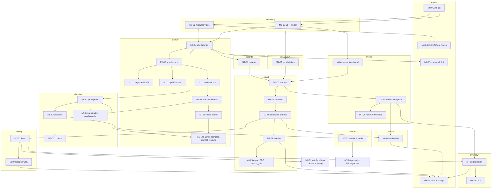

# Document D – Orchestration du backend · PsyMate, plateforme de suivi clinique

27 octobre 2026 · @Hayes · Version 1.1 · Complément du document C (plan). Ne redéfinit aucune tâche : il dit **dans quel ordre** lancer celles de C2 et C6 côté `psymate-api`, **lesquelles peuvent tourner en même temps**, et **ce qui bloque quoi**. Le frontend aura son propre document H quand le contrat `contract-v0.2.0` sera tagué.

Mis à jour le 29 octobre 2026 : renommages et décisions de docs/G-decisions.md (PsyMate, com.psymate, psymate-api / psymate-web ; tâche M1-14b ajoutée ; écarts D7 tranchés). Quand ce document et G se contredisent, G l'emporte.

## D0. Comment lire ce document

- Une **tâche** = un ID de C2/C6 (`M1-03`), un module Spring, une branche, une PR, un agent.
- Une **dépendance** = « ne peut pas commencer tant que la PR de … n'est pas fusionnée sur `main` ». Les dépendances ci-dessous sont celles de C2/C6, complétées quand C était implicite (par exemple `M0-04` dépend de `M0-03` : il lui faut la table `practitioner`).
- Un **couloir** = un module. Deux tâches du même couloir sont toujours séquentielles (même fichiers). Deux tâches de couloirs différents peuvent tourner en parallèle, chacune dans son worktree.
- Une **vague** = l'ensemble des tâches dont toutes les dépendances sont fusionnées. On lance une vague, on fusionne, la vague suivante se débloque. Les vagues sont un ordre de lecture, pas un calendrier : une tâche peut démarrer dès que ses propres dépendances sont vertes, sans attendre le reste de sa vague.

## D1. Inventaire des tâches backend et de leurs dépendances

Trente et une tâches `api` (C2 + C6), classées par module. « Dépend de » = ce qui doit être fusionné avant. « Débloque » = ce qui attend cette tâche.

| ID | Tâche | Couloir (module) | Dépend de | Débloque |
| --- | --- | --- | --- | --- |
| M0-01 | Initialiser `psymate-api` (Boot 4.1, Modulith 2, Flyway, CI, Compose) | racine | — | M0-02, M0-03 |
| M0-02 | Modules Modulith vides, `package-info`, ArchUnit | tous (package-info seulement) | M0-01 | M0-04, M0-08 |
| M0-03 | `V1__init.sql` : extensions, vocabulaires, tables V2 et réserves | tous (SQL seulement) | M0-01 | M0-04, M1-02, M4-01a |
| M0-04 | Identité minimale : signup, login, logout, tenant, reset | identity | M0-02, M0-03 | M0-05, M1-01, M1-10, M5-01 |
| M0-05 | Contrat OpenAPI généré, vérifié en CI, tag `contract-v0.1.0` | racine | M0-04 | M0-07 (web) |
| M0-08 | `CLAUDE.md`, `settings.json`, hooks, agents | racine (+ web) | M0-02 (+ M0-06 web) | toutes les tâches suivantes, en pratique |
| M4-01a | **Events minimal, avancé** : `DomainEventPublisher`, registry Modulith, table `outbox_event` branchée (voir D6) | events | M0-03 | M1-03 |
| M1-02 | Vocabulaires : 29 émotions, `link_type`, `entry_type`, tags, émotions custom | vocabulary | M0-03 | M1-03 |
| M1-01 | Patients : CRUD, propriété, archivage, `PatientCreated` | patients | M0-04 | M1-03 |
| M1-10 | Inscription enrichie, confirmation d'e-mail, colonnes A10.2 | identity | M0-04 | M1-11, M1-12, M1-13 |
| M1-11 | Connexion durcie, verrouillage, 2FA TOTP | identity (auth) | M1-10 | — |
| M1-12 | Préférences par compte (JSONB, PATCH merge) | identity (preferences) | M1-10 | M1-16 (web) |
| M1-13 | Dossier professionnel : documents, stockage chiffré, submit, purge | identity.verification | M1-10 | M1-14 |
| M1-14 | Administration : file de validation, décisions, effets, ArchUnit | identity.admin | M1-13 | M5-06, M7-08, M1-14b, M7-07 (web) |
| M7-08 | Compte admin de bootstrap (`make admin`) | identity | M1-14 | M1-14b (même couloir) |
| M1-14b | Administration : comptes, suspension manuelle, journal (`admin_journal_v`, V10), recours, vocabulaire de l'annuaire (G Q15, Q27, Q28) | identity.admin (+ façade `directory.api`) | M1-14, M5-01 | M7-07 (web) |
| M1-03 | Entrées : modèle hybride, versions, règle de grâce, séance obligatoire | clinical | M1-01, M1-02, M4-01a | M1-04 |
| M1-04 | Séances : démarrer, clôturer, compléter, séance courante | clinical | M1-03 | M1-05 |
| M1-05 | Endpoints entrées, validation 422, `authorType` en lecture, contrat | clinical | M1-03, M1-04 | M2-01, M3-01, M4-02, M1-08 (web) |
| M3-01 | Timeline fenêtrée, curseur keyset, facettes, résumé mensuel | clinical | M1-05 | M6-05, M7-01 |
| M6-05 | Export PDF / Markdown du dossier et export du compte refusé (`export_job`, V11, G Q18) | clinical | M3-01 | — |
| M2-01 | Liens : table, règles, cycle de vie, `superseded` | linking | M1-05 | M2-02, M2-03, M4-03 |
| M2-02 | Création d'entrée avec `links[]` en une transaction | **clinical + linking** (exclusif) | M2-01 | M2-05 (web) |
| M2-03 | Voisinage CTE, `/graph`, super-nœuds, `expand` | linking | M2-01 | M7-01 |
| M4-01 | Outbox complète : republication, abonnés idempotents, rejeu après redémarrage | events | M1-03 (et M4-01a) | M4-02, M4-03, M7-05 |
| M4-02 | Recherche : trigger `search_vector`, GIN, trigrammes, facettes | search | M4-01, M1-05 | M7-01 |
| M4-03 | Projection `patient_overview`, `OverviewListener`, `source_rev` | overview | M4-01, M2-01 | M4-06, M7-01 |
| M4-06 | `NarrativeComposer`, payload enrichi (vue « Récit ») | overview | M4-03 | M4-07 (web) |
| M5-01 | Profil public : `practitioner_profile`, `directory_vocabulary` (liste fermée, G Q15), `/api/me/profile`, photo, publish | directory | M0-04 | M5-02, M5-06, M1-14b |
| M5-02 | Annuaire public : `/api/public/directory`, fiche, sans auth, rate limit (Bucket4j) | directory | M5-01 | M5-03, M7-02 |
| M5-03 | Formulaire de contact : anti-spam, relais e-mail | directory | M5-02 | — |
| M5-06 | Publication conditionnée à `verification_status = approved`, dépublication sur refus ou suspension | directory | M5-01, M1-14 | — |
| M7-02 | Rate limiting (Bucket4j), journal d'audit applicatif, erreurs RFC 9457 | shared | M5-02 | M7-06 |
| M7-05 | Vérification des hooks V2 et des réserves du compagnon | events | M4-01 | — |
| M7-01 | Seed `medium` et tests de charge | racine (`tools/seed`) | M2-03, M3-01, M4-02, M4-03 | — |
| M7-06 | Document de passation hébergement (aucun code) | — | M7-02 | — |

Lecture des colonnes « Dépend de » corrigées par rapport à C2 :

- **M0-04** dépendait de rien dans C2 (ligne tronquée) ; il a besoin des packages (M0-02) et de la table `practitioner` (M0-03).
- **M1-03** dépend aussi de **M4-01a** : `clinical` est déclaré dépendant de `events` (A5) et émet `EntryCreated` dès sa première version ; sans `DomainEventPublisher`, l'agent de M1-03 l'inventerait. Voir D6.
- **M4-02** dépend aussi de **M1-05** : le trigger `search_vector` s'écrit sur `entry` et `entry_version`, qui n'existent qu'après M1-03/05.
- **M7-01** dépendait de M4-05 et M2-06 (écrans) dans C2 ; côté backend, ce sont les quatre endpoints lourds qui comptent (graphe, timeline, recherche, overview).
- **M1-14b** (ajoutée le 29 octobre, G) dépend de M5-01 parce qu'elle administre la table `directory_vocabulary` via une façade de `directory.api` ; elle suit M7-08 dans le couloir `identity` parce que les deux touchent `identity.admin`.

## D2. Graphe de dépendances



Trois choses sautent aux yeux dans ce graphe :

1. **`identity` est le couloir le plus long** : huit tâches en chaîne (M0-04 → M1-10 → M1-11/12/13 → M1-14 → M7-08 → M1-14b). Il ne bloque pourtant presque rien du dossier clinique : seule M0-04 est sur le chemin de `patients`. Il faut donc le lancer tôt et le laisser avancer en fond (D5).
2. **`clinical` est le goulot du dossier** : M1-03 → M1-04 → M1-05 est strictement séquentiel, et M1-05 débloque à lui seul `linking`, `search`, la timeline et l'éditeur d'entrée côté web. Rien de parallélisable à l'intérieur ; tout ce qui peut être fait avant (patients, vocabulaire, events minimal) doit l'être pour que M1-03 démarre sans attendre.
3. **`directory` est une île** : M5-01 → M5-02 → M5-03 ne dépend que de M0-04 et ne bloque que M7-02 (et M1-14b, pour la façade du vocabulaire). C'est le couloir idéal pour un agent (ou une équipe) qui tourne pendant M1–M4 sans jamais toucher aux modules cliniques.

## D3. Vagues de lancement

Ce qui peut démarrer, quand, et avec combien d'agents en parallèle. « ∥ » = en parallèle dans des worktrees distincts.

| Vague | Débloquée par | Tâches lançables | Agents en parallèle | Ce qui se débloque à la fin |
| --- | --- | --- | --- | --- |
| **V0** | rien | **M0-01** | 1 (seul : tout le reste attend le `pom.xml`) | V1 |
| **V1** | M0-01 fusionné | **M0-02 ∥ M0-03** | 2 (fichiers disjoints : `package-info.java` et tests d'architecture d'un côté, `V1__init.sql` et test Flyway de l'autre) | V2 |
| **V2** | M0-02 et M0-03 | **M0-04** ∥ **M4-01a** ∥ **M1-02** ∥ M0-08 (dès que M0-06 web existe) | 3 à 4 | M0-05, M1-01, M1-10, M5-01 (via M0-04) ; M1-03 attend encore M1-01 |
| **V3** | M0-04 | **M0-05** (tag `contract-v0.1.0`, court) puis **M1-01** ∥ **M1-10** ∥ **M5-01** | 3 | M1-03 (quand M1-01, M1-02, M4-01a sont verts) ; M1-11/12/13 ; M5-02 |
| **V4** | M1-01 + M1-02 + M4-01a | **M1-03** ∥ (M1-11 → M1-12 → M1-13, ou en parallèle selon D5) ∥ **M5-02** | 3 (ou 5 avec `identity` découpé) | M1-04 ; M1-14 ; M5-03 |
| **V5** | M1-03 | **M1-04** ∥ **M4-01** (outbox complète, sur `events` seulement) ∥ **M1-14** ∥ **M5-03** | 4 | M1-05 ; M7-05 ; M7-08, M5-06 |
| **V6** | M1-04 (+ M1-03) | **M1-05** → tag `contract-v0.3.0` ∥ **M7-08** puis **M1-14b** (même couloir, à la suite) ∥ **M5-06** ∥ **M7-05** | 4 (5 tâches) | M2-01, M3-01, M4-02 : c'est la vague qui ouvre tout le dossier ; tag `v0.8.1` après M1-14b |
| **V7** | M1-05 (+ M4-01) | **M2-01** ∥ **M3-01** ∥ **M4-02** ∥ **M7-02** | 4 (`linking`, `clinical`, `search`, `shared`) | M2-02, M2-03, M4-03, M6-05 |
| **V8** | M2-01, M3-01 | **M2-02** (exclusif : bloque `clinical` et `linking` le temps de sa PR, courte) puis **M2-03** ∥ **M4-03** ∥ **M6-05** | 3 | M4-06, M7-01 |
| **V9** | M4-03, M2-03, M4-02, M3-01 | **M4-06** ∥ **M7-01** ∥ **M7-06** | 3 | fin du backend V1 ; M4-07 web |

**Ce qu'on peut commencer aujourd'hui, sans rien d'autre** : M0-01. Dès qu'il est fusionné : M0-02 et M0-03 en même temps. Dès que ces deux-là sont fusionnés : trois agents sur trois modules (`identity`, `events`, `vocabulary`) qui ne se croiseront jamais.

**Ce qui doit absolument attendre** :

- Tout `clinical` (M1-03 et suite) attend `patients`, `vocabulary` et `events` minimal. Lancer M1-03 avant, c'est garantir que l'agent invente `PatientFacade`, `EmotionCatalog` ou `DomainEventPublisher` à sa façon.
- `linking`, `search` et la timeline attendent **M1-05** (les endpoints et le contrat des entrées), pas seulement M1-03 : ils lisent les DTO d'entrée et `authorType`.
- `overview` (M4-03) attend `linking` (M2-01) parce qu'il écoute `LinkAccepted` et compte les liens des situations actives ; le lancer sur `EntryCreated` seul produirait une projection à refaire.
- M5-06 attend l'administration (M1-14) : c'est la seule dépendance de `directory` vers l'identité étendue, et elle arrive tard. M5-01 → M5-03 n'ont pas à l'attendre.
- M1-14b attend M7-08 (même couloir `identity`) et M5-01 (façade du vocabulaire de l'annuaire).
- M7-01 attend les quatre endpoints lourds : un seed sans graphe ni recherche ne mesure rien.

## D4. Chemin critique

La chaîne la plus longue, qui fixe la durée minimale du backend quel que soit le nombre d'agents :

```
M0-01 → M0-03 → M0-04 → M1-01 → M1-03 → M1-04 → M1-05 → M2-01 → M4-03 → M4-06 → M7-01
```

Onze tâches en série. Tout ce qui n'est pas dessus (identité étendue, annuaire, recherche, timeline, export) peut glisser sans retarder la fin, à condition d'être lancé dans sa vague. Trois leviers pour le raccourcir :

| Levier | Gain | Condition |
| --- | --- | --- |
| Lancer M0-02 et M0-03 en parallèle (V1) | une session | Les deux agents ne touchent pas aux mêmes fichiers ; M0-03 ne crée aucune classe Java |
| Avancer `events` minimal (M4-01a) en V2, en parallèle de M0-04 | une session sur le chemin de M1-03 | Voir D6 |
| Découper M1-03 en deux PR : (a) `entry`, `entry_version`, `TimeSpan`, règle de grâce ; (b) les trois tables de détail et leurs validateurs | aucune en durée, mais chaque PR devient relisible en une fois | Même agent, même couloir, deux PR successives ; (b) ne démarre qu'après (a) |

Ce qu'il ne faut **pas** faire pour « gagner du temps » : lancer M2-01 sur une branche de M1-05 non fusionnée (le contrat bouge, le lien se construit sur des DTO qui changent) ; faire écrire la projection `overview` par l'agent de `clinical` « tant qu'il y est » (frontière de module, et c'est précisément ce que l'ArchUnit interdira).

## D5. Couloirs parallèles et règles d'exclusion

Un couloir par module ; un seul agent par couloir à la fois ; un worktree par agent.

| Couloir | Tâches, dans l'ordre | Peut tourner en même temps que | Jamais en même temps que |
| --- | --- | --- | --- |
| racine | M0-01 · M0-05 · M0-08 · M7-01 | tout, sauf pendant M0-01 (seul) | — |
| identity | M0-04 · M1-10 · M1-11 · M1-12 · M1-13 · M1-14 · M7-08 · M1-14b | patients, vocabulary, events, clinical, linking, search, overview, directory | une autre tâche `identity` ; **M5-06** le temps de M1-14 (il lit `PractitionerFacade`, qui change) ; une tâche `directory` le temps de M1-14b (il ajoute une façade dans `directory.api`) |
| events | M4-01a · M4-01 · M7-05 | tout | M1-03 le temps de M4-01a (M1-03 attend de toute façon) |
| vocabulary | M1-02 | tout | M1-03 (attend M1-02) |
| patients | M1-01 | tout | M1-03 (attend M1-01) |
| clinical | M1-03 · M1-04 · M1-05 · M3-01 · M6-05 | identity, directory, events, search, overview | linking pendant **M2-02** ; une autre tâche `clinical` |
| linking | M2-01 · M2-03 | clinical (sauf M2-02), search, overview, directory, identity | clinical pendant **M2-02** |
| clinical + linking | M2-02 | identity, directory, search, overview | **toute** tâche `clinical` ou `linking` : on la lance quand les deux couloirs sont vides, elle est courte |
| search | M4-02 | tout | — (lit `entry` par SQL et événements, n'écrit dans aucun autre module) |
| overview | M4-03 · M4-06 | tout | — |
| directory | M5-01 · M5-02 · M5-03 · M5-06 | tout | `identity` pendant M1-14 (pour M5-06 seulement) et pendant M1-14b |
| shared | M7-02 | — (il touche `shared`, lu par tous : la CI de toutes les branches ouvertes doit être relancée après fusion) | à lancer quand peu de branches sont ouvertes |

### Découper `identity` pour paralléliser M1-11, M1-12, M1-13

Le couloir `identity` est le plus long et ses trois tâches du milieu touchent des sujets distincts (authentification, préférences, dossier professionnel). Elles sont séquentielles dans C6 uniquement parce qu'elles vivent dans le même module. Pour les paralléliser sans conflit :

1. **M1-10 porte toute la migration de A10.2** (`V2__identity_extended.sql` : `role`, `phone`, adresse, `verification_status`, `preferences`, `totp_secret_enc`, `failed_logins`, `locked_until`, et les tables `verification_document`, `verification_decision`, `document_access_log`, `security_event`). Les trois tâches suivantes n'ajoutent alors **aucune colonne** à `practitioner` et ne se disputent pas la même migration. (E a depuis tranché autrement : toutes les colonnes de `practitioner` sont dans V01, les tables de vérification dans V03 portée par M1-10 ; le principe reste le même.)
2. M1-10 fixe aussi l'entité `Practitioner` avec tous ses champs, et les sous-packages `identity/auth`, `identity/preferences`, `identity/verification`, `identity/admin` avec leur `package-info` (Modulith 2 accepte les sous-modules nommés ; sinon, de simples sous-packages avec une règle ArchUnit « `admin` n'importe rien de `patients`, `clinical`, `linking`, `overview`, `search` »).
3. Ensuite : **M1-11** (`identity/auth`) ∥ **M1-12** (`identity/preferences`) ∥ **M1-13** (`identity/verification`), trois agents, trois worktrees, un seul point de contact commun : `PractitionerFacade` dans `identity/api`, que M1-10 a déjà déclaré avec ses méthodes (`verificationStatusOf`, `preferencesOf`, `profession`). Si une tâche doit ajouter une méthode à la façade, elle la déclare dans sa PR et le `reviewer` vérifie l'absence de conflit.
4. **M1-14** reste après M1-13 (il consomme les décisions et les documents) ; **M7-08** puis **M1-14b** suivent M1-14 dans le même sous-package `identity/admin`.

Gain : deux sessions sur le couloir `identity`, et surtout M1-12 (préférences, dont le web M1-16 dépend) disponible beaucoup plus tôt.

## D6. Ajustements proposés au plan C

Ces ajustements ont été reportés dans C le 29 octobre 2026 ; ils sont conservés ici pour mémoire.

| # | Ajustement | Pourquoi | Effet |
| --- | --- | --- | --- |
| A1 | Scinder M4-01 en **M4-01a** (events minimal, vague V2 : `DomainEventPublisher`, enregistrement du registry Modulith sur `outbox_event`, un test « un événement publié est écrit dans la table ») et **M4-01** (vague V5 : republication au redémarrage, abonnés idempotents, purge) | `clinical` dépend de `events` par construction (A5) et M1-03 émet des événements dès son premier commit ; sans M4-01a, soit M1-03 attend M4-01 (trop tard), soit l'agent invente un publisher que M4-01 devra remplacer | M1-03 démarre une vague plus tôt avec le vrai mécanisme ; M4-01 ne touche plus `clinical` |
| A2 | Compléter la ligne M0-04 de C2 : « Dépend de : M0-02, M0-03 » | Ligne tronquée dans C2 | Aucun, c'est déjà l'ordre réel |
| A3 | Faire porter **toute** la migration A10.2 par M1-10 (voir D5) | Permet M1-11 ∥ M1-12 ∥ M1-13 | Deux sessions gagnées sur `identity` |
| A4 | Tagger le contrat à chaque vague qui change l'API, pas seulement en M0-05 et M1-05 : `v0.1.0` (M0-05, auth minimale) · `v0.2.0` (identité étendue : après M1-12 et M1-13, pour M1-15/16 web) · `v0.3.0` (patients + entrées : M1-05) · `v0.4.0` (liens et graphe : M2-03) · `v0.5.0` (timeline : M3-01) · `v0.6.0` (recherche + overview : M4-03) · `v0.7.0` (annuaire : M5-03) · `v0.8.0` (admin : M1-14) · `v0.8.1` (admin complet : M1-14b) | Le frontend ne peut démarrer une feature qu'à un tag ; des tags rares retardent tout le web | Chaque tag est une PR d'une ligne (`CONTRACT_TAG`) côté web |
| A5 | Ajouter aux dépendances de M4-02 : M1-05 ; aux dépendances de M7-01 côté api : M2-03, M3-01, M4-02, M4-03 | Précision des dépendances réelles | Aucun sur l'ordre, évite un lancement prématuré |
| A6 | M2-02 : la lancer **uniquement** quand aucune PR `clinical` ni `linking` n'est ouverte, et la garder petite (le champ `links[]` et la transaction) | Seule tâche qui écrit dans deux modules | Évite le seul vrai risque de conflit de fusion du backend |

## D7. Écarts entre les fiches design et le plan C — tranchés le 29 octobre 2026 (G)

Les fiches `docs/design/` livrées le 25 octobre décrivaient des parties backend qui n'avaient ni section dans A, ni tâche dans C. Toutes sont désormais tranchées dans `G-decisions.md` ; la colonne « Décision » dit ce qui s'applique.

| Fiche | Ce qu'elle suppose côté backend | Proposition initiale | Décision (G) |
| --- | --- | --- | --- |
| **15 Agenda**, **15b Nouveau rendez-vous** | Un **module `scheduling` entier** : tables `appointment` et `practitioner_integration`, `AppointmentFacade`, événements, endpoints `/api/agenda`, `/api/appointments/*`, OAuth Google, webhook, flux iCal, synchronisation bidirectionnelle | Jalon **M8 Agenda** après M7, ou sortie de la V1 | **Tranché (G Q25) : hors V1.** Aucun jalon M8, aucun module `scheduling`, aucune tâche. Les fiches sont conservées pour plus tard. |
| **23 Admin · Signalements de l'annuaire** | `POST /api/public/directory/{slug}/report`, table `directory_report`, file admin, actions | Deux petites tâches `directory` à ajouter à M5/M7 | **Tranché (G Q26) : V1.1.** DDL prêt en E6.1 ; rien dans les vagues V0–V9. |
| **21 Admin · Praticiens**, **22 Admin · Journal** | `GET /api/admin/practitioners` avec suspendre / réactiver, journal paginé | Tâche **M1-14b** après M1-14 | **Tranché (G Q27, Q29) : M1-14b créée** (D1, D3 V6, D5, D9), journal = vue `admin_journal_v` sur `security_event`, migration V10. |
| **17 Émotions personnalisées** (fusion, promotion) | Fusion de deux émotions custom, promotion vers une globale | Fusion en V1, promotion en V2 | **Tranché (G Q8) : fusion en V1 dans M1-02** (`emotion_merge`, undo 30 jours) ; promotion en V2. |
| **27 Compte suspendu / refusé** (export, recours) | Export du dossier d'un compte refusé avant purge à 30 jours, endpoint de recours | Rattacher l'export à M6-05, le recours à M1-14b | **Tranché (G Q18, Q28) :** export du compte dans **M6-05** (`export_job`, migration V11, lien 7 jours) ; recours dans **M1-14b** (`practitioner_appeal`). |
| **16 Fiche patient** (drapeaux, tags du patient) | Tags au niveau patient et drapeaux éditables | Les ajouter à M1-01 | **Tranché (G Q7) : oui**, tags de patient (`patient_tag`, V02), versions de patient, drapeaux en table (E3.4, E3.5) ; portés par M1-01. |

## D8. Liste de contrôle avant de lancer une tâche

Pour chaque tâche, l'orchestrateur (toi, ou un agent lead) vérifie :

1. **Toutes ses dépendances de D1 sont fusionnées sur `main`** et la CI de `main` est verte.
2. **Aucune autre tâche du même couloir n'est en cours** (D5), et pour M2-02, aucune PR `clinical` ni `linking` ouverte.
3. **Le contrat au tag courant contient ce que la tâche va lire** (par exemple M2-01 lit les DTO d'entrée de `v0.3.0`).
4. Le prompt suit le gabarit C4 : sections de A/B à lire, décisions de G citées, périmètre de fichiers = le couloir, critères copiés de C2/C6, interdits (dépendance Maven, frontière, migration modifiée, `authorType` en écriture).
5. La branche est nommée `<ID>-<sujet>` ; le worktree est créé depuis `main` à jour.
6. À la fin : `./mvnw verify` vert, contrat regénéré (et tagué si la vague le prévoit, D6-A4), PR relue par `reviewer`, la ligne de D1 passe à « fusionnée » dans le suivi.

## D9. Suivi d'avancement

À tenir à jour à chaque fusion (un tableau, une issue GitHub épinglée, ou la liste de tâches de l'équipe d'agents) :

| Vague | Tâche | Couloir | État | Branche / PR | Tag contrat |
| --- | --- | --- | --- | --- | --- |
| V0 | M0-01 | racine | à lancer | — | — |
| V1 | M0-02 | tous | bloquée par M0-01 | — | — |
| V1 | M0-03 | tous | bloquée par M0-01 | — | — |
| V2 | M0-04 | identity | bloquée par M0-02, M0-03 | — | — |
| V2 | M4-01a | events | bloquée par M0-03 | — | — |
| V2 | M1-02 | vocabulary | bloquée par M0-03 | — | — |
| V2 | M0-08 | racine | bloquée par M0-02, M0-06 (web) | — | — |
| V3 | M0-05 | racine | bloquée par M0-04 | — | v0.1.0 |
| V3 | M1-01 | patients | bloquée par M0-04 | — | — |
| V3 | M1-10 | identity | bloquée par M0-04 | — | — |
| V3 | M5-01 | directory | bloquée par M0-04 | — | — |
| V4 | M1-03 | clinical | bloquée par M1-01, M1-02, M4-01a | — | — |
| V4 | M1-11 | identity/auth | bloquée par M1-10 | — | — |
| V4 | M1-12 | identity/preferences | bloquée par M1-10 | — | v0.2.0 (avec M1-13) |
| V4 | M1-13 | identity/verification | bloquée par M1-10 | — | v0.2.0 |
| V4 | M5-02 | directory | bloquée par M5-01 | — | — |
| V5 | M1-04 | clinical | bloquée par M1-03 | — | — |
| V5 | M4-01 | events | bloquée par M1-03 | — | — |
| V5 | M1-14 | identity/admin | bloquée par M1-13 | — | v0.8.0 |
| V5 | M5-03 | directory | bloquée par M5-02 | — | v0.7.0 |
| V6 | M1-05 | clinical | bloquée par M1-04 | — | v0.3.0 |
| V6 | M7-08 | identity | bloquée par M1-14 | — | — |
| V6 | M1-14b | identity/admin | bloquée par M7-08, M5-01 | — | v0.8.1 |
| V6 | M5-06 | directory | bloquée par M5-01, M1-14 | — | — |
| V6 | M7-05 | events | bloquée par M4-01 | — | — |
| V7 | M2-01 | linking | bloquée par M1-05 | — | — |
| V7 | M3-01 | clinical | bloquée par M1-05 | — | v0.5.0 |
| V7 | M4-02 | search | bloquée par M4-01, M1-05 | — | — |
| V7 | M7-02 | shared | bloquée par M5-02 | — | — |
| V8 | M2-02 | clinical + linking | bloquée par M2-01 ; couloirs vides | — | — |
| V8 | M2-03 | linking | bloquée par M2-01 | — | v0.4.0 |
| V8 | M4-03 | overview | bloquée par M4-01, M2-01 | — | v0.6.0 |
| V8 | M6-05 | clinical | bloquée par M3-01 | — | — |
| V9 | M4-06 | overview | bloquée par M4-03 | — | — |
| V9 | M7-01 | racine | bloquée par M2-03, M3-01, M4-02, M4-03 | — | — |
| V9 | M7-06 | — | bloquée par M7-02 | — | — |

Les écarts de D7 sont tous tranchés (G) : M1-14b et l'extension de M6-05 figurent dans ce tableau ; l'agenda est hors V1 ; les signalements sont en V1.1 et s'ajouteront le jour où ils seront planifiés.
