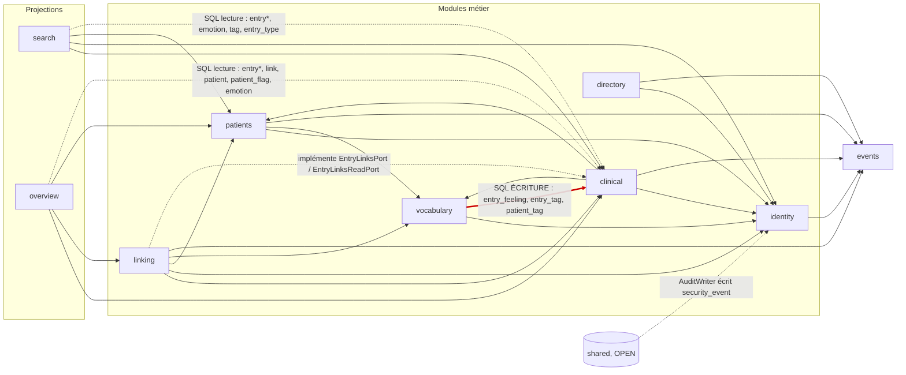

# Revue d'architecture — psymate-api

1er novembre 2026 · Revue en lecture seule de l'arbre de travail (`main`, après la fusion de M8-05, PR #46). Aucun build ni test lancé : les constats viennent de la lecture du code, des documents et de `git ls-files`. Les chemins Java sont relatifs à `src/main/java/com/psymate/` (ou `src/test/java/com/psymate/` pour les tests), sauf mention contraire.

**Mise à jour du 2 novembre 2026.** L'équipe a tranché R1, R2, R3, R5, R6, Q6 et Q7 (§7.1) : structure par rôle, lecture SQL des projections en lecture seule, suppression physique interdite pour les seules données cliniques, SQL natif des modules JPA par fragments Spring Data, un fichier par DTO, et tout le plan lancé maintenant. Les sections ci-dessous en tiennent compte.

---

## 1. Synthèse

**État général.** Le backend est solide. Les frontières de compilation sont réellement vérifiées (Spring Modulith `verify()` plus 8 règles ArchUnit, chacune prouvée par une fixture). Les modules communiquent par des façades `api` étroites et des événements dont la livraison est garantie par l'outbox. La migration JPA (G Q32) avance proprement : patients, vocabulary, directory, identity et clinical.export sont passés (M8-06 fusionnée, PR #47 ; voir la correction du 2 novembre ci-dessous). Les faiblesses tiennent à l'**hétérogénéité** plutôt qu'à des erreurs de conception : quatre organisations de packages, quatorze gestionnaires d'erreurs, trois styles d'accès aux données dans les modules JPA, et une documentation qui décrit un état antérieur.

**Les cinq points les plus importants**

1. **Une frontière est franchie en écriture (ARCH-01).** `vocabulary` réécrit en SQL natif les tables `entry_feeling` et `entry_tag` (de clinical) et `patient_tag` (de patients) lors des fusions d'émotions et de tags. Il le fait sans événement, sans version et sans toucher à `clinical_rev`. L'index de recherche et la vue d'ensemble des entrées concernées restent donc probablement périmés. Je n'ai pas pu le confirmer : aucun test ne couvre ce cas.
2. **Les gardes dépendent de la structure des packages, qui n'est pas uniforme (ARCH-03, ARCH-04).** La règle « jamais d'entité dans `web` » ne voit que les classes rangées dans un package `web` : **21 des 26 contrôleurs** lui échappent parce qu'ils vivent dans des modules plats ou découpés par fonctionnalité.
3. **La gestion des erreurs RFC 9457 est dupliquée (ARCH-05).** On compte 14 `@RestControllerAdvice` de module et environ 27 exceptions maison. `shared.problem.ProblemException` n'est adoptée que par clinical.export. La traduction 403/404 de la garde de propriété des patients est recopiée dans 6 gestionnaires.
4. **La documentation diverge du code (ARCH-12, ARCH-13).** Le plan C ne contient pas les tâches M8 (il affirme même que « le jalon M8 n'existe plus »). Le manuel du développeur affirme « JdbcClient, pas JPA ». Le tableau A5 des dépendances et la règle de grâce (5 min au lieu de 75) sont périmés. G se contredit lui-même entre Q25 et Q32.
5. **Une partie de la surface publique est morte, et il reste des indirections sans second usage (ARCH-06, ARCH-07, ARCH-10).** `LinkFacade`, `DirectoryFacade` et `ProfileFacade` n'ont aucun consommateur en production, et 3 méthodes d'`EntryFacade` ne servent qu'aux tests. Le module vocabulary passe par un port, un adaptateur et un wrapper pour lire le praticien courant. identity garde une couche de « coutures » qui ne font que transmettre aux repositories JPA.

**Recommandation principale.** D'abord, corriger ARCH-01 (passer les fusions par des événements) et rendre les gardes indépendantes de la structure (en s'appuyant sur les annotations `@RestController` et `@Entity` plutôt que sur les noms de packages). Ensuite seulement, déployer **une** convention de packages, adoptée le 2 novembre (R6) : **un dossier par rôle**, `api / controller / dto / service / repository / model / config`, où le suffixe d'une classe (`*Controller`, `*Dto`, `*Service`, `*Repository`) dit dans quel dossier elle va. Les sous-domaines ne sont admis que dans identity et clinical. On la déploie module par module, en une PR par module, et chaque PR verrouille son résultat par une règle ArchUnit de dossiers. Le plan est au §5 : 20 étapes, toutes compatibles avec un `./mvnw verify` vert, lancées dès maintenant (Q7).

---

## 2. Carte actuelle

### 2.1 Dépendances réelles

Relevé des `import com.psymate.<autre module>` dans `src/main/java`, ainsi que des tables SQL citées dans les chaînes de requête de chaque module.



Tous les modules dépendent de `shared` (`shared.problem` partout, `shared.ratelimit` dans identity et directory, `shared.audit` dans identity seulement).

| Module | `allowedDependencies` (package-info) | Utilisées réellement | A5 (l. 599-611) dit | Écart |
| --- | --- | --- | --- | --- |
| identity | events::api, shared | events.api (11), shared | — | — |
| patients | identity, events, vocabulary (api), shared | les trois | identity seul | + vocabulary, events |
| vocabulary | identity::api, shared | identity.api (en nom qualifié) | identity | — |
| clinical | identity, patients, vocabulary, events (api), shared | les quatre | patients, vocabulary, events | + identity |
| linking | clinical, vocabulary, events, identity, patients (api), shared | les cinq | clinical, vocabulary, events | + identity, patients |
| search | events, patients, identity, clinical (api), shared | clinical, identity, patients | events, patients | + clinical, identity ; **events déclaré, non utilisé** |
| overview | events, patients, identity, clinical, linking (api), shared | clinical, linking, patients | events, patients | + clinical, linking ; **identity, events déclarés, non utilisés** |
| directory | identity::api, events::api, shared | les deux | identity, events | — |
| events | shared | aucune | — | — |
| ai / companion | `"events", "clinical", …` (sans `:: api`) | vides | conforme | notation différente des autres (ARCH-24) |

### 2.2 Structure interne

| Module | Style | Fichiers (lignes) | Sous-packages |
| --- | --- | --- | --- |
| clinical | **par couche** + une fonctionnalité plate | 89 (8 731) | api, application (23), domain (16), persistence (2), web (14), **export (18, plat)** |
| linking | **par couche** | 38 (3 323) | api, application, domain, persistence, web |
| patients | **hybride** | 27 (2 556) | racine plate (7 : contrôleur, service, DTO…), api, persistence (entités + repositories) |
| identity | **par fonctionnalité** + persistance commune | 133 (14 580) | api, auth (29), admin (24), admin/bootstrap (7), preferences (7), verification (16), **persistence (36 : entités et repositories de tous)** |
| vocabulary | **plat** | 41 (2 590) | racine (32), api |
| directory | **plat** | 48 (4 506) | racine (43), api |
| search | **plat** | 11 (1 732) | — |
| overview | **plat** | 17 (2 673) | — |
| events | plat + api | 10 (371) | api |
| shared | technique | 18 (1 225) | audit, problem, ratelimit |
| ai, companion | réservés | 1 + 1 | package-info seulement (vérifié par `ArchitectureTests.java:450-457`) |

Dépendances internes, entre couches et entre fonctionnalités :
- **clinical** et **linking** : les couches sont propres et sans cycle (`web → application → domain`, `application → persistence → domain`, et tout le monde vers `api`).
- **identity** : `admin` dépend de `auth` (`AppealAuthenticator`) et de `verification` (`DocumentCipher`, `StorageService`) ; `auth` dépend de `preferences` (`Preferences`) ; tous dépendent de `persistence` (29 types publics). `admin/bootstrap` respecte bien sa promesse de n'importer rien de `auth` (`identity/admin/bootstrap/package-info.java`), mais aucune règle ne la vérifie.

---

## 3. Constats

Légende des sévérités : **bloquant** (corriger avant la prochaine fusion fonctionnelle du module), **important** (à planifier dans le lot en cours), **amélioration**, **remarque**.

### ARCH-01 · vocabulary écrit dans les tables de clinical et de patients
- **Sévérité** : important. Il devient bloquant si le test de confirmation proposé échoue.
- **Axe** : frontières.
- **Constat** : les fusions de tags et d'émotions réécrivent des tables d'autres modules en SQL natif. Elles ne publient aucun événement, ne créent aucune version et ne touchent pas à `patient.clinical_rev`. Le code le reconnaît : le commentaire parle de « tables hors du module (entry_tag, patient_tag, jamais mappées ici) ».
- **Preuve** :
  - `vocabulary/TagNativeQueriesImpl.java:15-35` : `delete from entry_tag`, `update entry_tag`, `delete from patient_tag`, `update patient_tag`.
  - `vocabulary/EmotionNativeQueriesImpl.java:17` et `:30` : `update entry_feeling set emotion_code…`.
  - `vocabulary/TagNativeQueries.java:5-9` : le commentaire cité ci-dessus.
  - `vocabulary/EmotionService.java:173` : `rewriteFeelings`, sans aucune publication.
- **Conséquence (plausible, non testée)** : le `search_vector` contient les libellés d'émotion et de tag (`V08__search.sql:11`, `:13`) et n'est recalculé que sur `EntryCreated` et `EntryCorrected` (`V08__search.sql:39`, `search/SearchIndexListener.java:31-36`). La projection `patient_overview` ne se recalcule que sur événement ou sur décalage de `clinical_rev` (A6). Après une fusion, la recherche par le nouveau libellé et les « émotions dominantes » sont donc probablement fausses jusqu'à la prochaine écriture clinique du patient. Aucun test de `search/`, `overview/` ou `clinical/` ne parle de fusion.
- **Proposition** :
  1. Écrire d'abord un IT qui le démontre : fusionner deux émotions, puis rechercher le libellé cible et lire la vue d'ensemble.
  2. `vocabulary.api` publie `EmotionsMerged(source, target, practitionerId)`, `EmotionMergeReverted(…)` et `TagsMerged(source, target, practitionerId)`.
  3. clinical s'abonne : il réécrit `entry_feeling` et `entry_tag` dans **ses** repositories, appelle `touchClinicalRev` pour les patients touchés, puis publie `EntryCorrected` ou un événement de réindexation dédié.
  4. patients s'abonne et réécrit `patient_tag`.
  5. search réindexe les entrées concernées.
  6. Les branches mortes `NativeSql.tableExists` disparaissent au passage (ARCH-06).
- **Coût** : M.
- **Risque** : la fusion devient asynchrone. Pendant quelques secondes, l'interface peut encore afficher l'ancienne émotion. L'ordre fusion puis annulation doit être conservé (l'identifiant de fusion part dans l'événement, et `EventDeduplicator` garantit l'idempotence).
- **Règles** : CLAUDE.md « Un module ne lit jamais les tables… d'un autre », « toute correction crée une version » ; A3 l. 172.

### ARCH-02 · La lecture SQL des projections contredit une règle non négociable
- **Sévérité** : important.
- **Axe** : frontières, docs.
- **Constat** : search et overview lisent directement en SQL les tables de clinical, linking, patients et vocabulary. Leur `package-info` se justifie par « ce que A5 autorise ». Or A5 ne le dit nulle part. A3 et CLAUDE.md l'interdisent sans exception, et A3 affirme même que search et overview « ne dépendent de personne à la compilation ».
- **Preuve** :
  - `search/package-info.java` et `overview/package-info.java` : la justification « ce que A5 autorise ».
  - `docs/A-architecture.md:172` (« aucun module ne lit les tables d'un autre ») et `:212` (« ne dépendent de personne à la compilation »).
  - En réalité, search dépend de `clinical.api`, `identity.api` et `patients.api`, et overview de `clinical.api`, `linking.api` et `patients.api` (§2.1).
  - `docs/etudes/etude-jpa.md` §3 répète « autorisé par A5 ».
  - Seule la requête d'exemple de A6 (l. 773-785) montre implicitement cette lecture.
- **Proposition** : formaliser l'exception en lecture seule pour les projections (remise en cause R1, acceptée le 2 novembre). Ajouter un test d'appartenance des tables (§5, étape A-02) et corriger A3 et A5.
- **Coût** : S pour les docs, M pour le test.
- **Risque** : faible.
- **Règles** : CLAUDE.md (architecture), A3, A5, A6.

### ARCH-03 · Quatre organisations de packages pour neuf modules
- **Sévérité** : important.
- **Axe** : packages.
- **Constat** : le tableau 2.2 montre quatre styles : par couche (clinical, linking), par fonctionnalité (identity), hybride (patients) et plat (vocabulary, directory, search, overview, events). Un nouvel arrivant ne peut pas deviner où se trouve un contrôleur, une entité ou une requête SQL. Les documents se contredisent eux-mêmes : A3 annonce « organisation package-par-fonctionnalité à l'intérieur » (l. 292), puis dessine un arbre par couche (l. 304-314). G5 (l. 67) et le manuel (`docs/handbook/manuel-developpeur.html:260-268`) reprennent l'arbre par couche.
- **Preuve** : §2.2 ; `docs/A-architecture.md:292` et `:304-314`.
- **Proposition** : une convention unique, par rôle (§4 ; R6 acceptée le 2 novembre).
- **Coût** : L au total, mais livré en 12 PR de taille S à M (étapes A-07 à A-18).
- **Risque** : collisions avec les branches ouvertes. Il faut donc avancer module par module, dans les couloirs de D5.
- **Règles** : A3, G5.

### ARCH-04 · Des gardes ArchUnit liées aux noms de packages et de classes
- **Sévérité** : important.
- **Axe** : tests.
- **Constat** :
  - `noEntityExposedToWebOrDto` ne regarde que les packages `..web..` et `..api..` et les classes dont le nom finit par `Dto` (`ArchitectureTests.java:263-265`). Résultat : **21 des 26 `@RestController`** et 11 des 14 advices de module sont hors de son champ. Les conteneurs `*Dtos` (`PatientDtos`, `PublicDirectoryDtos`, `SearchDtos`…) ne finissent pas par `Dto`. Leurs records imbriqués ne sont couverts que s'ils s'appellent eux-mêmes `*Dto` : `CreatePatientRequest` ne l'est pas. Une lecture rapide n'a trouvé aucune entité exposée, mais rien ne l'empêcherait.
  - `noRepositoryAccessAcrossModules` (`ArchitectureTests.java:93-113`) repose sur le suffixe `Repository`. Les `*NativeQueries` et `*Queries` y échappent. Surtout, elle est entièrement couverte par `ModularityTests.applicationModulesAreValid` : tout ce qui n'est pas dans `api` est déjà interdit aux autres modules.
- **Preuve** : la liste des contrôleurs hors `web` est `clinical/export/*Controller`, `directory/*Controller` (5), `identity/{admin,auth,preferences,verification}/*Controller` (8), `overview/OverviewController`, `patients/PatientController`, `search/SearchController` et `vocabulary/*Controller` (3).
- **Proposition** : réécrire la règle sur des prédicats d'annotation. Les classes annotées `@RestController` ou `@RestControllerAdvice`, les types de leurs signatures, et les classes et records imbriqués de `api` ne doivent dépendre d'aucune `@Entity`. Remplacer la règle « Repository » par la règle d'appartenance des tables (A-02), ou la supprimer après accord, puisqu'elle est redondante (CLAUDE.md interdit de supprimer une règle ArchUnit sans décision).
- **Coût** : S.
- **Risque** : faible. La fixture `psymatefixture.badjpa` se transpose telle quelle.
- **Règles** : G Q32 (« jamais d'entité dans un DTO ni dans `web` »).

### ARCH-05 · Erreurs RFC 9457 : 14 gestionnaires, 27 exceptions, une base commune inutilisée
- **Sévérité** : important.
- **Axe** : simplification.
- **Constat** :
  - `shared.problem.ProblemException` existe. Son commentaire dit que les modules « peuvent l'adopter… (ils gardent pour l'instant leurs propres handlers) ». Seul `clinical/export` l'utilise.
  - Tous les autres modules ont leur exception (`PatientException`, `LinkException`, `VocabularyException` ×2 de même nom dans deux modules, 12 exceptions imbriquées dans `identity/auth/AuthExceptions.java`…) et leur advice. Chaque advice reconstruit le même `ProblemDetail` : statut, titre, `code`, `errors`.
  - `PatientOwnershipGuard` lève un `ResponseStatusException`, un type Spring Web, depuis un package `api` (`patients/api/PatientOwnershipGuard.java:11-14`). Chaque consommateur retraduit donc 403/404 en `PATIENT_FORBIDDEN` / `PATIENT_NOT_FOUND`, dans 6 gestionnaires : patients, clinical/web, clinical/export, linking, search et overview.
  - Il y a trois records `FieldProblem` (`shared/problem`, `clinical/web`, `linking/web`) et 8 classes `*Messages`.
- **Preuve** :
  - `shared/problem/ProblemException.java:6-12`.
  - `grep @RestControllerAdvice` : 14 advices de module, plus `GlobalExceptionHandler`.
  - `patients/PatientExceptionHandler.java:27-36`.
  - `ArchitectureTests.java:464-485`, qui n'existe que parce qu'il y a 14 advices.
- **Proposition**, en 3 PR :
  1. `patients.api.PatientAccessException extends ProblemException` (403 `PATIENT_FORBIDDEN`, 404 `PATIENT_NOT_FOUND`), levée par la garde. On supprime les 6 traductions.
  2. Un `FieldProblem` unique dans `shared.problem` (le champ `message` reste optionnel, ajouté à la sérialisation).
  3. Les exceptions de module héritent de `ProblemException`, module par module. Leurs advices ne gardent que les cas particuliers : `Retry-After`, localisation par code, `errors[]` d'authentification. Il faut vérifier au préalable que `GlobalExceptionHandler.java:64` localise le `title` et le `detail` comme les gestionnaires de module ; je ne l'ai pas vérifié en détail.
- **Coût** : M.
- **Risque** : le corps des erreurs fait partie du contrat. `ProblemDetailIT`, les IT de chaque module et `ContractIT` servent de filet, et le contrat ne doit pas bouger.
- **Règles** : CLAUDE.md, convention « erreurs RFC 9457 ».

### ARCH-06 · vocabulary : trois classes pour lire le praticien courant, et une vérification de table morte
- **Sévérité** : amélioration.
- **Axe** : simplification.
- **Constat** : vocabulary lit le praticien courant à travers un port (`CurrentPractitionerPort`, public), un adaptateur (`IdentityCurrentPractitionerAdapter`, qui appelle `identity.api.CurrentPractitioner` en nom qualifié) et un wrapper (`CurrentPractitioner`). Le port lui-même dit que « les tests authentifient leurs requêtes plutôt que de remplacer le port » : il n'a pas de second usage. Les autres modules appellent directement `identity.api.CurrentPractitioner.get()`. Par ailleurs, `NativeSql.tableExists` teste à chaque fusion l'existence de `entry_tag` et `entry_feeling`, qui existent toujours depuis V05 puisque Flyway applique toutes les migrations. C'est un vestige de M1-02, livrée avant V05.
- **Preuve** : `vocabulary/CurrentPractitionerPort.java:5-8`, `vocabulary/IdentityCurrentPractitionerAdapter.java:12-16`, `vocabulary/CurrentPractitioner.java:7-9`, `vocabulary/NativeSql.java:11`, `vocabulary/TagNativeQueriesImpl.java:14`, `vocabulary/EmotionNativeQueriesImpl.java:13`, `:26`.
- **Proposition** : supprimer les 3 classes et `NativeSql` (ou le faire dans la même PR qu'ARCH-01).
- **Coût** : S.
- **Risque** : très faible.
- **Règles** : —

### ARCH-07 · Façades `api` mortes ou trop larges
- **Sévérité** : amélioration.
- **Axe** : frontières.
- **Constat** :
  - `linking.api.LinkFacade` n'a aucun consommateur en production (seul `LinkServiceIT` l'utilise). Elle double les ports : `createForNewEntry` répète `clinical.api.EntryLinksPort`, et `LinkFacadeService.java:37` délègue simplement à `EntryLinksAdapter`. `acceptedLinksOf` répète `EntryLinksReadPort`. `countFor` ne sert qu'aux tests. `LinkView` n'est utilisé nulle part.
  - `linking.api.GraphQueryFacade` et ses 6 records `Graph*` ne sont consommés que par le `GraphController` de linking lui-même. Leur Javadoc annonce des exceptions de `linking.domain`, un package interne (`GraphQueryFacade.java:16-20`, `:33-36`).
  - `clinical.api.EntryFacade`, présentée comme une « Lecture minimale » (l. 8), expose une écriture, `adjustLinkCount` (l. 56). Trois de ses méthodes ne servent qu'aux tests : `sameOwnedPatient` (l. 23), `currentSession` (l. 34) et `openSessionOf` (l. 40). `EntryVersionView` et `SessionView` ne sont lus par aucun autre module.
  - `directory.api.DirectoryFacade` et `ProfileFacade` n'ont aucun consommateur, ni en production ni en test (`DirectoryFacade.java:6`, `ProfileFacade.java:7`).
  - `vocabulary.api.EntryTypeView` n'est utilisé par aucun autre module.
- **Preuve** : relevé `grep -w` des types `api` hors de leur module (§8, méthode).
- **Proposition** :
  - Supprimer `LinkFacade`, `LinkView`, `DirectoryFacade` et `ProfileFacade`, ainsi que les 3 méthodes de test d'`EntryFacade` (les tests passent par les services).
  - Rapatrier `GraphQueryFacade` dans `linking.application` tant qu'aucun module ne le consomme (voir la question Q2 du §7).
  - Annoter les réserves V2 (`LinkRejected`) avec un marqueur explicite, par exemple `@Reserved("V2")`, plutôt que de les laisser ressembler à du code mort.
- **Coût** : S.
- **Risque** : faible, à condition que A5 soit corrigé dans la même PR.
- **Règles** : A3 (« API Java publiques étroites »), A5.

### ARCH-08 · `allowedDependencies` divergentes de A5, et déclarations inutilisées
- **Sévérité** : amélioration.
- **Axe** : frontières, docs.
- **Constat** : le tableau de A5 est en retard sur 6 modules (§2.1). overview déclare `identity :: api` et `events :: api` sans les importer, et search déclare `events :: api` sans l'importer. CLAUDE.md désigne pourtant les `package-info.java` comme référence. `verify()` vérifie que les dépendances utilisées sont autorisées, jamais l'inverse.
- **Preuve** : `overview/package-info.java`, `search/package-info.java`, `docs/A-architecture.md:599-611`.
- **Proposition** :
  1. Retirer les déclarations inutilisées : `verify()` tranchera, et si une dépendance transitive par l'héritage `DomainEvent` est vue par Modulith, la remettre.
  2. Générer le tableau A5 avec `org.springframework.modulith.docs.Documenter` dans un test, au lieu de le maintenir à la main.
  3. Ajouter un test « autorisé ⊆ utilisé ».
- **Coût** : S.
- **Risque** : faible.
- **Règles** : CLAUDE.md, A5.

### ARCH-09 · `shared` contient de la logique et écrit une table d'identity
- **Sévérité** : important.
- **Axe** : frontières.
- **Constat** : A5 définit `shared` comme des « types communs… types seulement, aucune logique ». Or `shared.audit.AuditWriter` est un pool de threads qui insère dans `security_event` en JdbcClient (l. 30 et 67). Cette table appartient à identity, qui la mappe aussi en JPA (`identity/persistence/SecurityEvent.java`, `SecurityEventJpaRepository`). Il existe donc deux chemins d'écriture vers une table en ajout seul, dans deux technologies. `shared.audit` n'est utilisé que par `identity/auth/SecurityConfig.java:3-4`. Les types `TenantId` et `PatientId` annoncés par A5 et C3 n'existent pas. En revanche, `shared.ratelimit` (identity et directory) et `shared.problem` (tous les modules) sont réellement partagés.
- **Preuve** : `shared/audit/AuditWriter.java:30`, `:67` ; `docs/A-architecture.md:611` ; `docs/C-plan.md:168` (« shared/ TenantId, PatientId… »).
- **Proposition** :
  1. Déplacer `shared.audit` dans `identity`, sous-domaine `audit`, et faire écrire `AuditWriter` par `SecurityEventJpaRepository`. Ce dernier point est à valider : l'écriture est asynchrone sur un thread dédié et demande une transaction propre.
  2. Redéfinir `shared` dans A5 : « infrastructure web transverse utilisée par au moins deux modules (erreurs, limitation de débit, aides IP et temps) ; aucune table ».
  3. Ajouter une garde : `shared` ne dépend d'aucun module et n'utilise ni `JdbcClient` ni `EntityManager`.
- **Coût** : S.
- **Risque** : faible. `AuditIT` sert de filet.
- **Règles** : A5, G Q29 (journal unique `security_event`).

### ARCH-10 · identity : une couche de coutures au-dessus des repositories JPA
- **Sévérité** : amélioration.
- **Axe** : simplification.
- **Constat** : M8-05 a gardé les 9 classes `@Repository` d'origine comme « coutures » entre les services et `identity.persistence` : `auth/{PractitionerRepository, TotpRepository, AuthTokenRepository}`, `admin/{AdminPractitionerRepository, AdminVerificationRepository, AppealRepository, AdminJournalRepository}`, `admin/bootstrap/AdminBootstrapRepository`, `preferences/PreferencesRepository` et `verification/VerificationRepository`. Certaines ne font que transmettre. Par exemple, `TotpRepository` délègue chaque méthode en une ligne à `PractitionerJpaRepository` (`identity/auth/TotpRepository.java:39-59`). D'autres portent un vrai mapping, comme `AdminPractitionerRepository.java:74-80` (`Tuple` vers record) ou `AdminVerificationRepository` (399 lignes). Il en résulte 29 types publics dans `identity/persistence`, plus 7 paires `*NativeQueries` / `*NativeQueriesImpl` et des aides `Rows` / `Times`.
- **Preuve** : la liste des repositories (§8) ; `identity/persistence/` compte 36 fichiers, dont 29 publics.
- **Proposition** : supprimer les coutures qui ne font que transmettre (Totp, AuthToken, Preferences, Bootstrap), avec des services qui appellent directement le repository Spring Data. Garder sous le nom `*Queries` celles qui assemblent des requêtes natives. À faire seulement après la stabilisation de M8-05, dans la PR de restructuration d'identity.
- **Coût** : M.
- **Risque** : moyen. identity porte environ 63 % du temps de test (`tools/it-slices.txt:8`).
- **Règles** : G Q32, checklist JPA §1.

### ARCH-11 · Trois styles d'accès aux données dans les modules JPA
- **Sévérité** : amélioration.
- **Axe** : simplification, docs.
- **Constat** : les modules JPA mélangent trois styles :
  - Spring Data, avec des requêtes dérivées ou JPQL ;
  - des fragments `*NativeQueriesImpl` sur `EntityManager.createNativeQuery`, avec un mapping `Tuple` fait main (`identity/persistence/Rows.java`) ;
  - `JdbcClient`, dans directory (`PublicDirectoryRepository`, `PractitionerProfileRepository`).

  G Q32 range le « keyset admin » côté JdbcClient. Or identity l'a écrit en `EntityManager` natif (`identity/persistence/AdminJournalNativeQueriesImpl.java:67`, `AdminPractitionerNativeQueriesImpl.java:95`). ~~clinical.export est encore entièrement en JdbcClient~~ **Correction du 2 novembre 2026** : ce constat était faux à la date de la revue. M8-06 est fusionnée (PR #47) : `ExportJob` est une entité JPA avec `ExportJobJpaRepository`, `ExportJobRepository` est un adaptateur qui renvoie des records, et `ExportRepository` ainsi que `lockPractitioner` restent en SQL natif. Ce SQL natif passe encore par `JdbcClient` (`ExportJobRepository.java`, `ExportRepository.java`), ce que G Q38 réserve aux modules non JPA : l'étape A-12 (M9-12) l'aligne, avec une exception temporaire dans la garde de technologie d'A-02.
- **Preuve** : `docs/G-decisions.md:73` ; les fichiers cités.
- **Proposition** : fixer une règle unique pour le SQL natif d'un module JPA (voir la remise en cause R3) et la verrouiller par une garde (A-02).
- **Coût** : S pour la règle, M pour l'alignement.
- **Risque** : faible.
- **Règles** : G Q32, CLAUDE.md.

### ARCH-12 · Les tâches M8 n'existent pas dans le plan, et G se contredit
- **Sévérité** : important.
- **Axe** : docs.
- **Constat** : G Q25 dit « Pas de jalon M8 », et C répète « Le jalon M8 n'existe plus » (l. 474). Pourtant G Q32 numérote la migration JPA « M8-02..06 », et les événements de suivi M8-01 à M8-05 existent. Aucune ligne M8 ne figure dans C2 ou C6. Or l'agent `backend-module-dev` commence par « Lis la ligne de ta tâche dans docs/C-plan.md (sections C2 ou C6) ». Les tâches M8 n'ont donc ni critères d'acceptation ni colonne « Lire » ; seule `jpa-conversion-checklist.md` en tient lieu.
- **Preuve** : `docs/G-decisions.md:52` et `:73` ; `docs/C-plan.md:474` ; `.claude/agents/backend-module-dev.md:11` ; `docs/progress/events/*M8-0[1-5]*.json`.
- **Proposition** :
  - Ajouter une section C8 « Migration JPA (G Q32) » avec M8-01 à M8-06 : module, critères, « Lire » = étude, checklist et G Q32.
  - Corriger G Q25 en « pas de jalon M8 *Agenda* », et la note de C l. 474.
  - Ajouter au plan les tâches de restructuration du §5 sous un préfixe libre, par exemple **M9**.
- **Coût** : S.
- **Risque** : nul.
- **Règles** : G Q25, G Q32.

### ARCH-13 · Documentation devenue obsolète
- **Sévérité** : important pour le manuel, amélioration pour le reste.
- **Axe** : docs.
- **Constat et preuve** :

| Où | Ce qui est écrit | Réalité |
| --- | --- | --- |
| `docs/handbook/manuel-developpeur.html:389`, `:609` | « Accès aux données : JdbcClient, pas JPA » ; « SQL explicite via JdbcClient, pas d'ORM » | G Q32 : JPA pour les modules CRUD |
| `docs/handbook/manuel-developpeur.html:267` | « persistence/ EntryRepository (JdbcClient, SQL explicite) » comme modèle de tout module | vrai pour clinical seulement |
| `docs/handbook/README.md` | « État décrit : révision 71b4fcf (vagues V0 à V8) » | M8 non décrite |
| `docs/A-architecture.md:464` (A4.8) | règle de grâce « moins de 5 minutes », `versioning.grace-period = 5m` | G Q31 : 75 min ; `application.yml:97-98` : `75m` |
| `docs/C-plan.md:174`, `docs/F-runbook-agents-backend.md:297` | `versioning.grace-period=5m` | idem |
| `docs/G-decisions.md:57-67` (G5) | liste des écarts reportés | ne mentionne pas A4.8 pour Q31 |
| `docs/A-architecture.md:606-607` | search et overview exposent `SearchFacade` / `OverviewFacade` | ni l'un ni l'autre n'a de package `api` |
| `docs/A-architecture.md:669` | « LinkService appelle EntryFacade… c'est la seule dépendance synchrone entre modules métier » | clinical → patients (`touchClinicalRev`), linking → patients, clinical.export → identity (`EncryptedStorageFacade`, `SuspendedAccountAuthenticator`), linking → clinical (`adjustLinkCount`) |
| `docs/A-architecture.md:302` | « garde tout le reste en package-private » | 21 types publics dans `clinical/application`, 29 dans `identity/persistence` (nécessaires entre sous-packages) |
| `docs/C-plan.md:179` | « ArchitectureTests : repositories privés » | aucune règle sur la visibilité des repositories ; les repositories JPA de patients et identity sont publics |
| `docs/E-modele-donnees.md` E4 « Vérifications en CI » | `expected-schema.yaml` | le fichier s'appelle `src/test/resources/expected-schema-v01.yaml`, et son en-tête dit « Schéma attendu après V01 », alors qu'il couvre les 40 objets de V01 à V11 |
| `docs/etudes/etude-jpa.md`, annexe | `patients/PatientRepository.java`, `vocabulary/VocabularyRepository.java`, `directory/ProfileRepository.java` | supprimés ; l'étude est datée, il suffit d'ajouter « état au commit adaec30 » |
| `src/test/java/com/psymate/directory/DirectoryTestConfig.java:11-14` (et `VocabularyTestConfig`) | « comme PostgresTestConfig, package-private dans com.psymate » | `PostgresTestConfig` est public |

- **Proposition** : une PR de documentation (étape A-01), puis la génération automatique du tableau A5 (ARCH-08).
- **Coût** : S.
- **Risque** : nul.
- **Règles** : G Q31, Q32, G5.

### ARCH-14 · « Rien n'est supprimé physiquement » : la règle est plus large que la pratique
- **Sévérité** : remarque.
- **Axe** : docs.
- **Constat** : le code supprime physiquement des lignes de tables d'association et des données purgées. A4.8 limite la règle aux entrées (« Suppression = archived_at sur entry »). CLAUDE.md l'énonce sans limite.
- **Preuve** :
  - `clinical/persistence/EntryRepository.java:455` (`delete from entry_tag`) ;
  - `patients/persistence/PatientTagRepository.java:15`, `:19` ;
  - `vocabulary/TagNativeQueriesImpl.java:16`, `:27` ;
  - `directory/ContactRequestRepository.java:21` (purge des demandes de contact) ;
  - `identity/persistence/SessionNativeQueriesImpl.java:16`, `:25` (`spring_session`) ;
  - la purge des fichiers : `identity/verification/VerificationService.java:293`, `clinical/export/ExportJobService.java:217`.
- **Proposition** : préciser le périmètre de la règle (remise en cause R2). Aucun changement de code.
- **Coût** : S.
- **Risque** : nul.
- **Règles** : CLAUDE.md, A4.8.

### ARCH-15 · Gardes manquantes, et défauts récurrents qu'elles empêcheraient
- **Sévérité** : important.
- **Axe** : tests.

| Garde manquante | Défaut récurrent observé qu'elle aurait empêché |
| --- | --- |
| Appartenance des tables : un test lit les chaînes SQL de `src/main/java` et la carte table → module ; écriture interdite hors du propriétaire ; lecture autorisée seulement pour search et overview | ARCH-01 (vocabulary écrit `entry_*`, `patient_tag`), ARCH-09 (shared écrit `security_event`) |
| Technologie d'accès par module (G Q32) : pas de `jakarta.persistence` ni de Spring Data dans search, overview, linking et clinical hors export ; règle unique pour le natif dans les modules JPA | ARCH-11 (trois styles) ; empêche un retour silencieux de JdbcClient dans un module JPA, ou l'inverse |
| Règles fondées sur les annotations `@RestController` et `@Entity`, plutôt que sur les noms de packages | ARCH-04 (21 contrôleurs hors champ) |
| Dossiers par rôle (suffixe → dossier, annotation → dossier, et `layeredArchitecture()` : controller → service → repository → model ; personne ↛ controller ; controller ↛ repository) | ARCH-03, qui revient à chaque module plat |
| `api` sans type Spring Web (`ResponseStatusException`, `HttpStatus`) ni type interne dans les signatures et `@throws` | `PatientOwnershipGuard.java:11-14`, `GraphQueryFacade.java:16-20` |
| Tout type public de `api` utilisé par un autre module ou annoté réservé | ARCH-07 (façades mortes) |
| « autorisé ⊆ utilisé » pour `allowedDependencies` | ARCH-08 |
| `identity.admin.bootstrap` n'importe rien de `identity.auth` | promesse du `package-info`, non vérifiée |
| `shared` sans dépendance vers un module, sans `JdbcClient` ni `EntityManager` | ARCH-09 |
| Une classe `*Mapper` est un `@Mapper` MapStruct ; pas de classe `*Assembler` ou `*Presenter` dans `web` sans justification | convention MapStruct appliquée à moitié (ARCH-20) |

Les règles existantes sont bonnes et prouvées non vacues par les fixtures de `psymatefixture` : ArchUnit sur JPA (M8-01), réserves (`ReservesConformanceIT`), rôle `psymate_app` (`*AppRoleIT`), contrat (`ContractIT`, `ContractDocumentationIT`). Deux doublons existent :
- `ArchitectureTests.java:450-457` et `ReservesConformanceIT.java:385` testent tous deux les packages réservés ;
- `FlywayMigrationIT.java:107` et `ReservesConformanceIT.java:284` testent tous deux que les tables du compagnon sont vides.

- **Proposition** : les étapes A-02 et A-04 du §5.
- **Coût** : M.
- **Risque** : faible. Chaque règle nouvelle reçoit sa fixture, comme les règles M8-01, et ses violations actuelles sont listées en exception explicite jusqu'à leur correction. Je ne propose pas de « freeze » ArchUnit, qui est moins lisible.

### ARCH-16 · L'organisation des tests ne reflète pas le code, et les supports sont dupliqués
- **Sévérité** : amélioration.
- **Axe** : tests, outillage.
- **Constat** :
  - Tous les tests de clinical sont à la racine `clinical/`, alors que le code est réparti en `web`, `application`, etc. linking mélange la racine et `web/`, `domain/`, `application/`. identity suit ses fonctionnalités.
  - Le conteneur Postgres est déclaré dans **18 fichiers** de test. `directory/DirectoryTestConfig` et `vocabulary/VocabularyTestConfig` sont des copies de `PostgresTestConfig` à la ligne près.
  - On trouve 3 clients Mailpit (`identity/auth/MailpitClient`, `identity/admin/AdminMailpit`, `directory/ContactMailpit`) et 3 générateurs TOTP (`identity/auth/TotpGenerator`, `identity/admin/AdminTotp`, `identity/admin/bootstrap/BootstrapTotp`).
  - Plus de vingt combinaisons `@Import` / `properties` distinctes coexistent sur `@SpringBootTest`, donc autant de contextes Spring. Comme le conteneur est un `@Bean @ServiceConnection` (`PostgresTestConfig.java:17-19`), chaque contexte en cache garde probablement **son propre conteneur** vivant. C'est cohérent avec la pression mémoire signalée dans `tools/it-slices.txt:8-11`, mais je ne l'ai pas mesuré.
- **Proposition** :
  1. Un package de test `com.psymate.testsupport` (Postgres, Mailpit, TOTP, horloge).
  2. Une seule configuration de conteneur, partagée (conteneur statique ou `@ImportTestcontainers` sur une interface commune).
  3. Réduire les variantes de contexte.
  4. Déplacer les tests avec les classes lors de chaque PR de restructuration : c'est obligatoire dès qu'ils touchent du package-private.
- **Coût** : M.
- **Risque** : moyen. Avec une base partagée, un test voit les données des autres. Le détail des risques, les règles qui les gèrent et la liste des tests à corriger sont au §5, étape A-19, « Base partagée : risques et gestion ». À faire par tranche, en mesurant avec `make verify-fast`.
- **Pourquoi les conteneurs s'accumulent.** Le projet n'a aucun `@DirtiesContext` et garde la taille de cache par défaut (32 contextes). Un contexte Spring n'est donc jamais fermé avant la fin de la JVM, et son conteneur `@Bean` non plus. Les classes de test tournent l'une après l'autre, mais leurs bases restent ouvertes en même temps. Chaque nouveau contexte relance un conteneur et rejoue toutes les migrations Flyway.
- **Règles** : CLAUDE.md (Testcontainers pgvector, jamais de mock de la base).

### ARCH-17 · Tranches d'IT : des noms trompeurs et des motifs à un seul niveau
- **Sévérité** : amélioration.
- **Axe** : outillage.
- **Constat** : la tranche `clinical` contient aussi vocabulary, patients et events. La tranche `identity` contient directory. La tranche `core` contient tout le reste. Les motifs `com/psymate/vocabulary/*IT.java`, `patients/*IT.java`, `directory/*IT.java` et `overview/*IT.java` ne descendent pas dans les sous-packages. Toute PR de restructuration qui range un IT dans `vocabulary/web/` le ferait sortir de sa tranche. `verify-fast.sh --check` l'attrape, ce qui est bien, mais impose une retouche à chaque PR. `make test` double `./mvnw verify` et n'est pas listé dans CLAUDE.md.
- **Preuve** : `tools/it-slices.txt:12-14` ; `.github/workflows/ci.yml:51` ; `Makefile:16-17`.
- **Proposition** : passer tous les motifs en `**` dès l'étape A-02 (avant toute restructuration), renommer les tranches selon leur contenu (par exemple `a`, `b`, `c`, ou d'après leurs modules), et retirer `make test` ou l'ajouter à CLAUDE.md.
- **Coût** : S.
- **Risque** : nul.
- **Règles** : —

### ARCH-18 · Aides techniques dupliquées entre modules
- **Sévérité** : amélioration.
- **Axe** : simplification.
- **Constat** :
  - Trois analyseurs d'adresse IP littérale dans identity, avec des expressions IPv6 qui divergent (`{2,45}` contre `+`) : `identity/auth/IpAddresses.java:10-11`, `identity/admin/AdminIps.java:15-16`, `identity/persistence/IpLiterals.java:13-14`. S'y ajoute `shared/ratelimit/RateLimiter.java:63` (`ipKey`), utilisé par directory.
  - Trois aides « UTC tronqué à la microseconde » : `identity/persistence/Times.java`, `vocabulary/Timestamps.java`, `directory/DirectoryClock.java`.
  - Deux abstractions de stockage de fichiers : `identity/verification/{StorageService, LocalStorageService}` et `directory/{PhotoStorage, LocalPhotoStorage}`, avec deux clés de configuration (`app.storage.dir`, `app.directory.storage-dir`, `application.yml:130-133`).
- **Proposition** : `shared.web.IpAddresses` (utilisé par identity et directory) et `shared.time.Timestamps` (identity, vocabulary, directory). Le stockage reste en double tant que l'étude hébergement (G Q16, Q17) n'a pas tranché : c'est à noter, pas à fusionner.
- **Coût** : S.
- **Risque** : faible. Il y a des tests unitaires (`IpAddressesTest`).
- **Règles** : —

### ARCH-19 · Événements sans abonné, et un événement manquant
- **Sévérité** : remarque.
- **Axe** : frontières.
- **Constat** :
  - Sept événements sont publiés sans aucun abonné : `PractitionerRegistered`, `PractitionerApproved`, `VerificationSubmitted`, `PreferencesChanged` (identity), `PatientArchived` (patients), `ProfilePublished` et `ProfileUnpublished` (directory).
  - `LinkRejected` n'est jamais publié, ce qui est voulu : c'est une réserve V2 (`linking/application/LinkService.java:35`, `:185`).
  - À l'inverse, retirer un lien ne publie rien (`LinkService.java:181-200`). La vue d'ensemble se rattrape par `clinical_rev` (A6), mais un futur abonné (ai, ou search s'il indexait les liens) ne verra jamais ce retrait.
  - `EventDeduplicator` n'a qu'un consommateur en production (`linking/application/EntryArchivedListener.java:32`) ; search et overview ne le citent qu'en Javadoc.
- **Proposition** :
  - Garder les événements publiés, qui ne coûtent presque rien, mais les marquer « sans abonné en V1 » dans leur Javadoc et dans A5.
  - Décider de `LinkRemoved` (question Q1).
- **Coût** : S.
- **Risque** : nul.
- **Règles** : A4.9 (hooks V2).

### ARCH-20 · Conventions appliquées à moitié : MapStruct et nommage des DTO
- **Sévérité** : amélioration.
- **Axe** : packages, simplification.
- **Constat** :
  - MapStruct (« MapStruct pour les DTO », CLAUDE.md) n'est utilisé que par 4 mappers : `clinical/web/{EntryMapper, TimelineMapper}` et `linking/web/{GraphMapper, LinkMapper}`. Ailleurs, le mapping est écrit à la main sous trois noms : `*Assembler` (`PatientAssembler`, `ProfileAssembler`, `FeelingsAssembler`), `*Mapper` non MapStruct (`directory/PublicProfileMapper`), `*Presenter` (`LinkPresenter`, `EntryLinkPresenter`), sans compter `vocabulary/VocabularyViews`.
  - Les DTO sont regroupés dans des classes conteneurs `*Dtos` (12 modules ou fonctionnalités), sauf dans directory, qui a `ProfileDto`, `UpdateProfileRequest` et `SubmitContactRequest` en fichiers séparés.
- **Proposition** :
  - Nommage : `*Mapper` est réservé à MapStruct, et le mapping manuel s'appelle `*Assembler` ; les deux vivent dans `dto/` (§4.1).
  - DTO : **un fichier par DTO** (Q6, tranchée le 2 novembre). Les conteneurs `*Dtos` sont éclatés à l'étape de restructuration de chaque module.
  - Faut-il rendre MapStruct obligatoire partout ? Voir la remise en cause R4.
- **Coût** : S.
- **Risque** : faible.
- **Règles** : CLAUDE.md (conventions).

### ARCH-21 · clinical.export : une fonctionnalité plate qui relit les entrées en SQL
- **Sévérité** : amélioration.
- **Axe** : packages.
- **Constat** : `clinical/export` contient 18 fichiers dans un seul package : 2 contrôleurs, l'entité `ExportJob` et ses repositories (JPA depuis M8-06), `ExportRepository` en SQL natif, des services, un job, 3 moteurs de rendu et des DTO. `ExportRepository` (160 lignes) relit `entry`, `entry_version` et les tables de détail en SQL, à côté de `clinical/persistence/EntryRepository`. C'est autorisé, puisque c'est le même module, mais cela fait deux lectures à maintenir. M8-06 a converti `export_job` en JPA (PR #47).
- **Proposition** : restructurer en `clinical/export/{controller, dto, service, repository, model}` (M8-06 étant faite). Évaluer ensuite si `ExportRepository` peut réutiliser les lectures de `EntryRepository` (question Q5).
- **Coût** : M.
- **Risque** : faible.
- **Règles** : G Q18, G Q32.

### ARCH-22 · Écriture synchrone de `entry.link_count` par linking
- **Sévérité** : remarque.
- **Axe** : frontières.
- **Constat** : `EntryFacade.adjustLinkCount` (l. 56) permet à linking d'écrire une colonne de projection de clinical, dans sa transaction (`LinkService.java:339-348`). Ce choix est cohérent (le compteur est exact dans la timeline), mais c'est la seule écriture inter-module synchrone de ce genre, et elle s'appelle « lecture ». L'alternative événementielle (clinical s'abonne à `LinkAccepted` et à un futur `LinkRemoved`) rendrait le compteur éventuellement cohérent.
- **Proposition** : documenter ce choix dans A5, ou le changer (question Q1).
- **Coût** : S.
- **Risque** : —
- **Règles** : A5 l. 669.

### ARCH-23 · Configuration : profils dupliqués et clé hors espace de noms
- **Sévérité** : remarque.
- **Axe** : simplification.
- **Constat** : les profils `local` et `test` répètent les mêmes blocs `app.mail`, `app.directory`, `app.storage` et `app.crypto` (`application.yml:127-161`). `versioning.grace-period` est la seule clé applicative hors de `app.*` (l. 97). La clé AES de développement a une valeur par défaut dans le fichier, clairement marquée « DEV ONLY » (l. 135-136) ; ce n'est pas un secret de production, mais elle mérite d'être signalée.
- **Proposition** : remonter les valeurs communes à `local` et `test` dans un fichier `application-dev-common.yml` importé par les deux profils (`spring.config.import`). Renommer la clé en `app.versioning.grace-period` dans une PR dédiée, en gardant l'ancienne clé en alias le temps d'un cycle.
- **Coût** : S.
- **Risque** : faible.
- **Règles** : G Q31.

### ARCH-24 · `ai` et `companion` : notation différente des dépendances autorisées
- **Sévérité** : remarque.
- **Axe** : frontières.
- **Constat** : tous les modules écrivent `"clinical :: api"`, sauf `ai` et `companion`, qui écrivent `"clinical"` (`ai/package-info.java`, `companion/package-info.java`). Avec des interfaces nommées, je ne suis pas certain que `"clinical"` donne accès à `clinical.api` : cela pourrait ne viser que l'interface non nommée, c'est-à-dire le package racine, qui est vide. Le jour où V2 ou le compagnon commencera, `verify()` pourrait échouer.
- **Proposition** : aligner sur `:: api`, ce qui ne coûte rien puisque les modules sont vides.
- **Coût** : S.
- **Risque** : nul. La règle « ne jamais supprimer les packages réservés » est respectée.
- **Règles** : A11, A4.9.

---

## 4. Organisation cible des packages

### 4.1 La convention : un dossier par rôle

> **Un module = un package racine. À l'intérieur, un dossier par rôle, et le suffixe d'une classe dit dans quel dossier elle va. On ne crée un dossier que s'il contient au moins une classe.**

```
com.psymate.<module>/
  package-info.java   @ApplicationModule(allowedDependencies = {... ":: api"})
  api/                ce que les autres modules voient : façades, vues, événements, exceptions publiques
  controller/         points d'entrée HTTP : contrôleurs et gestionnaires d'erreurs
  dto/                ce qui entre et sort en JSON : DTO, requêtes, mappers vers les DTO
  service/            la logique : services, leurs commandes, listeners, jobs, e-mails, fichiers
  repository/         l'accès à la base : repositories Spring Data, SQL natif, JdbcClient
  model/              les objets métier : entités JPA, records, enums, règles, exceptions métier
  config/             la configuration Spring : sécurité, filtres, propriétés
```

| Dossier | Ce qu'il contient | Suffixes attendus |
| --- | --- | --- |
| `api/` | façades, vues (records), événements, ports implémentés par un autre module, exceptions publiques (sous-classes de `ProblemException`) | `*Facade`, `*View`, `*Port`, événements au passé (`EntryCreated`) |
| `controller/` | `@RestController`, `@RestControllerAdvice`, textes d'erreur localisés, exceptions de requête | `*Controller`, `*ExceptionHandler`, `*Advice`, `*Messages`, `*RequestException` |
| `dto/` | DTO et requêtes, un fichier par record (Q6), mappers MapStruct, assemblers écrits à la main | `*Dto`, `*Request`, `*Mapper`, `*Assembler` |
| `service/` | services `@Transactional` et leurs commandes et résultats, implémentations des façades et des ports, `@ApplicationModuleListener`, jobs `@Scheduled`, e-mails, stockage de fichiers, chiffrement | `*Service`, `*FacadeImpl`, `*Adapter`, `*Listener`, `*Job`, `*Mailer`, `*Storage`, `*Cipher`, `*Command` |
| `repository/` | repositories Spring Data, fragments `*NativeQueries`, repositories JdbcClient, records de ligne | `*Repository`, `*JpaRepository`, `*Queries`, `*NativeQueries`, `*Row` |
| `model/` | entités JPA (modules CRUD) ou records (modules JdbcClient), enums, règles pures, exceptions métier | pas de suffixe imposé (`*Exception`, `*Policy`, `*Rules`, `*Calculator`…) |
| `config/` | `@Configuration`, `@ConfigurationProperties`, `SecurityFilterChain`, filtres servlet | `*Config`, `*Configuration`, `*Properties`, `*Filter` |

**Les interfaces se rangent par rôle, jamais par sorte de type Java.** Une interface de repository va dans `repository/`, une interface de stockage dans `service/`, une façade dans `api/`. Il n'y a pas de dossier `interfaces/`.

**Trois règles complémentaires, toutes vérifiées par ArchUnit (§5) :**
1. **Seuil de découpage.** Un module ou un sous-domaine de **moins de 8 classes** reste plat : events, `identity/preferences`, `identity/admin/bootstrap`, `identity/audit`. Les gardes portent aussi sur les annotations, donc un package plat reste protégé.
2. **Sous-domaines.** Ils ne sont admis que lorsque D5 les a voulus pour paralléliser (identity : `auth`, `admin`, `verification`, `preferences`) ou pour une fonctionnalité de plus de 15 classes (clinical : `export`). Un sous-domaine reprend les mêmes dossiers. Les entités et repositories communs à plusieurs sous-domaines restent au niveau du module (`identity/model`, `identity/repository`).
3. **Sens des dépendances.**
   - `controller → service`, `controller → dto`. Un contrôleur n'appelle jamais un repository.
   - `dto → model` (seuls les `*Mapper` et `*Assembler` touchent aux entités ; les `*Dto` et `*Request` n'en contiennent jamais).
   - `service → repository`, `service → model`, `repository → model`.
   - `model` ne dépend que de `model` et de `api`.
   - Personne ne dépend de `controller`. `config` peut dépendre de `service` (filtres, sécurité).

**Pourquoi celle-ci.**
- **Le suffixe donne le dossier.** Les noms de dossiers reprennent les suffixes que CLAUDE.md impose déjà (`EntryController`, `EntryService`, `EntryRepository`, `EntryDto`). Un nouvel arrivant n'a rien à interpréter : un contrôleur est dans `controller/`, un repository dans `repository/`, un DTO dans `dto/`.
- **Chaque module se lit de la même façon.** On ouvre `controller/` pour voir les routes, `service/` pour la logique, `model/` pour les données.
- **Les gardes deviennent simples.** « Une classe `*Controller` est dans `controller/` et porte `@RestController` » tient en une règle ArchUnit et ne peut pas être contournée par un rangement différent (ARCH-04).

**Ce qu'elle coûte.**
- **Tous les modules bougent**, y compris clinical et linking, qui suivent aujourd'hui l'arbre par couche de A3 (`web`, `application`, `domain`, `persistence`) : 127 fichiers Java sur 436 sont renommés de dossier sans autre changement.
- **La documentation est à réécrire** : A3 (l. 304-314), G5 (l. 67, qui cite `persistence/`) et le manuel (l. 260-268) décrivent l'arbre par couche. C'est la remise en cause R6, acceptée le 2 novembre : l'étape A-01 les réécrit.
- **Les classes deviennent publiques entre dossiers.** Elles perdent leur visibilité package-private. Modulith (`verify()`) continue de protéger les frontières entre modules, et la règle de dossiers protège l'intérieur. A3 l. 302 doit le dire (R5, acceptée avec R6).
- **Les tests suivent leurs classes.** Un IT d'endpoint va dans `controller/`, un test de règle dans `model/`, un IT de service dans `service/`.

### 4.2 Arborescence actuelle et cible par module

Pour chaque module : le dossier cible et les classes qu'il contient. « → shared » renvoie à ARCH-18, « supprimé » à ARCH-06, ARCH-07 ou ARCH-10.

> **DTO (Q6).** Dans la colonne cible, un nom `XxxDtos` placé dans `dto/` désigne l'ensemble de ses records : chacun devient son propre fichier (`PatientDtos.PatientDto` → `dto/PatientDto.java`), et le conteneur disparaît.

#### patients (exemple complet)

```
Actuel                              Cible
patients/                           patients/
  NameFilter                          api/          PatientFacade, PatientOwnershipGuard, PatientRef,
  PatientAssembler                                  PatientCreated, PatientUpdated, PatientArchived,
  PatientController                                 PatientAccessException (nouveau, ARCH-05)
  PatientDtos                         controller/   PatientController, PatientExceptionHandler
  PatientException                    dto/          PatientDtos, PatientAssembler
  PatientExceptionHandler             service/      PatientService
  PatientService                      repository/   PatientJpaRepository, PatientFlagRepository, PatientTagRepository,
  api/ (7)                                          PatientVersionRepository, PatientNativeQueries, PatientNativeQueriesImpl,
  persistence/ (12 : entités                        PatientOwnership
    + repositories)                   model/        Patient, PatientFlag, PatientTag, PatientTagId, PatientVersion,
                                                    PatientException, NameFilter
```

#### clinical

```
Actuel                              Cible
clinical/                           clinical/
  api/ (15)                           api/          inchangé (− EntryVersionView, SessionView si ARCH-07)
  web/ (14)                           controller/   EntryController, SessionController, TimelineController, ClinicalExceptionHandler,
                                                    ForbiddenFieldsAdvice, ClinicalMessages, EntryRequestException
                                      dto/          EntryDtos, TimelineDtos, EntryMapper, TimelineMapper, EntryCommandFactory,
                                                    EntryLinkAssembler (ex-EntryLinkPresenter)
                                                    (− FieldProblem → shared.problem)
  application/ (23)                   service/      EntryService, EntryQueryService, EntryFacadeService, SessionService,
                                                    TimelineQueryService, IntakeSessionListener, EntryValidators,
                                                    et leurs commandes et résultats (CreateEntryCommand, CorrectEntryCommand,
                                                    StartSessionCommand, CloseSessionCommand, ContactCommand, CorrectionResult,
                                                    EntryCreation, EntryDetails, EntryHistory, TimelineQuery, TimelinePage,
                                                    TimelineItem, TimelineCursor, TimelineFacets, TimelineGranularity, TimelineSummary)
  domain/ (16)                        model/        Entry, EntryVersion, EntryContent, EntryType, EntryStatus, Visibility, TimeSpan,
                                                    TimeSpec, FeelingDetail, MedicationDetail, SessionDetail, LifePhase,
                                                    GraceRule, EntryChecks, ClinicalError, ClinicalException
  persistence/ (2)                    repository/   EntryRepository, TimelineRepository
  export/ (18, plat)                  export/
                                        controller/ AccountExportController, PatientExportController, ExportExceptionHandler
                                        dto/        ExportDtos
                                        service/    ExportJobService, ExportJobRunner, ExportPurgeJob, PatientExportService,
                                                    HtmlRenderer, MarkdownRenderer, PdfRenderer, ExportTexts, ExportDates
                                        repository/ ExportJobRepository, ExportRepository
                                        model/      ExportDocument, ExportFormat, ExportedFile (+ entité ExportJob)
```

#### linking

```
Actuel                              Cible
linking/                            linking/
  api/ (11)                           api/          LinkAccepted, LinkRejected (@Reserved V2)
                                                    (− LinkFacade, LinkView : supprimés ;
                                                     GraphQueryFacade + Graph* → service/ selon Q2)
  web/ (10)                           controller/   LinkController, GraphController, LinkExceptionHandler, LinkMessages
                                      dto/          LinkDtos, GraphDtos, LinkMapper, GraphMapper, LinkAssembler (ex-LinkPresenter)
                                                    (− FieldProblem → shared.problem)
  application/ (7)                    service/      LinkService, GraphQueryService, EntryLinksAdapter, EntryLinksReadAdapter,
                                                    EntryArchivedListener (− LinkFacadeService : supprimé)
  domain/ (7)                         model/        Link, LinkStatus, LinkProvenance, LinkRules, LinkError, LinkException,
                                                    GraphRequestException, GraphGrouping (depuis application/)
  persistence/ (2)                    repository/   LinkRepository, GraphRepository
```

#### vocabulary

```
Actuel : vocabulary/ (32 plats) + api/      Cible :
                                            vocabulary/
                                              api/          (+ EmotionsMerged, EmotionMergeReverted, TagsMerged, ARCH-01)
                                              controller/   MyEmotionController, TagController, VocabularyController, VocabularyExceptionHandler
                                              service/      EmotionService, EntryTypeService, LinkTypeService, TagService, VocabularyViews
                                              repository/   EmotionRepository, EmotionMergeRepository, EntryTypeRepository, LinkTypeRepository,
                                                            TagRepository, EmotionNativeQueries(+Impl), TagNativeQueries(+Impl)
                                              model/        Emotion, EmotionMerge, EntryType, LinkType, Tag, TagMergePolicy, TextNormalizer,
                                                            VocabularyException
```

Les contrôleurs de vocabulary renvoient directement les vues d'`api` : le module n'a pas de dossier `dto/`.

#### directory

```
Actuel : directory/ (43 plats) + api/       Cible :
                                            directory/
                                              api/          ProfilePublished, ProfileUnpublished (− DirectoryFacade, ProfileFacade)
                                              controller/   ProfileController, PublicDirectoryController, PublicContactController,
                                                            DirectoryVocabularyController, DirectoryVocabularyAdminController,
                                                            DirectoryExceptionHandler, DirectoryVocabularyAdminExceptionHandler
                                              dto/          ProfileDto, UpdateProfileRequest, SubmitContactRequest, PublicDirectoryDtos,
                                                            ProfileAssembler, PublicProfileAssembler (ex-PublicProfileMapper)
                                              service/      ProfileService, PublicDirectoryService, ContactRequestService,
                                                            DirectoryVocabularyAdminService, PractitionerStatusListener, ContactPurgeJob,
                                                            ContactMailer, PhotoStorage, LocalPhotoStorage, PhotoProcessor, IpHasher
                                              repository/   PractitionerProfileRepository, PublicDirectoryRepository, ContactRequestRepository,
                                                            DirectoryVocabularyRepository, DirectoryVocabularyUsageQueries(+Impl)
                                              model/        PractitionerProfile, ContactRequest, DirectoryVocabulary, DirectoryVocabularyId,
                                                            ProfileValidator, SlugGenerator, ProfileException,
                                                            DirectoryVocabularyException (ex-VocabularyException)
                                              config/       PublicSecurityConfig
```

#### search (10 classes, au-dessus du seuil)

```
search/
  controller/   SearchController, SearchExceptionHandler, SearchMessages, SearchRequestException
  dto/          SearchDtos
  service/      EntrySearchService, SearchIndexListener, SnippetBuilder
  repository/   EntrySearchRepository
  model/        QuerySyntax
```

#### overview (16 classes)

```
overview/
  controller/   OverviewController, OverviewExceptionHandler, OverviewMessages, OverviewRequestException
  dto/          OverviewDtos
  service/      OverviewService, OverviewListener, NarrativeComposer
  repository/   OverviewRepository, OverviewProjector (il lit le SQL ; à scinder plus tard s'il le faut)
  model/        OverviewPayload, OverviewWindow, NarrativeFacts, NarrativeCalculator, TrendCalculator,
                FeelingsCalculator (ex-FeelingsAssembler : il calcule un bloc de la projection, ce n'est pas un DTO)
```

#### identity

```
Actuel                                   Cible
identity/                                identity/
  api/                                     api/           inchangé
  persistence/ (36)                        model/         AuthToken, DocumentAccessLog, Practitioner, PractitionerAppeal, SecurityEvent,
                                                          Tenant, TotpRecoveryCode, VerificationDecision, VerificationDocument
                                           repository/    *JpaRepository, *NativeQueries(+Impl), Rows, UniqueViolations
                                                          (− Times, IpLiterals → shared)
  (shared/audit)                           audit/         AuditEvent, AuditFilter, AuditWriter, AuditConfiguration (plat)
  auth/ (29)                               auth/
                                             controller/  AuthController, TwoFactorController, AuthExceptionHandler, AuthMessages
                                             dto/         AuthDtos
                                             service/     AuthService, LoginService, TwoFactorService, OtpVerifier, LoginAttemptLimiter,
                                                          AppealAuthenticator, PractitionerFacadeImpl, AuthMailer, TotpSecretCipher
                                             repository/  PractitionerRepository, PractitionerRow (− TotpRepository, AuthTokenRepository)
                                             model/       AuthExceptions, PasswordPolicy, PhoneNumbers, Totp
                                             config/      SecurityConfig, AdminTwoFactorFilter, EmailConfirmationFilter,
                                                          RememberMeCookieSerializer, RequestPaths
  admin/ (24)                              admin/
                                             controller/  AdminJournalController, AdminPractitionerController, AdminVerificationController,
                                                          AppealController, AdminExceptionHandler, AdminMessages
                                             dto/         AdminDtos, AdminAccountDtos
                                             service/     AdminJournalService, AdminPractitionerService, AdminVerificationService,
                                                          AppealService, OverdueReminderJob, AdminCursors, AdminMailer, AdminAsyncMail
                                             repository/  AdminJournalQueries, AdminPractitionerQueries, AdminVerificationQueries,
                                                          AppealQueries (ex-*Repository, ARCH-10)
                                             model/       AdminException, BusinessDays
  admin/bootstrap/ (7)                     admin/bootstrap/  plat, 6 classes (− AdminBootstrapRepository si ARCH-10)
  preferences/ (7)                         preferences/      plat, 6 classes (− PreferencesRepository si ARCH-10)
  verification/ (16)                       verification/
                                             controller/  VerificationController, VerificationExceptionHandler, VerificationMessages
                                             dto/         VerificationDtos
                                             service/     VerificationService, EncryptedStorageFacadeImpl, PurgeJob, StorageService,
                                                          LocalStorageService, DocumentCipher, DocumentSanitizer, VerificationMailer
                                             repository/  VerificationRepository
                                             model/       CompletenessRules, VerificationException
```

#### events, shared, ai, companion

```
events/          inchangé (plat, 5 classes + api)
shared/          problem/ (+ FieldProblem unique), ratelimit/, web/IpAddresses (nouveau), time/Timestamps (nouveau) ;
                 audit/ → identity/audit. shared reste une boîte à outils technique, hors convention par rôle.
ai/, companion/  inchangés (package-info seulement ; notation ":: api", ARCH-24)
```

### 4.3 Tableau ancien → nouveau

Préfixe `com.psymate.` omis. Les tests suivent leurs classes dans la même PR. Pour clinical et linking, le changement est un renommage de dossier (`web` → `controller` + `dto`, `application` → `service`, `domain` → `model`, `persistence` → `repository`) ; seules les exceptions sont détaillées.

| Ancien | Classes | Nouveau |
| --- | --- | --- |
| `patients` | PatientController, PatientExceptionHandler | `patients.controller` |
| `patients` | PatientDtos, PatientAssembler | `patients.dto` |
| `patients` | PatientService | `patients.service` |
| `patients` | PatientException, NameFilter | `patients.model` |
| `patients.persistence` | Patient, PatientFlag, PatientTag, PatientTagId, PatientVersion | `patients.model` |
| `patients.persistence` | PatientJpaRepository, PatientFlagRepository, PatientTagRepository, PatientVersionRepository, PatientNativeQueries, PatientNativeQueriesImpl, PatientOwnership | `patients.repository` |
| `clinical.web` | EntryController, SessionController, TimelineController, ClinicalExceptionHandler, ForbiddenFieldsAdvice, ClinicalMessages, EntryRequestException | `clinical.controller` |
| `clinical.web` | EntryDtos, TimelineDtos, EntryMapper, TimelineMapper, EntryCommandFactory, EntryLinkPresenter | `clinical.dto` (EntryLinkPresenter → EntryLinkAssembler) |
| `clinical.application` | les 23 classes | `clinical.service` |
| `clinical.domain` | les 16 classes | `clinical.model` |
| `clinical.persistence` | EntryRepository, TimelineRepository | `clinical.repository` |
| `clinical.export` | AccountExportController, PatientExportController, ExportExceptionHandler | `clinical.export.controller` |
| `clinical.export` | ExportDtos | `clinical.export.dto` |
| `clinical.export` | ExportJobService, ExportJobRunner, ExportPurgeJob, PatientExportService, HtmlRenderer, MarkdownRenderer, PdfRenderer, ExportTexts, ExportDates | `clinical.export.service` |
| `clinical.export` | ExportJobRepository, ExportJobJpaRepository, ExportRepository | `clinical.export.repository` |
| `clinical.export` | ExportJob (entité JPA) | `clinical.export.model` |
| `clinical.export` | ExportDocument, ExportFormat, ExportedFile | `clinical.export.model` |
| `clinical.web`, `linking.web` | FieldProblem | `shared.problem.FieldProblem` (ARCH-05) |
| `linking.web` | LinkController, GraphController, LinkExceptionHandler, LinkMessages | `linking.controller` |
| `linking.web` | LinkDtos, GraphDtos, LinkMapper, GraphMapper, LinkPresenter | `linking.dto` (LinkPresenter → LinkAssembler) |
| `linking.application` | LinkService, GraphQueryService, EntryLinksAdapter, EntryLinksReadAdapter, EntryArchivedListener | `linking.service` |
| `linking.application` | GraphGrouping | `linking.model` |
| `linking.domain` | les 7 classes | `linking.model` |
| `linking.persistence` | LinkRepository, GraphRepository | `linking.repository` |
| `linking.api` | GraphQueryFacade, GraphQuery, GraphView, GraphNode, GraphEdge, GraphSuperNode | `linking.service` (selon Q2) |
| `linking.api` | LinkFacade, LinkView ; `linking.application.LinkFacadeService` | supprimés (ARCH-07) |
| `vocabulary` | MyEmotionController, TagController, VocabularyController, VocabularyExceptionHandler | `vocabulary.controller` |
| `vocabulary` | EmotionService, EntryTypeService, LinkTypeService, TagService, VocabularyViews | `vocabulary.service` |
| `vocabulary` | EmotionRepository, EmotionMergeRepository, EntryTypeRepository, LinkTypeRepository, TagRepository, EmotionNativeQueries, EmotionNativeQueriesImpl, TagNativeQueries, TagNativeQueriesImpl | `vocabulary.repository` |
| `vocabulary` | Emotion, EmotionMerge, EntryType, LinkType, Tag, TagMergePolicy, TextNormalizer, VocabularyException | `vocabulary.model` |
| `vocabulary` | CurrentPractitioner, CurrentPractitionerPort, IdentityCurrentPractitionerAdapter, NativeSql | supprimés (ARCH-06) |
| `vocabulary` | Timestamps | `shared.time.Timestamps` |
| `directory` | ProfileController, PublicDirectoryController, PublicContactController, DirectoryVocabularyController, DirectoryVocabularyAdminController, DirectoryExceptionHandler, DirectoryVocabularyAdminExceptionHandler | `directory.controller` |
| `directory` | ProfileDto, UpdateProfileRequest, SubmitContactRequest, PublicDirectoryDtos, ProfileAssembler, PublicProfileMapper | `directory.dto` (PublicProfileMapper → PublicProfileAssembler) |
| `directory` | ProfileService, PublicDirectoryService, ContactRequestService, DirectoryVocabularyAdminService, PractitionerStatusListener, ContactPurgeJob, ContactMailer, PhotoStorage, LocalPhotoStorage, PhotoProcessor, IpHasher | `directory.service` |
| `directory` | PractitionerProfileRepository, PublicDirectoryRepository, ContactRequestRepository, DirectoryVocabularyRepository, DirectoryVocabularyUsageQueries, DirectoryVocabularyUsageQueriesImpl | `directory.repository` |
| `directory` | PractitionerProfile, ContactRequest, DirectoryVocabulary, DirectoryVocabularyId, ProfileValidator, SlugGenerator, ProfileException, VocabularyException | `directory.model` (VocabularyException → DirectoryVocabularyException) |
| `directory` | PublicSecurityConfig | `directory.config` |
| `directory` | DirectoryFacadeImpl, ProfileFacadeImpl ; `directory.api` DirectoryFacade, ProfileFacade | supprimés (ARCH-07) |
| `directory` | DirectoryClock | `shared.time.Timestamps` |
| `search` | SearchController, SearchExceptionHandler, SearchMessages, SearchRequestException | `search.controller` |
| `search` | SearchDtos | `search.dto` |
| `search` | EntrySearchService, SearchIndexListener, SnippetBuilder | `search.service` |
| `search` | EntrySearchRepository | `search.repository` |
| `search` | QuerySyntax | `search.model` |
| `overview` | OverviewController, OverviewExceptionHandler, OverviewMessages, OverviewRequestException | `overview.controller` |
| `overview` | OverviewDtos | `overview.dto` |
| `overview` | OverviewService, OverviewListener, NarrativeComposer | `overview.service` |
| `overview` | OverviewRepository, OverviewProjector | `overview.repository` |
| `overview` | OverviewPayload, OverviewWindow, NarrativeFacts, NarrativeCalculator, TrendCalculator, FeelingsAssembler | `overview.model` (FeelingsAssembler → FeelingsCalculator) |
| `identity.persistence` | AuthToken, DocumentAccessLog, Practitioner, PractitionerAppeal, SecurityEvent, Tenant, TotpRecoveryCode, VerificationDecision, VerificationDocument | `identity.model` |
| `identity.persistence` | *JpaRepository, *NativeQueries, *NativeQueriesImpl, Rows, UniqueViolations | `identity.repository` |
| `identity.persistence` | Times ; IpLiterals | `shared.time.Timestamps` ; `shared.web.IpAddresses` |
| `shared.audit` | AuditConfiguration, AuditEvent, AuditFilter, AuditWriter | `identity.audit` |
| `identity.auth` | AuthController, TwoFactorController, AuthExceptionHandler, AuthMessages | `identity.auth.controller` |
| `identity.auth` | AuthDtos | `identity.auth.dto` |
| `identity.auth` | AuthService, LoginService, TwoFactorService, OtpVerifier, LoginAttemptLimiter, AppealAuthenticator, PractitionerFacadeImpl, AuthMailer, TotpSecretCipher | `identity.auth.service` |
| `identity.auth` | PractitionerRepository, PractitionerRow ; TotpRepository, AuthTokenRepository | `identity.auth.repository` ; supprimés (ARCH-10) |
| `identity.auth` | AuthExceptions, PasswordPolicy, PhoneNumbers, Totp | `identity.auth.model` |
| `identity.auth` | SecurityConfig, AdminTwoFactorFilter, EmailConfirmationFilter, RememberMeCookieSerializer, RequestPaths | `identity.auth.config` |
| `identity.auth` | IpAddresses | `shared.web.IpAddresses` |
| `identity.admin` | AdminJournalController, AdminPractitionerController, AdminVerificationController, AppealController, AdminExceptionHandler, AdminMessages | `identity.admin.controller` |
| `identity.admin` | AdminDtos, AdminAccountDtos | `identity.admin.dto` |
| `identity.admin` | AdminJournalService, AdminPractitionerService, AdminVerificationService, AppealService, OverdueReminderJob, AdminCursors, AdminMailer, AdminAsyncMail | `identity.admin.service` |
| `identity.admin` | AdminJournalRepository, AdminPractitionerRepository, AdminVerificationRepository, AppealRepository | `identity.admin.repository` (renommés `*Queries`, ARCH-10) |
| `identity.admin` | AdminException, BusinessDays | `identity.admin.model` |
| `identity.admin` | AdminIps | `shared.web.IpAddresses` |
| `identity.verification` | VerificationController, VerificationExceptionHandler, VerificationMessages | `identity.verification.controller` |
| `identity.verification` | VerificationDtos | `identity.verification.dto` |
| `identity.verification` | VerificationService, EncryptedStorageFacadeImpl, PurgeJob, StorageService, LocalStorageService, DocumentCipher, DocumentSanitizer, VerificationMailer | `identity.verification.service` |
| `identity.verification` | VerificationRepository | `identity.verification.repository` |
| `identity.verification` | CompletenessRules, VerificationException | `identity.verification.model` |
| `identity.preferences`, `identity.admin.bootstrap`, `events` | toutes | inchangées (plats, sous le seuil) ; `PreferencesRepository` et `AdminBootstrapRepository` supprimés si ARCH-10 |

Le contrat OpenAPI ne doit pas bouger : springdoc nomme les schémas d'après les noms simples des classes, que ces déplacements ne changent pas. L'éclatement des `*Dtos` (Q6) garde aussi les noms simples. Une exception : deux records de même nom simple dans deux conteneurs d'un même module se retrouveraient dans le même dossier. Il faut alors en renommer un, et vérifier que le schéma OpenAPI ne change pas (sinon, bump de version). Les renommages (`*Presenter`, `PublicProfileMapper`, `FeelingsAssembler`, `VocabularyException` de directory) ne touchent aucune classe exposée en JSON, à vérifier PR par PR. `ContractIT` doit rester vert **sans** `make contract`.

---

## 5. Plan de migration

Chaque étape a la taille d'une tâche C (une session d'agent, une PR, `./mvnw verify` vert) et touche un seul module, ou seulement `src/test` et `docs`. Les identifiants **A-xx** sont provisoires, à renommer en M9-xx dans C8 (ARCH-12). Le bloc de chaque étape détaille son module, ce qu'elle fait, ses prérequis et la garde ArchUnit qui verrouille le résultat.

### A-01 · Remettre les documents d'aplomb
- **Module** : docs.
- **Contenu** : C8 (tâches M8-01 à M8-06 et A-xx), G Q25 et G5, A3 (l. 172, 212, 292, 302), A4.8 (75 min), A5 (tableau, `shared`, l. 669), C3 (l. 168, 174, 179), F (l. 297), manuel (l. 267, 389, 609, et sa révision), E4 (nom du fichier de schéma). Décisions du 2 novembre (§7.1) :
  - G reçoit Q33 (R6 et R5, structure par rôle), Q34 (R1, lecture SQL des projections), Q35 (Q6, un fichier par DTO), Q36 (Q7, calendrier), Q37 (R2, suppression physique) et Q38 (R3, SQL natif dans un module JPA, qui précise Q32).
  - CLAUDE.md : la règle « Un module ne lit jamais les tables… » devient la formulation de R1, et la section Conventions cite la structure par rôle et « un fichier par DTO ».
  - A3 l. 172 et 212 suivent R1 ; A3 l. 302 suit R5 ; A3 l. 304-314, G5 l. 67 et le manuel l. 260-268 décrivent la convention par rôle du §4.
  - CLAUDE.md : « rien n'est supprimé physiquement » devient la formulation de R2, et la règle d'accès aux données (G Q32) cite les fragments `*NativeQueries` de R3. E reçoit la liste des tables purgées (R2), et A4.8 suit R2.
- **Prérequis** : —
- **Garde** : un test `Documenter` (Modulith) qui génère le tableau des modules dans `docs/generated/` (ARCH-08). Ce test remplace la maintenance à la main du tableau A5.

### A-02 · Gardes indépendantes de la structure
- **Module** : `src/test` et `tools`.
- **Contenu** :
  - Réécrire `noEntityExposedToWebOrDto` sur des prédicats d'annotation (ARCH-04).
  - Ajouter la technologie d'accès par module (G Q32), avec clinical.export en exception explicite (`JdbcClient` restant) jusqu'à A-12.
  - Ajouter « autorisé ⊆ utilisé » (ARCH-08), `bootstrap ↛ auth`, et `shared` sans module ni accès SQL (ARCH-09, avec `shared.audit` en exception jusqu'à A-05).
  - Ajouter le test d'appartenance des tables (ARCH-15), qui lit les chaînes SQL de `src/main/java` à partir d'une carte table → module. vocabulary, en écriture, y figure en exception explicite jusqu'à A-03.
  - Préparer la règle de dossiers par rôle (ci-dessous), vide au départ : elle prend un ensemble `ROLE_FOLDER_MODULES` qui grandit à chaque restructuration.
  - Ajouter la garde DTO (Q6) : aucune classe `*Dtos`, et aucun record public imbriqué dans un package `..dto..`. Elle s'applique aux modules de `ROLE_FOLDER_MODULES`.
  - Passer les motifs de `tools/it-slices.txt` en `**` (ARCH-17).
- **Prérequis** : —
- **Garde** : toutes les gardes listées. Chacune a sa fixture `psymatefixture.*`, et la liste d'exceptions ne peut que décroître.

**La règle de dossiers par rôle**, appliquée à chaque module de `ROLE_FOLDER_MODULES`, vérifie trois choses :
1. **Suffixe → dossier** : `*Controller`, `*ExceptionHandler` et `*Advice` dans `..controller..` ; `*Dto`, `*Request`, `*Mapper` et `*Assembler` dans `..dto..` ; `*Service`, `*Listener` et `*Job` dans `..service..` ; `*Repository` et `*Queries` dans `..repository..` ; `*Config`, `*Configuration`, `*Properties` et `*Filter` dans `..config..`.
2. **Annotation → dossier** : `@RestController` et `@RestControllerAdvice` seulement dans `controller` ; `@Entity` seulement dans `model` ; les interfaces Spring Data `Repository` seulement dans `repository` ; `@Configuration` seulement dans `config` (ou dans un module plat).
3. **Sens des dépendances** : le §4.1, règle 3, avec `layeredArchitecture()` d'ArchUnit (une « couche » par dossier).

### A-03 · Fusions du vocabulaire par événements (ARCH-01, ARCH-06)
- **Module** : vocabulary, puis clinical, patients et search dans 3 petites PR de couloir (D5).
- **Contenu** :
  1. Un IT de confirmation.
  2. Les événements dans `vocabulary.api`.
  3. Les abonnés dans clinical, patients et search.
  4. La suppression des 4 classes vocabulary d'ARCH-06.
- **Prérequis** : A-02.
- **Garde** : on retire l'exception vocabulary de la garde d'appartenance des tables.

### A-04 · Erreurs, partie 1 (ARCH-05)
- **Module** : patients, puis les 5 consommateurs.
- **Contenu** : `PatientAccessException` dans `patients.api`, et un `FieldProblem` unique.
- **Prérequis** : —
- **Garde** : `api` ne dépend d'aucun type `org.springframework.web..` ni `org.springframework.http..`, sauf liste explicite.

### A-05 · Nettoyage de shared (ARCH-09, ARCH-18)
- **Module** : shared et identity.
- **Contenu** : déplacer `shared.audit` vers `identity.audit` ; créer `shared.web.IpAddresses` et `shared.time.Timestamps` ; supprimer les 6 doublons.
- **Prérequis** : A-02.
- **Garde** : `shared` n'importe aucun module et n'utilise ni `JdbcClient` ni `EntityManager` (on retire l'exception).

### A-06 · Élagage de l'API (ARCH-07, ARCH-24)
- **Module** : linking, directory et clinical (une PR par module).
- **Contenu** : supprimer `LinkFacade` et `LinkView`, les façades de directory et les méthodes de test d'`EntryFacade` ; annoter `@Reserved` ; aligner `ai` et `companion`.
- **Prérequis** : A-01, pour A5.
- **Garde** : tout type public d'`api` est utilisé hors de son module ou porte `@Reserved`.

### A-07 · Restructurer search
- **Module** : search.
- **Contenu** : §4.3, environ 10 fichiers. C'est le premier module, pour roder la règle de dossiers.
- **Prérequis** : A-02.
- **Garde** : `ROLE_FOLDER_MODULES += search`.

### A-08 · Restructurer overview
- **Module** : overview.
- **Contenu** : §4.3, dont le renommage de `FeelingsAssembler` en `FeelingsCalculator`.
- **Prérequis** : A-07.
- **Garde** : `ROLE_FOLDER_MODULES += overview`.

### A-09 · Restructurer patients
- **Module** : patients.
- **Contenu** : §4.2 (exemple complet) et §4.3 ; les entités passent dans `model`.
- **Prérequis** : A-04.
- **Garde** : `ROLE_FOLDER_MODULES += patients`.

### A-10 · Restructurer vocabulary
- **Module** : vocabulary.
- **Contenu** : §4.3.
- **Prérequis** : A-03.
- **Garde** : `ROLE_FOLDER_MODULES += vocabulary`.

### A-11 · Restructurer directory
- **Module** : directory.
- **Contenu** : §4.3, dont les renommages `DirectoryVocabularyException` et `PublicProfileAssembler`.
- **Prérequis** : A-06.
- **Garde** : `ROLE_FOLDER_MODULES += directory`.

### A-12 · Restructuration de clinical.export
- **Module** : clinical (sous-domaine `export` seulement).
- **Contenu** : le sous-domaine `export/{controller, dto, service, repository, model}`, et le passage du SQL natif restant (`JdbcClient` dans `ExportJobRepository` et `ExportRepository`) en fragments `*NativeQueries` (G Q38). M8-06 (`export_job` en JPA) est déjà fusionnée (PR #47).
- **Prérequis** : A-02.
- **Garde** : on retire l'exception clinical.export de la garde de technologie, et `ROLE_FOLDER_MODULES += clinical.export`.

### A-13 · Renommer les dossiers de clinical
- **Module** : clinical (hors `export`).
- **Contenu** : `web` → `controller` + `dto`, `application` → `service`, `domain` → `model`, `persistence` → `repository`, et `EntryLinkPresenter` → `EntryLinkAssembler`. C'est un pur renommage de packages, sans changement de code. Ne pas le lancer en même temps qu'une tâche fonctionnelle de clinical.
- **Prérequis** : A-04 (FieldProblem unique) et A-12.
- **Garde** : `ROLE_FOLDER_MODULES += clinical`.

### A-14 · Renommer les dossiers de linking
- **Module** : linking.
- **Contenu** : même renommage que A-13, plus `LinkPresenter` → `LinkAssembler` et `GraphGrouping` → `model`.
- **Prérequis** : A-06.
- **Garde** : `ROLE_FOLDER_MODULES += linking`.

### A-15 à A-18 · Restructurer identity, un sous-domaine par PR
- **Module** : identity.
- **Contenu** : A-15 `verification`, A-16 `admin`, A-17 `auth`, A-18 les entités de `persistence` vers `model`, `persistence` → `repository`, et la suppression des coutures (ARCH-10).
- **Prérequis** : A-05.
- **Garde** : `ROLE_FOLDER_MODULES += identity.*`. La règle `identityAdminDoesNotTouchClinicalModules` est conservée telle quelle. On peut envisager des modules Modulith imbriqués pour `identity.admin`, si Modulith 2.1 les gère comme D5 l. 254 le suppose, ce que je n'ai pas vérifié.

### A-19 · Supports de test (ARCH-16)
- **Module** : `src/test`.
- **Contenu** : `com.psymate.testsupport` (Postgres, Mailpit, TOTP), suppression des 10 configurations de module qui recopient le conteneur, moins de variantes de contexte. Le temps est mesuré avant et après avec `make verify-fast`.
- **Prérequis** : idéalement après A-07 à A-18, pour ne déplacer chaque test qu'une fois.
- **Garde** : aucun `PostgreSQLContainer` hors de `testsupport` et de la liste des tests à base dédiée ci-dessous (règle ArchUnit sur le code de test).

#### Base partagée : risques et gestion

**Principe.** Un seul conteneur par JVM, donc un par tranche d'IT. Il est déclaré en champ `static` dans `com.psymate.testsupport.SharedPostgres` et importé par `@ImportTestcontainers`. Tous les contextes Spring de la tranche pointent vers la même base. On ne vide **pas** la base entre les tests (pas de `TRUNCATE`) : la règle est l'**isolation par les données**. Chaque test crée ses propres données et ne regarde que celles-là.

**Les risques relevés dans le code actuel**

| # | Risque | Où, aujourd'hui | Gestion |
| --- | --- | --- | --- |
| B1 | **Compter une table entière.** Un test qui attend un nombre exact sur toute une table casse dès qu'un autre test y a écrit. | `AccountExportJobIT.java:432` (`purgeDue()` doit valoir zéro), `AdminBootstrapIT.java:66-67, 259-277` (`count(*) from practitioner` avant et après), `IdentityPersistenceIT.java:154, 193` (`count(*) from tenant` avant et après), `VocabularyIT.java:130, 137` (6 types d'entrée et 8 types de lien sur toute la table). | Filtrer sur les identifiants ou le marqueur du test (e-mail, `tenant_id`, `scope = 'global'`). Pour une purge, vérifier l'état des lignes du test, pas le total renvoyé. |
| B2 | **Rejeu de l'outbox par un autre contexte.** Au démarrage, un contexte rejoue les publications d'événements inachevées qu'il trouve en base, y compris celles des autres tests. Un listener s'exécute alors deux fois (e-mail, projection). | `EventRepublicationIT.java:35` démarre avec `app.events.republish-older-than=0s` et rejoue donc tout. Les autres contextes sont protégés par `republish-older-than: 1h` du profil de test (`application.yml`). | `EventRepublicationIT` garde une base dédiée. Garde : aucun test ne descend `app.events.republish-older-than` sous `1h` sans base dédiée. |
| B3 | **Purges globales appelées par les tests.** `purgeDue()` et `job.run()` purgent toutes les lignes échues, y compris celles d'un autre test. | `ContactPurgeIT.java:64, 76`, `DirectoryPersistenceIT.java:394`, `DirectoryAppRoleIT.java:171`, `AccountExportJobIT.java:432-477`, `PurgeJobIT.java:72-139`, `EventPurgeIT.java:59`. La plupart vérifient déjà leurs propres lignes et un total `>=` (bon modèle : `ContactPurgeIT.java:64-67`). | Assertions sur les lignes du test, et `isGreaterThanOrEqualTo` sur le total. Un test ne laisse jamais de lignes échues en sortie : il les marque purgées ou les supprime dans un `@AfterEach`, comme `ExportPersistenceIT` le fait pour ses jobs d'export. |
| B4 | **Contextes en cache toujours vivants.** Leurs listeners asynchrones et leurs planificateurs continuent d'écrire dans la base pendant que la classe suivante tourne. | Listeners `@ApplicationModuleListener` (search, overview, directory) ; planificateurs privés `ContactPurgeJob`, `ExportPurgeJob`, `PurgeJob`, `EventPublicationPurgeJob`, `OverdueReminderJob` (cron quotidien, par exemple 03:30 UTC dans `ContactPurgeJob.java:25`). | La gestion de B1 suffit : un test qui ne lit que ses données ne voit pas ces écritures. En plus, un test qui attend un traitement asynchrone attend **sa** ligne (par identifiant), jamais un total. |
| B5 | **Gros volumes de données.** Les 5 000 entrées des tests de performance restent en base et faussent les mesures ou les plans de requête des tests suivants. | `SearchPerformanceIT`, `OverviewPerformanceIT` (dans la tranche core, pas dans `perf/`). | Base dédiée pour ces deux tests, ou déplacement dans `perf/`. |
| B6 | **Tests qui touchent au schéma ou aux droits.** Ils exigent une base dans un état précis. | `SearchSchemaIT.java:114-130` (migre pas à pas sa propre base), `*AppRoleIT` (droits du rôle `psymate_app`), `FlywayMigrationIT`. | Base dédiée, sans changement. |

Les invariants « table vide » sur les réserves restent valables tels quels. Ils deviennent même plus forts avec une base partagée, car tout test qui écrirait dans ces tables serait détecté : `EntryServiceIT.java:371-372` (`patient_device`, `patient_submission`), `ReservesConformanceIT.java:294` et `FlywayMigrationIT.java:289` (`ai_feedback`).

Déjà conformes à la règle d'isolation, à prendre pour modèles : `PublicDirectoryIT` (ville unique `"Ville" + tag`), `AdminPractitionersIT` (marqueur `q=` propre au test), `PublicationGateIT` et `EventPublicationIT` (filtre sur l'identifiant de l'événement).

**Tests à base dédiée (liste fermée de la garde)** : `*AppRoleIT`, `SearchSchemaIT`, `FlywayMigrationIT`, `EventRepublicationIT`, `SearchPerformanceIT`, `OverviewPerformanceIT`. Ajouter un test à cette liste demande une justification dans la PR.

**Comment le risque est géré dans les tests (contenu obligatoire d'A-19)**
1. **Corriger d'abord, partager ensuite.** Une première PR corrige les assertions B1 et B3 alors que les bases sont encore séparées ; elle doit rester verte. La PR suivante seulement branche `SharedPostgres`.
2. **Un garde-fou de détection : `SharedDatabaseHygieneTest`**, une règle sur le code de test. Il échoue si :
   - un `*IT` hors de la liste dédiée contient un `count(*) from <table>` sans `where`, sauf sur les tables de réserve (`ai_feedback`, `patient_device`, `patient_submission`), et seulement suivi de `isZero` ;
   - un `@SpringBootTest` fixe `app.events.republish-older-than` sous `1h` hors de la liste dédiée ;
   - un `*IT` exécute un `truncate`, ou un `delete from <table>` sans `where`, hors de la liste dédiée et des tests qui vérifient qu'une suppression est refusée.

   Comme les autres règles, il a une fixture dans `psymatefixture.*` qui prouve qu'il attrape chaque cas.
3. **Un test de non-régression de l'isolation : `SharedDatabaseIsolationIT`.** Il écrit en base des données « parasites » dans un tenant à lui : un praticien, un contact échu, un job d'export échu, une publication inachevée. Puis il relance, dans le même processus, des scénarios représentatifs (purge de contact, export, liste admin, annuaire public) et vérifie que leurs résultats ne changent pas. Il tourne dans chaque tranche d'IT.
4. **Ordre aléatoire des classes dans la CI.** Ajouter `junit.jupiter.testclass.order.default = org.junit.jupiter.api.ClassOrderer$Random` à la configuration de test, avec la graine affichée dans les logs pour rejouer un échec. Une dépendance cachée à l'ordre des classes apparaît ainsi tout de suite, et non un jour au hasard.
5. **Mesure.** `make verify-fast` avant et après, avec les chiffres dans la PR : temps total, nombre de conteneurs démarrés (`docker ps` en fin de tranche) et mémoire libre minimale.

### A-20 · Conventions de mapping (ARCH-20)
- **Module** : un module par PR, avec la restructuration.
- **Contenu** : nommage `*Mapper` (MapStruct) et `*Assembler` (manuel), tous deux dans `dto/`. L'éclatement des `*Dtos` (Q6) n'est plus ici : il se fait à l'étape de chaque module (A-07 à A-18).
- **Prérequis** : décision sur R4.
- **Garde** : une classe `*Mapper` porte `@Mapper`.

Les étapes A-04, A-05 et A-06 peuvent tourner en parallèle de A-03, car elles sont dans des couloirs différents. Les restructurations (A-07 à A-18) sont séquentielles par module, mais deux modules différents peuvent avancer en même temps, comme en D5. **Ne pas lancer A-13 (clinical) ni A-17 (`identity.auth`) en même temps qu'une tâche fonctionnelle du même module** : ce sont les deux plus gros renommages, et identity est le chemin critique des tests.

**Calendrier (Q7, tranchée le 2 novembre) : tout le plan est lancé maintenant.** Conséquence : pendant la restructuration d'un module (A-07 à A-18), aucune tâche backend fonctionnelle ne touche ce module ; elle attend la fusion de la PR de restructuration. A-02 (motifs `**` de `it-slices.txt`) est fusionnée avant le premier déplacement.

---

## 6. Remises en cause de décisions

Ces points touchent à des règles de CLAUDE.md, à des décisions G ou à des ADR de A. Ils sont présentés à part, comme demandé, et ne doivent pas être appliqués sans décision.

**R1 · Remise en cause de la règle CLAUDE.md « Un module ne lit jamais les tables ni les classes internes d'un autre »** (A3 l. 172). **Acceptée le 2026-11-02.**
- **Proposition** : la reformuler ainsi : « Un module n'**écrit** jamais dans les tables d'un autre. Seuls les modules de projection déclarés (search, overview) **lisent** en SQL les tables d'autres modules, en lecture seule et sur une liste tenue dans `TableOwnershipTest`. Aucun module ne référence les classes internes d'un autre. »
- **Argument** : A6 repose entièrement sur cette lecture (cibles de 300 ms et 200 ms, `ts_rank_cd`, `LATERAL`). L'étude JPA la tient pour acquise, les `package-info` la revendiquent déjà, et elle est la raison d'être d'un module de projection. La règle actuelle est violée en permanence, donc non vérifiable. La version proposée l'est, et elle attrape le vrai défaut (ARCH-01).

**R2 · Remise en cause de la règle CLAUDE.md « rien n'est supprimé physiquement »** (et A4.8). **Acceptée le 2026-11-02.**
- **Proposition** : « Aucune donnée clinique (`patient`, `entry`, `entry_version`, `link` et les tables de détail courantes) n'est supprimée physiquement. Les tables d'association (`entry_tag`, `patient_tag`), les purges planifiées (`contact_request`, `spring_session`, fichiers d'export et justificatifs) et les sessions le sont, et chacune est listée dans E. »
- **Argument** : la pratique actuelle (ARCH-14) est saine (RGPD, minimisation) et contredit la lettre de la règle. Un agent qui l'applique au pied de la lettre bloquerait une purge légitime.

**R3 · Remise en cause de la décision G Q32 sur le « keyset admin » en JdbcClient.** **Acceptée le 2026-11-02 (proposition retenue, alternative écartée).**
- **Proposition** : préciser que, dans un module JPA, le SQL natif passe par des fragments Spring Data (`*NativeQueries` + `EntityManager`), et que `JdbcClient` est réservé aux modules et sous-domaines non JPA (search, overview, graphe, timeline, et recherche publique de l'annuaire, alors explicitement citée).
- **Argument** : il n'y a qu'une seule unité de travail par module. `TagNativeQueriesImpl.java:42-46` montre le piège d'un UPDATE natif sous un contexte de persistance (le `refresh` est obligatoire). identity l'a déjà fait ainsi (ARCH-11).
- **Alternative** : garder Q32 telle quelle et remettre le keyset admin en JdbcClient. Ce serait plus cohérent avec la lettre de Q32, mais cela ferait deux technologies dans `identity.persistence`.

**R4 · Remise en cause de la convention CLAUDE.md « MapStruct pour les DTO ».**
- **Proposition** : « MapStruct pour les mappings de plus de 5 champs ou avec des collections ; sinon une méthode statique `from(…)` sur le DTO. »
- **Argument** : 4 mappers MapStruct contre 7 mappings manuels (ARCH-20). Dans les petits modules, MapStruct ajoute du code généré et une configuration de processeur pour un gain nul. La convention actuelle n'est de toute façon pas respectée. Si l'équipe préfère la garder, l'étape A-20 s'en charge.

**R5 · Remise en cause de A3, l. 302 (« garde tout le reste en package-private »).** **Acceptée le 2026-11-02, avec R6.**
- **Proposition** : « Les classes internes sont publiques entre dossiers du même module. La frontière inter-module est vérifiée par Modulith, et la frontière entre dossiers par ArchUnit. »
- **Argument** : c'est déjà le cas dans clinical, linking, patients et identity (ARCH-13), et la convention du §4 le généralise.

**R6 · Remise en cause de la structure de module de A3 (l. 304-314), reprise par G5 (l. 67) et par le manuel (l. 260-268).** **Acceptée le 2026-11-02.**
- **Proposition** : remplacer l'arbre par couche (`api / domain / application / persistence / web`) par l'arbre par rôle du §4.1 (`api / controller / dto / service / repository / model / config`). G5 l. 67 devient : « A (structure d'un module) `repository/` : JPA (Spring Data) pour le CRUD, `JdbcClient` pour les projections et requêtes natives (Q32). »
- **Argument** : les noms de dossiers reprennent les suffixes de classes que CLAUDE.md impose déjà, ce qui supprime toute interprétation pour un nouvel arrivant ou un agent : `EntryController` est dans `controller/`, `EntryRepository` dans `repository/`. La règle ArchUnit devient mécanique (suffixe, annotation, dossier). L'arbre par couche n'est suivi que par 2 modules sur 9, donc l'écart avec la documentation existe de toute façon.
- **Coût** : clinical et linking (127 fichiers) sont renommés eux aussi (étapes A-13 et A-14), et trois documents sont réécrits (étape A-01).
- **Alternative (écartée)** : garder l'arbre par couche de A3. Il demande moins de déplacements dans clinical et linking, mais il faut savoir que `web` regroupe contrôleurs, DTO et gestionnaires d'erreurs, et que `persistence` désigne les repositories.

---

## 7. Questions ouvertes pour l'équipe

1. **Liens retirés et `link_count`.** Faut-il un événement `LinkRemoved`, au moins comme réserve V2 et pour la symétrie avec `LinkAccepted` ? Et `entry.link_count` doit-il rester écrit en synchrone par linking via `EntryFacade.adjustLinkCount`, ou passer par événement (ARCH-19, ARCH-22) ?
2. **`GraphQueryFacade`.** Le module `ai` de la V2, ou overview, doit-il la consommer ? Si oui, on la garde dans `api` en retirant de sa Javadoc les types internes. Sinon, elle redescend dans `linking.application` (ARCH-07). **Tranchée le 2026-11-02 : elle redescend (G Q39).**
3. **Coutures d'identity.** Faut-il garder la couche de coutures comme couche anti-corruption délibérée, ou n'était-ce qu'un moyen de limiter le diff de M8-05 (ARCH-10) ?
4. **Limites de débit de G Q24.** Où sont appliquées les limites « 3/h/e-mail » et « 10/h/IP » ? `application.yml:71-88` ne déclare que 60/min (annuaire), 5/h (contact) et 600/min (session). Une recherche rapide ne m'a pas permis de les situer ; c'est peut-être dans `RateLimitFilters` ou `AuthService`, à confirmer.
5. **Lecture des entrées par l'export.** `clinical.export.ExportRepository` doit-il continuer à relire les entrées par son propre SQL, ou réutiliser les lectures de `clinical.persistence.EntryRepository` (ARCH-21) ?
6. **DTO.** Des classes conteneurs `*Dtos`, ou un fichier par DTO ? Les deux coexistent (ARCH-20). **Tranchée le 2026-11-02 : un fichier par DTO.**
7. **Calendrier.** La restructuration passe-t-elle avant ou après la V1 web ? Les déplacements ne changent pas le contrat, donc le frontend n'est pas bloqué. En revanche, ils entrent en conflit avec toute branche backend ouverte. **Tranchée le 2026-11-02 : tout le plan maintenant.**
8. **Modules imbriqués.** L'équipe veut-elle essayer les modules Modulith imbriqués pour `identity.admin`, comme D5 l. 254 l'envisageait, à la place de la règle ArchUnit `identityAdminDoesNotTouchClinicalModules` ?
9. **Événements sans abonné.** Les sept événements d'ARCH-19 doivent-ils continuer à être publiés dès la V1 (hooks), ou seulement à l'arrivée de leur premier abonné ? **Tranchée le 2026-11-02 : ils restent publiés, annotés `@Reserved` (G Q40).**

### 7.1 Décisions prises le 2026-11-02

| Point | Décision | Conséquence pour le plan |
| --- | --- | --- |
| R6 · Structure d'un module | **Par rôle** : `api / controller / dto / service / repository / model / config` (§4.1). | A-01 réécrit A3 l. 304-314, G5 l. 67 et le manuel l. 260-268. A-02 pose la règle de dossiers par rôle. R5 (classes publiques entre dossiers) en découle et est adoptée avec elle. |
| R1 · Lecture SQL des projections | **Acceptée, en lecture seule** : aucun module n'écrit dans les tables d'un autre ; search et overview lisent en SQL sur une liste tenue dans `TableOwnershipTest`. | A-01 reformule la règle de CLAUDE.md et A3 l. 172. A-02 crée `TableOwnershipTest`. A-03 (fusions par événements) devient obligatoire, car c'est la seule écriture interdite qui reste. |
| Q7 · Calendrier | **Tout le plan maintenant**, de A-01 à A-20. | Aucune tâche backend fonctionnelle sur un module pendant sa restructuration (A-07 à A-18). Les motifs `**` de `tools/it-slices.txt` (A-02) passent avant tout déplacement. |
| Q6 · DTO | **Un fichier par DTO.** | Les conteneurs `*Dtos` sont éclatés pendant l'étape du module concerné ; A-02 ajoute une garde « pas de record public imbriqué dans `dto/` ». |
| R2 · Suppression physique | **Interdite pour les données cliniques seulement** (`patient`, `entry`, `entry_version`, `link` et leurs tables de détail courantes). Les tables d'association (`entry_tag`, `patient_tag`), les purges planifiées (`contact_request`, `spring_session`, fichiers d'export, justificatifs) et les sessions peuvent l'être. | A-01 reformule la règle de CLAUDE.md et A4.8, et liste dans E chaque table purgée avec sa raison. A-02 ajoute au test d'appartenance des tables une garde : aucun `DELETE` sur une table clinique. |
| R3 · SQL natif dans un module JPA | **Fragments Spring Data** (`*NativeQueries` + `EntityManager`), une seule unité de travail par module. `JdbcClient` est réservé à search, overview, graphe, timeline et à la recherche publique de l'annuaire. | A-01 précise G Q32 (Q38). La garde de technologie d'A-02 l'applique : pas de `JdbcClient` dans un module JPA, sauf la recherche publique de l'annuaire, citée nommément. Le keyset admin reste en `EntityManager` natif (ARCH-11). |

Ces six décisions seront reportées dans `docs/G-decisions.md` (nouvelles lignes Q33 à Q38) par l'étape A-01. Restent ouvertes, à trancher au plus tard à l'étape indiquée :
- R4 : A-20 ;
- Q1 : A-14 ;
- Q2 : A-06 ;
- Q3 : A-18 ;
- Q5 : A-12 ;
- Q8 : A-16 ;
- Q9 : A-06.

Q4 est une vérification, à faire par l'agent d'A-02.

---

## 8. Annexe : documents et fichiers lus

**Méthode.** Lecture directe, `grep` et `wc`, et `git ls-files` pour lister les fichiers suivis. Aucun build, test, `git log`, `git show`, `git blame` ni accès réseau. L'arbre de travail contient une modification locale non commitée (`src/test/java/com/psymate/ContractIT.java`), que je n'ai ni lue ni touchée. Les usages des types `api` ont été relevés par `grep -w <Type>` hors du module propriétaire ; ceux des méthodes de façade, par `grep "\.<méthode>("`. Les tables par module, par recherche des motifs `from|join|into|update|table <table>` dans les sources Java. Ce relevé est sujet à des faux positifs (commentaires), et ceux d'identity ont été vérifiés un par un.

**Documents**
- `CLAUDE.md`
- `docs/G-decisions.md` (en entier)
- `docs/A-architecture.md` : A3 (l. 170-315), A4.8 (l. 453-465), A5 (l. 593-764), A6 (l. 765-812), table des matières
- `docs/C-plan.md` : l. 1-60, C3 (l. 150-237), recherches M8, JPA et grace-period, l. 474
- `docs/D-orchestration-backend.md` : D5 (l. 229-258), recherches M8 et shared
- `docs/E-modele-donnees.md` : E4 (l. 906-941), E8 (l. 1152-1176), E3.8 (recherche)
- `docs/F-runbook-agents-backend.md` : table des matières, recherches (l. 293, 297, 361, 430, 1460)
- `docs/etudes/etude-jpa.md`, `docs/etudes/jpa-conversion-checklist.md` (en entier)
- `docs/handbook/README.md` ; `docs/handbook/manuel-developpeur.html` (recherches) ; `docs/handbook/filet-de-tests.html` (recherche)
- `docs/progress/README.md` ; liste des événements `docs/progress/events/*M8*`

**Code de production** (`src/main/java/com/psymate/`)
- Tous les `package-info.java`
- Toutes les interfaces de façade d'`api` : `EntryFacade`, `EntryLinksPort`, `EntryLinksReadPort`, `LinkFacade`, `GraphQueryFacade`, `PatientFacade`, `PatientOwnershipGuard`, `PractitionerFacade`, `EncryptedStorageFacade`, `SuspendedAccountAuthenticator`, `AuthErrorScope`, `DirectoryFacade`, `ProfileFacade`, `TagFacade`, `EmotionCatalog`, `LinkTypeCatalog`, `DomainEventPublisher`
- vocabulary : `TagNativeQueriesImpl`, `EmotionNativeQueriesImpl`, `TagNativeQueries`, `NativeSql`, `Timestamps`, `CurrentPractitioner*`, `IdentityCurrentPractitionerAdapter`, `EmotionService` (l. 160-180)
- identity : `admin/AdminPractitionerRepository` (l. 1-80), `auth/TotpRepository` (l. 1-60), `admin/AdminIps`, `persistence/IpLiterals`, `persistence/Times`
- directory : `DirectoryClock`
- shared : `problem/FieldProblem`, `problem/ProblemException`, `audit/AuditWriter` (l. 20-66)
- clinical, linking, patients : `clinical/web/FieldProblem`, `linking/web/FieldProblem`, `patients/PatientExceptionHandler`, `linking/application/LinkService` (l. 175-200)
- Survols par `grep` (stéréotypes, imports, SQL, exceptions, advices, listeners, publications) de tous les modules
- `src/main/resources/application.yml` (en entier) ; liste des migrations V01 à V11 (tables créées) ; `V08__search.sql` (recherche)

**Tests** (`src/test/java/com/psymate/`)
- `ArchitectureTests.java` et `ModularityTests.java` (en entier)
- `PostgresTestConfig.java` ; diff avec `directory/DirectoryTestConfig.java` et `vocabulary/VocabularyTestConfig.java`
- `FlywayMigrationIT.java` (l. 40-70) ; signatures de `ReservesConformanceIT.java`, `JpaFoundationIT.java`, `FlywayMigrationIT.java`
- `src/test/resources/expected-schema-v01.yaml` (en-tête et tables)
- Inventaire `@SpringBootTest` / `@Import`, et liste des fixtures `psymatefixture.*`
- Ajout du 2 novembre (A-19, base partagée) : `PostgresTestConfig`, `identity/auth/AuthTestConfig` ; relevé des `count(*)`, `delete from`, `purgeDue()` et `run()` dans les `*IT.java` ; extraits de `AccountExportJobIT`, `AdminBootstrapIT`, `IdentityPersistenceIT`, `VocabularyIT`, `PublicDirectoryIT`, `AdminPractitionersIT`, `ContactPurgeIT`, `DirectoryPersistenceIT`, `PublicationGateIT`, `EventPublicationIT`, `EventRepublicationIT`, `SearchSchemaIT`, `SearchPerformanceIT` ; `directory/ContactPurgeJob` ; `application.yml` (`app.events`)

**Outillage et configuration**
- `pom.xml` (dépendances et plugins)
- `Makefile`, `tools/it-slices.txt`, `.github/workflows/ci.yml` (en entier)
- `tools/verify-fast.sh` (en-tête et fonctions)
- `.claude/agents/backend-module-dev.md`, `reviewer.md`, `seed-perf.md`
- `.claude/settings.json`

**Non lus**
- `contract/openapi.yaml`, `tools/seed/**`, `tools/progress/progress.mjs`, `docs/B-ux.md`, `docs/design/*.md`, `docs/ops/*`
- Le corps des services et contrôleurs au-delà des extraits cités
